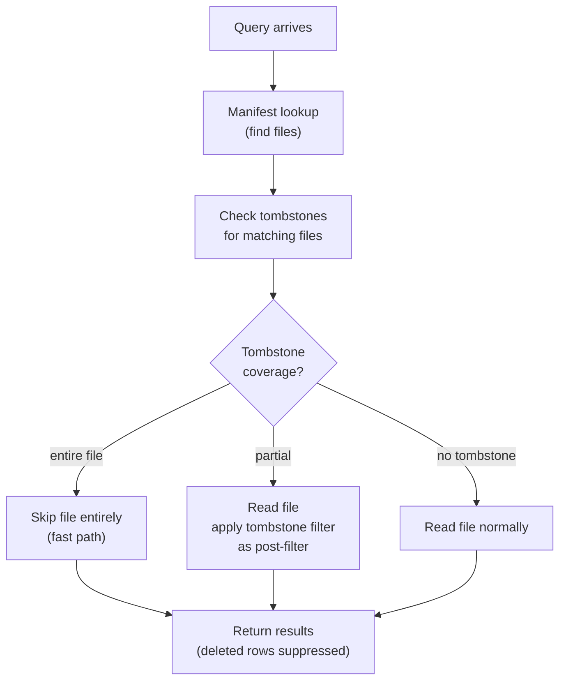

# Cost-Aware Deletion Strategy

> **Status:** A delete is a write-once tombstone object (plus, for `hide` mode, a write-once un-delete object) that every pod reads from the bucket and applies at query time. **Physical removal (rewriting objects, the `permanent` and `auto` modes) is not enabled in this release**: every mode hides the rows at query time and nothing in the bucket is rewritten; a `permanent` or `auto` delete cannot be un-deleted. See [What the modes do today](#what-the-modes-do-today).

## Supported Modes

| Mode | Delete Endpoint Prefix | Row Type | Field Mapping |
|---|---|---|---|
| `logs` | `/delete/logsql/*` | `schema.LogRow` | `body`, `service.name`, `level`, etc. |
| `traces` | `/delete/tracessql/*` | `schema.TraceRow` | `span.name`, `trace_id`, `status.code`, etc. |

Both modes share the same tombstone protocol, storage-class detection and APIs. Only the HTTP prefix, Parquet row type and field mapping differ.

## Problem

Deleting records from Parquet files on S3 is inherently expensive because Parquet is immutable — you must read the file, filter out deleted rows, and write a new file. On a cold S3 class, this means retrieval fees (sourced, us-east-1: $0.01 per GB in Standard-IA, $0.03 per GB in Glacier Instant Retrieval; Glacier Flexible Retrieval and Deep Archive must be restored first) plus a PUT, plus an early-deletion charge if the object is inside the class's minimum duration (30 d Standard-IA, 90 d Glacier IR, 180 d Deep Archive), plus a new minimum-duration clock for the rewritten object. The default storage class is S3 Standard, where none of these retrieval or early-deletion charges apply; the tombstone-only behaviour below matters once you add lifecycle transitions ([cold storage classes](cost-estimates.md#cost-and-cold-storage-classes-read-this-first)). Rewriting one TB held in Glacier IR costs at least $30 of retrieval alone.

Victoria Lakehouse supports VL/VT-compatible delete APIs with the same LogsQL query syntax. A delete is recorded as a predicate (a tombstone) and applied when data is read, so it takes effect at once and costs no object rewrite.

## Design: Write-Once Tombstones

### The keys

A delete is one or two small objects under `{prefix}_tombstones/` (`{prefix}` is the deployment's S3 prefix, typically `logs/` or `traces/`; tombstones are not stored per tenant). **Nothing under that prefix is ever overwritten.** Every key is created with `If-None-Match: *`, so the store arbitrates a race and exactly one writer wins.

| Key | Written by | Content | Purpose |
|---|---|---|---|
| `t<16 hex ns>-<id>.json` | the pod that takes the delete (any role) | the definition: `{"v":1,"id","tenants","filter","filter_at","start_ns","end_ns","mode"[,"by"]}` | what is deleted |
| `t<un-delete time>-<definition time>-<id>.undo` | the un-delete of a `hide` delete | empty | a time-ordered event, so polling pods learn of an un-delete; written once. It names the key time of the definition it undoes, so it binds to that definition and never to another one that carries the same id |

There are no other kinds of key. Two creates of one id on pods that had not yet polled each other (reachable only with a caller-chosen, non-numeric task id on the cluster delete protocol) leave two definitions; the earlier key wins on every pod, and an undo names the definition it was written for, so the un-delete of the later one never undoes the earlier one. The number is a nanosecond timestamp in fixed-width hex, so the order of the keys is the order of their times and a pod can list only what is new. Ids are escaped into the key (`%XX` for any byte outside `[A-Za-z0-9_-]`), so any task id upstream accepts is a valid key. The definition's bytes are canonical (fixed field order, sorted tenants, no receive time, no pod field): two nodes that receive the same upstream delete task write the same key with the same bytes, and the second finds the first. `by` (the creating tenant) is the audit trail of a Lakehouse API delete; an upstream task has none.

**Every time is a pod's own clock; there is no store clock.** The time in a definition key is the task's own timestamp when the id is one (upstream's task ids are the creating node's clock in nanoseconds, so a task delivered to several nodes lands on the same key), otherwise the clock of the pod that creates it. An undo key carries the creating pod's clock. A pod compares a key time with the poll window only to decide what to list; a creator whose clock is more than ten minutes behind the listing pod is caught by the full listing, counted in `lakehouse_delete_tombstones_learned_late_total`, and its size is exported as `lakehouse_delete_tombstone_key_skew_seconds` (see [Clock skew](#failure-behaviour)).

Any other key under the prefix, and any record of an earlier version (`<id>.json`, a record with progress fields, a `.fate` or `.done` key), is ignored and counted in `lakehouse_delete_tombstone_keys_rejected_total`. **Tombstones written by an earlier release are not read after the upgrade** (see the release note). A definition that cannot be read is different: see [Failure behaviour](#failure-behaviour).

### Create, un-delete, stop

- **Create:** validate (tenant scope, filter parse), `PUT` the definition with `If-None-Match`, add it to the pod's view, answer. The pod that took the delete hides the rows at once. A failed `PUT` answers `502` and leaves nothing behind: no key, nothing queued, nothing owed.
- **Same task twice:** the key and bytes are the same, so a repeat with identical content (the `vlselect` fan-out of one task to several nodes, or a retry) succeeds; a repeat of the same id with different content is refused with upstream's `the delete task with task_id="…" is already registered`.
- **Un-delete** (`DELETE …/tombstone/{id}`): only a **`hide`** delete can be undone. The call `PUT`s the `.undo` key with `If-None-Match` (an existing one is success), and the rows are visible again on this pod at once and on every other pod at its next poll. A `permanent` or `auto` delete (only taken when a request or `delete.default_mode` asks for it; the default is `hide`) is not reversible: the answer is `409` and nothing is written, because those modes are meant to be physical (see [What the modes do today](#what-the-modes-do-today)). An id this pod has not learned yet triggers one poll before answering `404`. An un-deleted id cannot be reused until its keys expire.
- **Upstream's `stop_task`** is a no-op that answers ok: upstream's task is finished once registered (below), there is nothing running to stop, and a delete does not come back.

### How a pod learns

- **Poll** every minute (a constant, not a setting): one `ListObjectsV2` with `StartAfter` set to ten minutes before the pod's clock, which returns the keys created in that window (one page, however many tombstones exist), then one `GET` per key the pod has not read.
- **Full listing** at start and every 60 polls (hourly): lists the whole prefix, reads what is new, applies `.undo` keys, and checks that the tombstones it holds still exist. It catches anything a poll could have missed, including a key whose creator's clock put it outside the poll window.
- **Start-up:** reads wait for the first complete sync (full listing plus reads) for at most 30 seconds, then answer `503`; on a select pod the first sync is part of readiness (`/ready`). Ingest, the durable buffer and flush never wait, so an object-store outage at boot does not stop writes.
- **Staleness gate:** a pod whose last complete sync is older than three minutes answers cold-tier and buffer-bridge reads with `503` (field and stream enumerations, trace-by-ID lookup included) instead of showing rows that may have been deleted. A failing `LIST` closes the gate for every tenant (the same as upstream, which answers `502` when a storage node is down). It reopens at the next complete sync. Ingest, flush and compaction are not gated.
- **Unreadable definition:** a definition that cannot be decoded closes the gate **only for the tenants its body names** (read on a best-effort basis from the raw JSON, so a body that is not JSON names none); when the body names none, for every tenant. A request that reads every tenant (the global-read credential) is closed by any such definition. A named `ProjectID` 0 stands for the whole account (the account-only key layout), so a definition naming `1001:0` also closes `1001:5`; a named project closes only itself. Other tenants keep being served.
- **`delete.enabled: false`** turns the gate off along with the API: with it off, no read waits or answers `503` because of tombstones, but the tombstones already in the bucket are still read and enforced.
- **Archive classes.** Keep `_tombstones/` out of any lifecycle rule that moves objects to Glacier Flexible Retrieval, Deep Archive or another archive tier: a pod must be able to `GET` every tombstone object. If it cannot (a cold start, or a cache miss), the first sync never completes and every tenant is refused (`503`) indefinitely.
- **Readiness.** A select pod is not ready until its first sync completes. Role `all` is not readiness-gated: its reads wait up to 30 seconds for the first sync and then answer `503` until it finishes. Ingest, flush and compaction never wait.
- **Retention must match across pods.** Every pod expires a tombstone by its own retention policy (the longest retention it knows, plus a day). Two pods with different retention settings (for instance during a configuration rollout) expire it at different times: a pod with the shorter retention removes the keys while a pod with the longer one still serves files the tombstone covered, which then reappear. Known limit; keep retention identical across pods and roll it out before shortening it.

### What a pod forgets, and when

The view is **add-only with respect to the bucket**: a tombstone enters it when its definition is listed or created here, and leaves it only on positive evidence:

1. its `.undo` key was read (hide mode only; an `.undo` for a `permanent` or `auto` delete is ignored);
2. its retention has passed: the data it covers is past retention (below), a predicate every pod evaluates from the definition and its own clock;
3. a `HEAD` of its definition answers `404` after a full listing did not list it (an operator removed the key by hand; counted in `lakehouse_delete_tombstones_forgotten_total`). At most max(100, 1 % of the view) such checks run per listing, a window that moves round the keys so each is checked in turn, so a listing that is short without an error cannot turn a sync into a storm of requests (`lakehouse_delete_tombstone_confirm_deferred_total` counts the rest, left to later listings).

Absence from a listing removes nothing: a listing that is short without an error (a lagging or buggy store can return one) delays learning a new delete and can never make a pod forget one. **Nothing a pod holds locally ever causes a `DELETE`.** The only deletes are the retention GC. Neither the sweep nor the GC runs before the pod has completed a listing.

### Local cache

`delete.cache_dir` (default `/data/lakehouse/tombstones`, empty disables it) holds the bytes of the tombstone objects a pod has read. They never change, so a cached body needs no validation: it only saves the `GET`. At start the cached definitions put the known tombstones in force at once (reads still wait for the first sync), and the first listing confirms or removes them. **Nothing in the cache is ever written back to the bucket**, and an entry the bucket no longer lists is `HEAD`-checked and only a `404` forgets it. A pod that was down for any length of time restarts from its disk copy without bringing back a tombstone that was un-deleted meanwhile: the un-delete's `.undo` key is listed and read at start, and it wins.

### Retention and garbage collection

A tombstone is in force until `range end + the longest retention that can apply + 1 day`; with retention off it never expires. The read path cuts its plans at the same retention: **a query never plans a file that is past its retention**, although the retention loop may not have deleted it yet (one predicate, shared by the eviction loop, the read cut and this expiry, so they cannot drift). That is what makes removing the record safe: when it expires, no readable file can still hold a row it covered (files span at most a day; the 1-day margin covers it).

Every pod that runs maintenance (the roles `all` and `insert`) deletes the keys of expired tombstones after a successful full listing, with no hash placement: the `.undo` key first, the definition last, so a crash leaves the definition and the work, never a key without one. Deleting an absent key is a no-op, so several pods doing it is harmless; select pods never delete. Un-deleted tombstones are kept until retention too, so a late fan-out `run_task` with the same id meets an existing definition.

### Query-time semantics

A tombstone's scope is **its tenants × rows with `_time` in `[start_ns, end_ns]` × its filter** (evaluated at `filter_at`, so `_time:5m` is pinned to the moment of the delete). It is a property of the data, not of an object's age, so it is applied on every pod, to buffer, cold and compacted data alike.

The behaviours that differ from upstream VictoriaLogs/VictoriaTraces are registry `differ` rows ([parity-and-gaps.md](parity-and-gaps.md)):

- **Rows ingested after the delete whose `_time` is inside its range are hidden too**, for as long as the tombstone lives. Upstream processes a task once, in the partitions that exist at that moment, and keeps rows that arrive later. Matching that exactly would need a per-row ingest time, which would be a Lakehouse-only field in the rows. The benefit is that a writer that flushes rows hours late (a crash, a kept volume) cannot bring deleted data back.
- **A task is finished once it is registered**: `active_tasks` is always an empty list and `stop_task` answers ok and changes nothing, as for an upstream task that has completed. Upstream deletes physically and has no un-delete; the Lakehouse un-delete is its own extension, for `hide` only.
- **An un-deleted id cannot be reused** until its keys expire.
- **A task delivered twice with identical content is a success** (upstream's node-local registry refuses a repeated id).
- **No empty-row residue**: upstream can leave a row that holds only its `_time` and `_stream` fields after a delete (VictoriaLogs `rows.go`, issue #825). A hidden Lakehouse row is never returned, so it never produces one.

### Delay bounds

| Event | On the pod that took it | On every other pod |
|---|---|---|
| Delete | at the answer | within one poll interval plus one `LIST` and `GET` (about 0.4 s measured with a 1 s interval in tests); a pod that cannot sync fails reads closed after three minutes; a key missed by the poll is caught by the next full listing (at most an hour) |
| Un-delete (hide) | at the answer | within one poll interval (via the `.undo` event); at most an hour if the event was lost to a crash |

### What the modes do today

| Mode | Today | Un-delete |
|---|---|---|
| `hide` | the rows are hidden at query time until the tombstone is un-deleted or expires | yes (`.undo` key) |
| `permanent`, `auto` (never the default) | **hide the rows, as `hide` does**: the mode is recorded in the definition; **physical removal is not enabled in this release** (nothing is rewritten, and compaction copies the rows forward unchanged: they stay hidden because the tombstone stays in force until retention). Planned as D1b, [issue #627](https://github.com/ReliablyObserve/victoria-lakehouse/issues/627) | no: `409` |

Consequences to plan for: the bytes stay in the bucket until the data's retention (or its lifecycle rule) removes them, so [right to erasure](#gdpr--compliance-considerations) is met by inaccessibility, not by physical removal; and the metadata-only fast paths (count, field names and values, hits answered from the manifest) are off for the files a tombstone can match (a file whose time range, complete label set or pmeta bloom proves it cannot match keeps them, since #624), for as long as the tombstone lives. The cost of that is measured in [Read cost while a hide-mode delete is active](#read-cost-while-a-hide-mode-delete-is-active).

### Cost of the protocol

The poll is one `LIST` request per pod per minute, whatever the number of tombstones; only the hourly full listing grows (one page per 1,000 keys). `LIST` is $0.005 per 1,000 requests (sourced, S3 Standard, us-east-1 list price). Per month, 30 days, one poll per minute, keys = 1.1 × tombstones (assumed: 10 % are un-deleted), sourced price, assumed counts:

| Tombstones in retention (N) | 1 pod | 10 pods | 100 pods |
|---|---|---|---|
| 1,000 | $0.22 | $2.23 | $22.32 |
| 10,000 | $0.26 | $2.56 | $25.56 |
| 100,000 | $0.62 | $6.16 | $61.56 |

The first read of a cold pod costs one `GET` per tombstone (1,000 at N = 1,000; 10,000 at N = 10,000; none with a warm cache). A new delete costs each pod one `GET`. Measured request counts (in-memory bucket, [`scale_test.go`](../internal/delete/scale_test.go)): an idle poll is 1 `LIST` page for N = 0, 1,000 and 10,000; a full listing is 1, 1 and 10 pages. **Memory of the view: about 370 bytes per tombstone, measured** (35.2 MB at 100,000; 350 to 377 bytes over three sizes, the planning figure was 600 bytes), **plus about 560 bytes per distinct filter** a query touches (the parsed LogsQL filter, measured, kept while some tombstone of the view uses it and evicted with the last one): about 90 MB at 100,000 tombstones with distinct queries. The parsed filters are not bounded by a size limit, only by the number of distinct tombstone queries in the view. A query that ends after every tombstone's range finds none of them in O(log N) (about 13 ns at N = 10,000); a query that overlaps all of them copies them (about 0.54 ms at N = 10,000, 4.6 ms at N = 100,000).

### Failure behaviour

| Case | Behaviour | Bound |
|---|---|---|
| A reader cannot refresh (a failing or timing-out `LIST`) | reads answer `503` for every tenant after three minutes; nothing deleted is shown | 3 minutes |
| Silent short listing | a new delete is learned at the next poll or full listing; nothing is dropped or deleted | at most an hour for a new delete, 0 for known ones |
| Crash after the definition `PUT`, before the answer | the client sees an error; the tombstone exists and is enforced; a retry of an upstream task meets identical bytes and succeeds | none |
| Crash after the definition, before the `.undo` key | the un-delete did not happen; repeating the call writes the event | none |
| A restarted pod with a stale or lost cache | the cache is rebuilt from the bucket; a tombstone un-deleted meanwhile is not enforced | start time |
| Object store down | creates through the lakehouse API fail with `502` (upstream's `run_task` handler reports the same failure as `400`, its own wording); readers fail closed after three minutes; ingest is unaffected | none |
| A tombstone object that cannot be read or parsed | the gate fails closed for the tenants the body names (all tenants when it names none) and `LakehouseTombstoneUnreadable` fires; the key is retried at every sync until it is readable or removed | operator action |
| Clock skew on a pod | a key time comes from the creating pod's clock (or the task id). A creator more than ten minutes behind a polling pod publishes a key the poll window has passed: that pod learns it at its next full listing, up to an hour late. The delay is visible: `lakehouse_delete_tombstones_learned_late_total` counts such keys, `lakehouse_delete_tombstone_key_skew_seconds` shows the age of the last key learned, and `LakehouseTombstoneClockSkew` fires. A pod whose clock is ahead only writes keys that are listed earlier | up to 60 polls; keep NTP on every pod |
| A store without conditional writes (`If-None-Match` answered `501`) | creates become a check followed by a write and `lakehouse_delete_conditional_writes` is `0`; two pods creating the same task at the same instant can both write identical bytes | documented weaker mode |

A store that silently ignores `If-None-Match` is not detected at run time; the `s3compat` suite checks the stores the project supports.

## API Surface

The delete API uses a mode-specific prefix: `/delete/logsql/*` for logs mode, `/delete/tracessql/*` for traces mode. All endpoints accept the same parameters.

### Tenant Scope

Every delete belongs to a tenant, and every tombstone names at least one: a
definition naming none is not a tombstone (it is refused when created, and an
unreadable definition read from the bucket closes the gate, see
[Failure behaviour](#failure-behaviour)).

A request is resolved to its tenant exactly like a select request, in both of
the forms the lakehouse accepts:

- **integer tenants** — upstream's form: the `AccountID` / `ProjectID` headers
  (or the `X-Scope-AccountID` / `X-Scope-ProjectID` pair); a request without them
  is the default tenant `0:0`. An unparseable header is `400 cannot obtain
  tenantID`, as for a select. Integer-tenant answers never depend on whether
  string tenants are configured.
- **string tenants** — a lakehouse extension: `X-Scope-OrgID`, which the tenant
  middleware in front of every route (installed when aliases or
  auto-registration are configured) maps through the tenant aliases to an
  account/project pair before any handler runs. An unknown OrgID gets the
  middleware's answer, the same one a select gets.

That tenant:

- **creates** tombstones scoped to itself, over its own objects (for `0:0`
  that includes objects written before tenant prefixes existed, which the read
  path also serves to `0:0`);
- **lists, reads, verifies against and un-deletes** only its own tombstones —
  those scoped to exactly that tenant. Any other id answers `404`, so another
  tenant's delete can be neither read nor removed;
- **estimates** over its own objects.

A request that presents the global-read credential
(`tenant.global_read_header` / `global_read_value`, or `global_read_token` —
the credential that widens a select to every tenant) is the operator view
(`"scope": "instance"`): it sees and may un-delete every tombstone, including
cluster delete tasks that name several tenants. Its deletes
are still scoped to the tenant in its headers. Without a configured credential
there is no operator view.

Object keys carry the tenant as `{AccountID}/{ProjectID}/`. Where a manifest
parses keys by account alone (an `{OrgID}/` prefix template), every project of
an account shares the account's objects, so a delete for a `ProjectID` other
than `0` is refused (`400`); string OrgIDs map to `ProjectID` `0`, and a
tombstone scoped to `N:0` there acts for every project of account `N`.

A tombstone's tenants limit everything it does: query-time suppression (rows,
field values, streams, the count and metadata fast paths, buffered rows).
Objects are attributed to tenants by their key, the same way the read path
selects them. A tombstone of tenant A never costs tenant B a fast path.

### Delete Endpoint

```
POST /delete/{logsql|tracessql}/delete
  ?query=<LogsQL filter>
  &start=<unix nanoseconds>
  &end=<unix nanoseconds>
  &mode=hide|permanent|auto   (default: the configured delete.default_mode, "hide")
```

`start` and `end` are UNIX timestamps in **nanoseconds** — the same unit the
manifest and the Parquet files store — and are parsed as integers: a request
carrying `start=2025-01-01` is rejected with `400 invalid start parameter`.
Produce them from a date with `date -u -d '2025-01-01' +%s`000000000 (GNU date)
or `date -ujf '%Y-%m-%d' 2025-01-01 +%s`000000000 (BSD/macOS date).

**Examples:**

```bash
# Delete logs matching a query (2025-01-01 .. 2025-06-01)
curl -X POST 'http://lakehouse:9428/delete/logsql/delete?query=service.name:="leaked-creds"&start=1735689600000000000&end=1748736000000000000'

# Delete traces matching a query
curl -X POST 'http://lakehouse:10428/delete/tracessql/delete?query=trace_id:="abc123"&start=1735689600000000000&end=1748736000000000000'
```

**Mode behavior** (see [What the modes do today](#what-the-modes-do-today)):
- `hide` (default): soft-delete only (cheapest, instant; rows stay in the objects and come back if the tombstone is un-deleted, the only mode that can be)
- `permanent`: physical deletion once it ships; in this release it hides, and cannot be un-deleted
- `auto`: hide immediately, then physically remove the S3 Standard files' rows once it ships (files on IA/Glacier stay suppressed until lifecycle expiry); in this release it hides, and cannot be un-deleted

### Cost Estimation Endpoint

Before executing a delete, users can estimate the cost:

```
POST /delete/{logsql|tracessql}/estimate
  ?query=<LogsQL filter>
  &start=<unix nanoseconds>
  &end=<unix nanoseconds>

Response:
{
  "affected_files": 47,
  "affected_rows_estimate": 12500,
  "storage_classes": {
    "STANDARD": {"files": 12, "bytes": 156000000, "rewrite_cost": "$0.02"},
    "STANDARD_IA": {"files": 20, "bytes": 890000000, "rewrite_cost": "$11.13"},
    "GLACIER_INSTANT": {"files": 10, "bytes": 450000000, "rewrite_cost": "$40.50"},
    "GLACIER_DEEP": {"files": 5, "bytes": 230000000, "rewrite_cost": "$120.75"}
  },
  "recommended_mode": "hide",
  "auto_behavior": "hide data at query time (physical removal is not enabled)"
}
```

The bytes and `rewrite_cost` values in this example are illustrative and are not derived from the prices above (at $0.03 per GB, 450 MB read back from Glacier IR is about $0.01 of retrieval). Run the endpoint on your own data for real numbers.

### Tombstone Management

```
GET /delete/{logsql|tracessql}/tombstones
  # The tombstones in force that the caller may see

GET /delete/{logsql|tracessql}/tombstone/{id}
  # One tombstone in force (404 once it is un-deleted or expired)

DELETE /delete/{logsql|tracessql}/tombstone/{id}
  # Un-delete (hide mode only): 200 {"status":"removed"}; 404 for an unknown id;
  # 409 for a permanent or auto delete, which cannot be undone;
  # 502 when the object store cannot take the undo key
```

The listing reports `"scope": "tenant"` (the caller's own tombstones) or
`"scope": "instance"` (every tombstone, global-read credential). Each record
carries `Tenants`, the tenants it acts on, `CreatedAt` (the time of its key: the task's
timestamp, or the creating pod's clock), `CreatedBy` (the creating tenant,
for an API delete) and `FilterAt`, the time its relative time filters
(`_time:5m`) are evaluated at — when the delete was issued, so the window a
tombstone covers never drifts with the clock. The record no longer carries
affected keys or rewrite progress: a tombstone is a definition, and nothing about
its progress is recorded anywhere.

### Verify Endpoint

```
POST /delete/{logsql|tracessql}/verify
  ?query=<LogsQL filter>
  &start=<unix nanoseconds>
  &end=<unix nanoseconds>
```

Reports the tombstones in force that cover the query (`tombstone_ids`) and the fraction of the requested range they cover (`coverage`).

## Query-Time Tombstone Evaluation

Tombstones are evaluated during the normal read path:



**Performance impact:**
- Full-file tombstones: zero cost (file skipped at manifest level)
- Partial tombstones: one additional filter per affected file (~microseconds)
- Finding the tombstones of a query is a binary search by range end: a query newer than every tombstone costs nanoseconds whatever the count; one that overlaps them pays for the tombstones that overlap
- A tombstone lives until the data it covers is past retention, so with physical removal off the count follows the number of deletes taken within retention

## Storage Class Detection

Lakehouse detects the S3 storage class of each file via:

1. **HeadObject on first access** — `StorageClass` header in response
2. **Cached in manifest** — storage class stored per-file, refreshed on lifecycle transitions
3. **Lifecycle prediction** — if lifecycle rules are configured, predict class from file age

```yaml
lakehouse:
  delete:
    cache_dir: /data/lakehouse/tombstones         # Optional local copy of the objects read; never written back
    # Not read in this release:
    rewrite_batch_size: 50                        # Max files per rewrite job
    force_glacier_header: "X-Force-Glacier-Delete" # Required header for forced Glacier rewrite
    cost_warning_threshold: 10.0                  # Warn user if estimated cost ($) exceeds this
```

## Cost Comparison: Delete Operations

| Operation | Lakehouse (Tombstone) | Lakehouse (Rewrite, Standard) | Loki | Tempo |
|---|---|---|---|---|
| **Delete single record** | **$0** (instant) | $0.001 (1 file rewrite; planned, not enabled) | Not supported | Not supported (whole trace only) |
| **Delete by query (1K matches)** | **$0** (instant) | $0.05 (batch rewrite; planned, not enabled) | Not supported | N/A |
| **Delete from Glacier IR** | **$0** (tombstone only) | at least $30 per TB rewritten (retrieval at $0.03 per GB) plus early deletion inside the 90-day minimum, plus the PUT (computed from AWS list prices) | N/A | N/A |
| **GDPR "right to erasure"** | **$0** immediate (inaccessible from every read path) | Physical delete for strict compliance: planned | Export + reimport (manual) | Not supported at record level |
| **Retention-based expiry** | S3 Lifecycle (free) | S3 Lifecycle (free) | Compactor retention (CPU cost) | Compactor (CPU cost) |

## GDPR / Compliance Considerations

Tombstone-based deletion **satisfies GDPR right to erasure** requirements because:

1. Data is immediately inaccessible through all query interfaces
2. No API, tool, or user can retrieve tombstoned records
3. Physical deletion occurs when the data's retention or S3 lifecycle expires the file
4. Physical removal on demand (rewriting S3 Standard files for strict compliance) is planned and is **not available yet**; until it ships, a requirement for the bytes to be gone before retention is not met by this release

**Audit trail:**
- Every tombstone records what was deleted, when (the key time) and, for an API delete, by which tenant (`by`)
- The definition and undo objects are kept until the data is past retention, so the record of a delete outlives its effect

## Comparison: Why Loki/Tempo Can't Do This

| Capability | Lakehouse | Loki | Tempo |
|---|---|---|---|
| Record-level delete | Tombstone (selective rewrite planned) | Not supported (whole stream only) | Whole trace only |
| Query-based delete | Full LogsQL filter support | Not supported | TraceID only |
| Cost-aware deletion | Per-storage-class strategy | N/A (all S3 Standard) | N/A |
| Glacier-safe delete | Tombstone suppression (no retrieval) | Can't use Glacier (compaction) | Can't use Glacier (compaction) |
| GDPR compliance | Immediate tombstone + audit trail | Manual stream deletion | Manual trace deletion |
| Un-delete | Remove tombstone | Not possible | Not possible |
| Delete cost estimation | Built-in API | N/A | N/A |

## Cluster Delete Protocol (`/internal/delete/*`)

A VictoriaLogs or VictoriaTraces cluster deletes through its storage nodes:
`vlselect`/`vtselect` fans `/internal/delete/run_task`, `stop_task` and
`active_tasks` out to every storage node. The lakehouse serves this protocol
through upstream's own code, behind the same switch: the logs binary mounts
VictoriaLogs' `vlselect.RequestHandler` for `/internal/delete/*`, so the flag,
its help text and its answers are upstream's. The traces binary carries a
verbatim copy of VictoriaTraces' gate (checked against the vendored source by a
test). It serves `/select/logsql/*` with VictoriaTraces' own handlers but not
`vtselect.RequestHandler`: `/internal/select/*` and `/internal/delete/*` go
through VictoriaLogs' `internalselect` (VT's `vtstorage` does not route delete
calls to external storage), and VT's and VL's `internalselect` register the same
flag, so both cannot be linked into one binary.

- **`-internaldelete.enable`** (default `false`, same name and default as
  upstream). While it is off, every `/internal/delete/*` request answers
  upstream's own error — `400 requests to /internal/delete/* are disabled; pass
  -internaldelete.enable command-line flag for enabling them` — exactly like a
  VictoriaLogs or VictoriaTraces node started with its defaults, whatever
  `delete.enabled` says.
- With the flag on, the lakehouse also requires **`delete.enabled: true`**,
  because the protocol writes into the lakehouse tombstone store.
- **POST only**, like `/internal/select/*`: any other method answers a bare
  `405` (empty body) after the two gates above, as VictoriaTraces 0.12 and
  VictoriaLogs v1.53.0 (#1635) do, so a GET forged through SSRF cannot run, stop
  or list tasks. Upstream's cluster client already sends POST. The logs binary
  gets the 405 from upstream's own handler; the traces binary adds the check
  itself, because the VictoriaLogs revision it embeds (v1.52.0) lacks it.
- **`run_task`** registers a tombstone with the task's id, scoped to exactly
  the task's `tenant_ids`, over every row not newer than the task's timestamp
  that matches its filter, with `delete.default_mode`. The filter's relative
  time filters are evaluated at the task's timestamp, as upstream does. The
  tombstone's key carries the task's timestamp, so the fan-out of one task to
  several nodes writes one key: a repeat with identical content succeeds, and
  a task id that is already registered with different content is refused with
  upstream's error. Rows ingested after the task whose `_time` is inside its
  range are hidden too (see [Query-time semantics](#query-time-semantics)). A task naming no tenant is accepted and deletes nothing, as
  upstream, but differs in what is left behind: upstream registers it and lists
  it in `active_tasks` until its (empty) pass finishes; the lakehouse creates no
  tombstone for it, so it is never listed.
- **A registered task is finished**, as an upstream task that has completed:
  **`active_tasks`** answers an empty list (`[]`) and **`stop_task`** is a no-op
  that answers ok, for every id and every caller. Nothing is un-deleted through
  this protocol (see [Create, un-delete, stop](#create-un-delete-stop)).
- The protocol is **not tenant-scoped**, as upstream: it is the storage-node
  side of a `vlselect`/`vtselect` fan-out, which scopes the request itself, and
  it is served only behind `-internaldelete.enable`. `stop_task` and
  `active_tasks` answer the same to every caller.

Mounting `vlselect.RequestHandler` also registers VictoriaLogs' other select
flags in the logs binary, so `-help` lists `-search.maxQueryDuration`,
`-search.maxConcurrentRequests`, `-search.maxQueueDuration`, `-select.disable`,
`-internalselect.disable`, `-delete.enable`, `-deleteAuthKey`,
`-search.logSlowQueryDuration` and `-vmalert.proxyURL`. The lakehouse's own `/select/*` handling does not read the
search and select ones yet — `query.timeout` and `query.max_concurrent` govern
the lakehouse select path — so setting any of them makes lakehouse-logs refuse
to start instead of silently ignoring it (as before vlselect was linked, when
they were undefined). Moving `/select/*` onto upstream's handler, which will
honour them, is tracked separately. `-delete.enable` and `-deleteAuthKey` are honoured: see the
next section.

### Upgrade note: mixed VictoriaTraces v0.11 / v0.12 clusters

The delete fan-out carries a protocol version (`version=` on `/internal/delete/run_task`,
`stop_task` and `active_tasks`). VictoriaLogs v1.52.0, which the traces binary embeds since
VictoriaTraces v0.12.0, moved it from `v1` to `v2`. A VictoriaTraces v0.11 `vtselect` (which sends
`v1`) therefore cannot delete through a v0.12 Lakehouse storage node, and a v0.12 `vtselect` (which
sends `v2`) cannot delete through a v0.11 one: the node answers `unexpected protocol version`, the
fan-out fails, and the delete is refused. Nothing is deleted and no data is at risk. The query
protocol (`/internal/select/*`, version `v5`) is unchanged, so reads keep working across the two
versions. Upgrade `vtselect` and the Lakehouse traces nodes together before using the delete API.

## Upstream Delete API (`/delete/*`)

VictoriaLogs and VictoriaTraces delete through `/delete/run_task`,
`/delete/stop_task` and `/delete/active_tasks`. The lakehouse serves them
through upstream's code as well: the logs binary mounts VictoriaLogs'
`vlselect.RequestHandler` for `/delete/`, the traces binary a copy of
VictoriaTraces' gate and delete handler, held to the vendored source by a test,
whose storage calls go through the same dispatch as the cluster protocol.

- **`-delete.enable`** (default `false`; upstream's name, default and help).
  While it is off, every `/delete/*` path the lakehouse does not serve itself
  answers upstream's own error — `400 requests to /delete/* are disabled; pass
  -delete.enable command-line flag for enabling them` — exactly like an
  upstream node started with its defaults.
- With the flag on, the lakehouse also requires **`delete.enabled: true`**.
- **`run_task`** takes upstream's parameters (`filter`, the tenant from the
  request headers) and answers upstream's `{"task_id":"…"}`; the task becomes a
  tombstone scoped to the request's tenant, exactly as a cluster `run_task` for
  that one tenant.
  **`run_task` requires POST**, as VictoriaTraces 0.12 and VictoriaLogs v1.53.0
  (#1635) do (VictoriaTraces issue #225): any other method answers `405 Only POST method
  is allowed; got <METHOD>.` after the `-delete.enable` and `delete.enabled`
  checks and before anything is parsed, and no task is created, so a GET forged
  through SSRF cannot start a delete. `stop_task` and `active_tasks` accept any
  method, as upstream. The logs binary gets this from upstream's handler, the
  traces binary adds the check itself (its embedded VictoriaLogs, v1.52.0, lacks it).
- **`-deleteAuthKey`** (logs binary only; VictoriaLogs v1.53.0, #1749): when set,
  every `/delete/*` request, the lakehouse's own `/delete/logsql/*` API included,
  must carry it as the `authKey` argument, else `401` with upstream's text
  (`Expected to receive non-empty authKey when -deleteAuthKey is set`, or `The
  provided authKey doesn't match -deleteAuthKey`). The check comes first, before
  the `-delete.enable` answer, and it replaces `-httpAuth.*` on `/delete/*`
  (#1764): the key alone opens the path, and `-httpAuth.*` credentials alone no
  longer do. With the flag unset, `/delete/*` still needs the `-httpAuth.*`
  credentials, if any. The traces binary has no such flag (VictoriaTraces v0.12.0
  and the VictoriaLogs revision it embeds predate it).
- **`stop_task`** and **`active_tasks`** answer as for a finished task: the list
  is always `[]` and `stop_task` answers `{"status":"ok"}` and changes nothing,
  for the task's tenant, another tenant, an unknown id and the global-read
  credential alike, so a task's existence leaks nowhere. Upstream's task is
  likewise done once the rows are deleted.

`-delete.enable` and `delete.enabled` are different switches. `delete.enabled`
(lakehouse config) turns on the lakehouse's own API under `/delete/logsql/*` and
`/delete/tracessql/*` and the creation of tombstones; the tombstones already in
the bucket are enforced either way. `-delete.enable` (upstream flag) additionally
serves upstream's API, which writes the same tombstone objects and is
tenant-scoped the same way.

Other differences from upstream once enabled: rows are hidden the moment the
task is registered on the pod that took it and within one poll interval on the
others, and physical removal per `delete.default_mode` is not enabled in this
release (upstream removes the rows in a background pass). The differences
described under [Query-time semantics](#query-time-semantics) apply as well.

## Traces Delete Support

The same tombstone protocol applies to `lakehouse-traces`. All endpoints use the `/delete/tracessql/*` prefix instead of `/delete/logsql/*`.

### Trace Field Matching

Tombstone queries match against trace span fields:

| Query Pattern | Matches Against |
|---|---|
| `service.name:="payment-service"` | TraceRow.ServiceName |
| `trace_id:="abc123"` | TraceRow.TraceID |
| `span.name:="HTTP GET"` | TraceRow.SpanName |
| `status.code:="ERROR"` | TraceRow.StatusCode (as string) |
| `k8s.namespace.name:="prod"` | TraceRow.K8sNamespaceName |
| `http.method:="POST"` | TraceRow.Attributes["http.method"] |
| `*` or empty | All rows in time range |

The `body` field in wildcard/fallback queries maps to `SpanName` for traces (vs `Body` for logs).

### Cross-Signal Deletion

To delete data matching across both logs and traces (e.g., GDPR erasure of a user's activity):

1. Issue delete to logs: `POST /delete/logsql/delete?query=user_id:="user-123"&start=...&end=...`
2. Issue delete to traces: `POST /delete/tracessql/delete?query=user_id:="user-123"&start=...&end=...`

Each operates independently on its respective Parquet files. Both share the same tombstone store if running in `all` mode.

## Implementation Notes

### Tombstone Storage Format

```
s3://{bucket}/{prefix}_tombstones/
  t<16 hex ns>-<id>.json    # the definition, written once
  t<16 hex ns>-<16 hex ns>-<id>.undo    # the un-delete event of a hide delete (time of the un-delete, then the time of the definition key it undoes), written once
```

`{prefix}` is the deployment's S3 prefix: `s3.prefix` if set, otherwise the
default tenant prefix followed by the signal (`logs/` or `traces/`). Tombstones
are **not** stored per tenant — in multi-tenant mode every tenant's tombstones
share that one prefix (typically `logs/_tombstones/`), not the
`{AccountID}/{ProjectID}/<signal>/` prefix its data lives under. With bucket per
tenant they live in the default bucket. The `_tombstones/` segment is on the
orphan sweep's never-delete list, so the sweep cannot reclaim a live tombstone.

A definition is under 1 KB. Every object is written once; nothing is rewritten
when a delete's state changes, so there is no shared record for pods to clobber
and no record that can grow with the number of affected files.

### Metrics and alerts

| Metric | Type | Description |
|---|---|---|
| `lakehouse_delete_tombstones_active` | Gauge | Tombstones in force on this pod |
| `lakehouse_delete_tombstones_total` | Counter | Tombstones created by this pod |
| `lakehouse_delete_tombstone_view_age_seconds` | Gauge | Time since this pod's last complete sync (since start before the first one) |
| `lakehouse_delete_tombstone_sync_total{kind}` | Counter | Complete syncs (`poll`, `full`) |
| `lakehouse_delete_tombstone_sync_errors_total{kind}` | Counter | Syncs that failed or left the view incomplete |
| `lakehouse_delete_tombstone_unreadable` | Gauge | Tombstone objects that could not be read or parsed (the view is incomplete while above 0) |
| `lakehouse_delete_tombstone_keys_rejected_total` | Counter | Keys under the prefix that are not tombstone objects |
| `lakehouse_delete_tombstone_definition_conflicts_total` | Counter | Ids with two definition keys (the earlier key wins) |
| `lakehouse_delete_tombstones_learned_late_total` | Counter | Tombstones learned from a key older than the poll window (a creator's clock behind this pod's) |
| `lakehouse_delete_tombstone_key_skew_seconds` | Gauge | The age on this pod's clock of the key it learned last (after its first listing); normally under one poll interval |
| `lakehouse_delete_tombstones_forgotten_total` | Counter | Tombstones dropped because their key was removed by hand |
| `lakehouse_delete_tombstone_gc_deleted_total` | Counter | Objects removed by the retention GC |
| `lakehouse_delete_tombstone_confirm_deferred_total` | Counter | Unlisted tombstones whose HEAD check was left to a later listing (budget spent) |
| `lakehouse_delete_reads_refused_total{reason}` | Counter | Reads answered `503` (`stale`, `not_synced`, `tenant_unreadable`) |
| `lakehouse_delete_conditional_writes` | Gauge | `1` while tombstone keys are created with `If-None-Match`, `0` in the weaker fallback |
| `lakehouse_delete_rows_suppressed_total` | Counter | Rows filtered by tombstones at query time |

`LakehouseTombstoneViewStale` fires when a view is older than three minutes
(reads on that pod answer `503`; check the object store and the pod's
credentials), `LakehouseTombstoneUnreadable` when a tombstone object cannot be
read (the log names the key; fix or remove it) and `LakehouseTombstoneClockSkew`
when keys keep arriving older than the poll window (a creating pod's clock is
behind; fix NTP).

## Read cost while a hide-mode delete is active

While a tombstone is in force (physical removal is not enabled), a hide-mode delete is applied on the read path to every query whose time window overlaps it, and the columns the delete's query references are read for that. A delete on a registered column adds roughly 24% to 77% to a `stats` query's latency on a cold file; a delete on an unregistered field adds the attribute MAP and Tier-2 slot columns to every query in the window (+296% for an unfiltered `stats count()`), because the exact column is not known per file. Details and the measurement are in [read-path.md](read-path.md); the exact-column resolution is tracked in #292.
