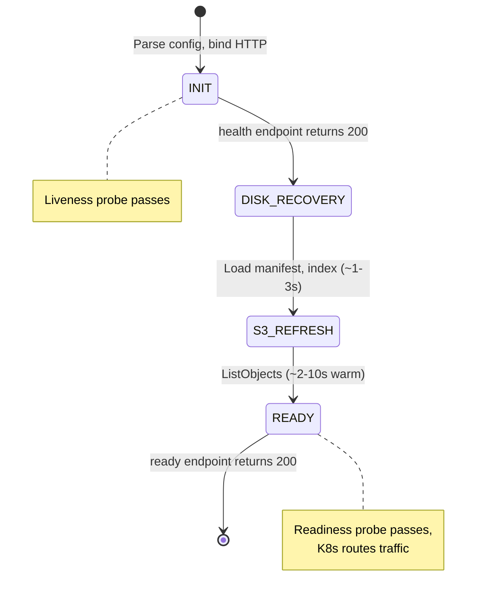
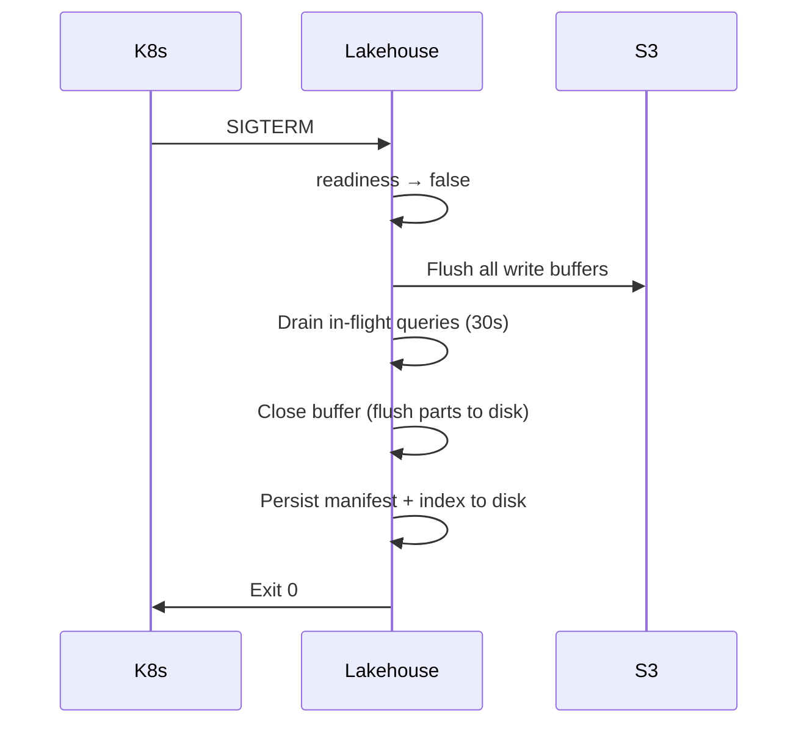
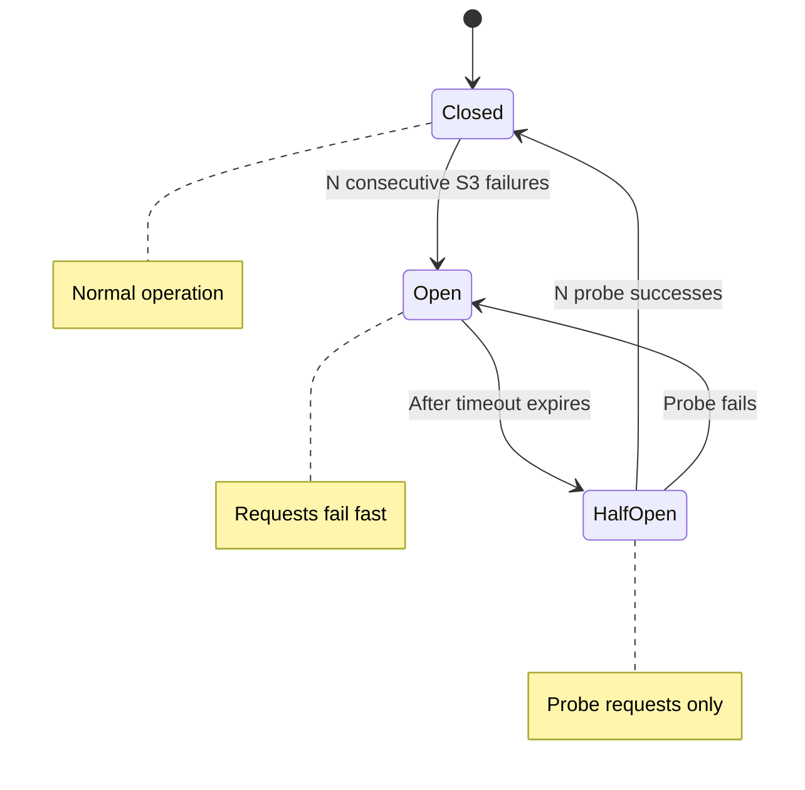

# Operations

## Health Endpoints

| Endpoint | Purpose | Returns 200 |
|---|---|---|
| `/health` | Liveness probe | Always (once HTTP binds) |
| `/ready` | Readiness probe | After startup warmup completes |
| `/lakehouse/info` | Build/config info | Always |
| `/manifest/range` | Data range served | Always |
| `/metrics` | Prometheus metrics | Always |
| `/internal/buffer/query` | Buffer query (insert pods) | When insert role enabled |

## Startup Behavior

Victoria Lakehouse goes through 4 phases on startup:



1. **INIT** — parse config, bind HTTP port. `/health` returns 200.
2. **DISK_RECOVERY** — load persisted manifest, label index, and footers from disk (~1-3s warm, N/A cold).
3. **S3_REFRESH** — incremental S3 ListObjects for new files since last persist (~2-10s warm, 30-60s cold).
4. **READY** — `/ready` returns 200. Kubernetes routes traffic.

Monitor: `lakehouse_startup_phase` gauge, `lakehouse_startup_total_seconds` gauge.

### Early Serving

Set `--lakehouse.startup.serve-stale=true` to serve from persisted cache (Phase 1) before S3 refresh completes. Queries may return slightly stale results until refresh finishes.

### Warmup Safety Valve

`--lakehouse.startup.max-warmup-time=5m` aborts warmup and goes ready with whatever was loaded. Background refresh continues.

## Write Path Operations

### Buffer durability (no WAL)

There is no lakehouse WAL. The insert buffer is a sequence of upstream
`logstorage` segments under `insert.buffer_dir`; acknowledged rows are fsynced
within upstream's 5 s window, and the flusher drains every segment it finds on
restart (see [Persistence & Durability](durability.md)). Operators should
monitor:
- **Buffer dir**: `insert.buffer_dir` must be on a persistent volume (a StatefulSet PVC; the Helm chart provides one) — it is the only copy of acknowledged rows until they are in Parquet.
- **Backlog**: `lakehouse_buffer_segments{state="pending"}`, `lakehouse_buffer_pending_rows` and `lakehouse_buffer_oldest_pending_age_seconds`. A growing backlog means object storage is slower than ingest or unreachable; the rows are safe on disk meanwhile (alert `LakehouseBufferNotDraining`).
- **Disk floor**: below its free-space floor (1 GiB) the buffer volume makes inserts get 429 (`lakehouse_insert_rejected_total{reason="read_only"}`, alert `LakehouseInsertRefusedDiskFloor`). Size the volume as in [Sizing](operations/sizing.md).
- **Restore on start**: check logs for the segments found and the `/ready` readiness gate clearing before the pod takes traffic. A buffer directory of an earlier release is moved aside to `legacy-<unix>/` with a warning; delete it when no longer needed.

### Buffer Query Bridge

When running separate insert and select pods:
- Select pods discover insert pods via `--lakehouse.select.insert-headless-service`
- Buffer query timeout is configurable via `--lakehouse.select.buffer-query-timeout` (default 2s)
- Endpoint errors are silently ignored — degraded to S3-only results rather than failing the query

### Flush Pipeline

- **Age seal**: a segment is sealed `insert.buffer_flush_interval` (default 5m) after its first row and then drained completely to Parquet.
- **Size seal**: earlier, once the segment holds about `insert.target_file_size` (default 128MB) of rows while fewer than 64 segments are pending. The size is an estimate of rows × 512 B, so 262,144 rows at the 128MB default; written objects are smaller after Parquet compression.
- **Graceful shutdown**: the flusher stops and the buffer closes (upstream persists every segment); the next start drains what is left.

## Graceful Shutdown



On SIGTERM:
1. Stop accepting new queries (readiness -> false)
2. Stop the buffer flusher (a drain cut short resumes after the restart)
3. Drain in-flight queries (30s timeout)
4. Close the insert buffer (upstream flushes every segment's parts to disk; segments not yet written to S3 are drained on the next start)
5. Persist manifest, label index, peer ring to disk
6. Close S3 and peer connections
7. Exit

Set `terminationGracePeriodSeconds: 60` in Kubernetes (30s drain + 30s persist).

## Cache Management

### L1 Memory Cache

- Stores footers (~1KB), bloom filters (~10KB), hot pages
- LRU eviction at `--lakehouse.cache.memory-limit`
- Monitor: `lakehouse_cache_memory_bytes` vs `lakehouse_cache_memory_limit_bytes`

### L2 Disk Cache

- Stores full Parquet files from S3
- LRU eviction at `--lakehouse.cache.eviction-watermark` (default 80%) of disk limit
- Monitor: `lakehouse_cache_disk_bytes` vs `lakehouse_cache_disk_limit_bytes`
- Alert: `LakehouseCacheDiskFull` if >95% full

### L3 Peer Cache

- Consistent hash routes keys to peer instances
- Requires headless service and `--lakehouse.peer-auth-key`
- Monitor: `lakehouse_peer_ring_members`, `lakehouse_peer_hits_total`

### Cache Coalescence

`singleflight.Group` ensures only one S3 fetch per cache key, even under concurrent queries for the same data. Monitor: `lakehouse_cache_singleflight_dedup_total`.

## Manifest Refresh

The partition manifest tracks all Parquet files in S3. It refreshes:
- **Polling**: every `--lakehouse.manifest.refresh-interval` (default 5m) via S3 ListObjects
- **SQS** (optional): near-real-time updates from S3 event notifications

Monitor: `lakehouse_manifest_files`, `lakehouse_manifest_refresh_total`, `lakehouse_manifest_sqs_events_total`.

## Hot Boundary Discovery

Victoria Lakehouse polls vlstorage/vtstorage nodes to learn the hot tier's data range:
- Refreshes every `--lakehouse.discovery.refresh-interval` (default 5m)
- Monitor: `lakehouse_discovery_hot_boundary_seconds`, `lakehouse_discovery_hot_boundary_gap_days`
- Alert: `LakehouseHotBoundaryGap` if gap > 1 day between cold and hot data

## Circuit Breaker



S3 failures trigger a circuit breaker:
- **Closed** (normal): requests flow through
- **Open** (after N failures): requests fail fast for `--lakehouse.circuit-breaker.timeout`
- **Half-open**: probe requests; N successes close the breaker

Monitor: `lakehouse_s3_circuit_breaker_state` (0=closed, 1=half-open, 2=open).
Alert: `LakehouseS3CircuitBreakerOpen`.

## Scaling

### Vertical

- **CPU**: driven by Parquet decompression and filter evaluation. 0.5-2 vCPU per instance typical.
- **Memory**: L1 cache + query working set. 512MB-2GB per instance typical.
- **Disk**: L2 cache. Size to hold 2-4 weeks of frequently queried data.

### Horizontal

- Add replicas to increase query throughput
- Peer cache distributes L2 across fleet (3x effective cache)
- Manifest and label index replicated on each instance (lightweight)
- No coordination required between instances

### Sizing Guide

| Dataset | Replicas | CPU/instance | Memory/instance | L2 Disk |
|---|---|---|---|---|
| 100GB S3 | 3 (1/AZ) | 0.5 vCPU | 512MB | 10GB |
| 1TB S3 | 6 (2/AZ) | 1 vCPU | 1GB | 50GB |
| 10TB S3 | 12 (4/AZ) | 2 vCPU | 2GB | 100GB |
| 100TB S3 | 24 (8/AZ) | 2 vCPU | 4GB | 200GB |

## Compaction

### Compaction on or off

Compaction is on by default in both binaries. Every pod that writes data (role `all` or `insert`)
runs the scheduler, and highest-random-weight (HRW) ownership over the live peer set assigns each
partition to exactly one of them, so no leader election is involved. A `select` pod never compacts,
whatever `compaction.enabled` says: it logs one INFO line and starts no scheduler
([roles](architecture/roles.md)). Tune it in the config file:

```yaml
lakehouse:
  compaction:
    interval: 5m
    max_concurrent: 1        # merges per tenant per scan
    min_files_l0: 10
    min_files_l1: 10
    min_age: 1h
```

The scan interval, daily rollup age and row-group schedule also have flags, for example
`-lakehouse.compaction.interval=5m`. `compaction.enabled: false` in the config file and
`-lakehouse.compaction.enabled=false` do not turn compaction off; a config file that
selects the `max-cost-savings` or `dev` profile does. See
[Configuration — Compaction on or off](configuration.md#compaction-on-or-off).

Compaction is only meaningful where inserts are active.

### Upgrading to the span events and links columns

The traces binary stores span events and links in the optional columns `span.events_json` and `span.links_json` ([format](open-parquet-format.md#span-events-links-and-scope-attributes)). A pod running an older version reads an object through its own row struct, so:

- an older pod that **compacts** or **delete-rewrites** an object written by the newer version drops the two columns from the output permanently, and the events and links of those spans are gone;
- an older **select** pod shows the two columns as plain fields of the span.

Nothing in the older version can be told to leave such objects alone, so the only safe order is: stop the old pods from rewriting, then let the new version write.

1. **Turn compaction off on the OLD pods first, as a separate rollout, and wait until it is in effect everywhere.** Compaction can only be turned off through the profile, and the config file is the way to set it:
   - set `profile: max-cost-savings` or `profile: dev` **in the config file** (`lakehouse.profile`), and do not set `compaction.enabled: true`. `compaction.enabled: false` does nothing (the key is enable-only), and `-lakehouse.profile=max-cost-savings` or `=dev` on the command line leaves compaction on (a profile flag gap). See [Compaction on or off](configuration.md#compaction-on-or-off);
   - under Helm set `lakehouseConfig.profile` to one of them **and** `lakehouseConfig.compaction.enabled: false` (the chart writes `enabled: true` by default, which wins);
   - both profiles change other defaults too (flush interval, cache sizes, durability knobs; see the [profile table](configuration.md#configuration-profiles)). Read it before choosing, and put the old values back afterwards.
   - A long `compaction.min_age` is a weaker alternative and only works if it is **longer than the age of the oldest span ingested during the rollout**: `min_age` is measured from the partition's hour, not from the file's age, so a late or back-filled span in an old partition is merged at once. And `POST /lakehouse/compaction/recompact` ignores `min_age` altogether: make no manual recompaction during the rollout.
2. **Settle the deletes.** A delete rewrite is the second path that drops the columns; physical removal is not enabled in this release (every delete mode only hides rows), so a tombstone does not touch the columns. A release that enables it will need the pending tombstones drained first: `GET /delete/logsql/tombstones` (`/delete/tracessql/tombstones` on the traces binary) and, with `--delete.enable`, `/delete/active_tasks`.
3. **Roll out the new version.** Only now do pods write the new columns.
4. **Turn compaction back on** once every pod runs the new version: restore the profile or `lakehouseConfig.compaction.enabled`.

Rolling back below this version is the same hazard in reverse: do it only with compaction and deletes still off. As soon as compaction resumes on the old version, it merges objects that carry the columns, and the events and links of every object it merges are lost.

The schema fingerprint is unchanged on purpose: a deployed pod treats any other fingerprint as stale and merges it, which would make older pods seek the newer objects.

From this version on compaction leaves an object alone when it holds a top-level column its row struct does not model (a column a later version adds). The compactor merges the other inputs and keeps the object, and does not plan it again. Each such object is counted once in `lakehouse_compaction_skipped_unknown_columns_total{signal,op}`, logged once, and raises the alert `LakehouseCompactionSkippedUnknownColumns`. This protects every later column addition. It cannot protect the transition above, because the older pods have no such check. (A delete rewrite would be fenced the same way; physical removal is not enabled in this release.)

### How a scan plans merges

Compaction plans per **tenant and partition**, the unit it actually merges: it writes one output
per tenant (and bucket) of an hour, so it counts and selects files per tenant too. One tenant's
files never make another tenant's single file look mergeable (issue #343). For each tenant of
each owned partition, in order:

1. **Open hour.** `compaction.min_files_l0` L0 files merge into one L1 file; else
   `compaction.min_files_l1` L1 files merge into one L2 file. Only files older than
   `compaction.min_age` (partition age) count.
2. **Closed hour.** Once the partition is `compaction.daily_rollup_age` old, every file of the
   tenant in that hour that is **under 32 MiB** and carries the majority schema merges into one
   file, whatever its level; the output is one level above the highest input. Late data landing
   in an old hour therefore folds into the hour's file instead of staying as loose small files.
   Files of 32 MiB or more ("mature") are never merged by the rollup or by the fragmentation
   hint, so write amplification stays proportional to the late data, not the hour's size. The
   open-hour thresholds and the stale-schema heal can still take them.
3. **Hints.** A stale-schema pair heals whatever its size. Two or more non-mature files at the
   top level L2 or above merge as "fragmented" (see Compaction Hints & Stats).

Every merge needs at least two files: a tenant with a single file in an hour is left alone, so a
settled manifest produces **zero** merges on the next scan.

`compaction.max_concurrent` is the number of merges per tenant per scan. The scan picks open-hour
merges first, then the plans that remove the most files per byte rewritten, then the oldest
partition; fair share (keyed by the tenant in the object keys) decides who goes first when a
tenant has several plans.

**Failure backoff.** A merge that fails (a download the store cannot serve, an upload error) is
skipped for the scan interval, doubled for each consecutive failure, at most one hour. Until then
the tenant's next plan takes its slot, so one permanently failing partition cannot starve a
tenant. The entry clears on success and when the plan disappears.

**Scan budget.** A scan starts no new merge once it has run for the scan interval (the first merge
always runs), so thousands of tenants with work cannot keep one scan going for hours.
`lakehouse_compaction_scan_budget_exhausted_total` counts the scans that were cut off; the
fair-share cursor moves past the tenants served, so the next scan starts with the ones it did not
reach. The budget is `SchedulerConfig.ScanBudget`: 0 means the interval, negative disables it (it
has no config key).

### Lifecycle freeze: tiered objects are not rewritten

Rewriting an object that S3 lifecycle moved to STANDARD_IA, ONEZONE_IA, Glacier Instant/Flexible
Retrieval or Deep Archive costs a retrieval fee plus the early-deletion charge for the class's
minimum duration, and fails outright in Glacier Flexible Retrieval and Deep Archive. Compaction
keeps away from such objects, in three ways:

1. **The class S3 reports.** Every manifest refresh lists the bucket, and the listing carries each
   object's storage class, so it is recorded on the manifest entry (and updated on every refresh)
   **at zero extra requests**. An object whose class is not STANDARD / INTELLIGENT_TIERING is skipped
   (`lakehouse_compaction_frozen_files{reason="storage_class"}`). Lakehouse never issues a HEAD to
   learn a class, and the Intelligent-Tiering archive tiers are not detected.
2. **The mirrored lifecycle rules.** Between refreshes, and for objects S3 has not moved yet (it runs
   lifecycle asynchronously), the rules in the config apply: a partition older than the **first
   transition out of a rewritable class, minus 48 h** is skipped (`reason="age"`). The margin is capped at
   half the transition (a 1-day rule freezes at 12 h). Rules come from `delete.lifecycle_rules`,
   per-tenant `tenant.overrides.<tenant>.lifecycle` (replacing the global rules for that tenant) and
   `stats.s3_lifecycle_rules`; the earliest wins. Rules that only move objects to
   INTELLIGENT_TIERING never freeze anything.
3. **No-rule cap.** A tenant with no such rule gets no size merges (thresholds, rollup, fragmentation)
   on partitions older than `compaction.size_merge_max_age`, 7 days by default (0 means 7 days,
   negative removes the cap), so backfill into old data cannot keep rewriting objects whose bucket rule
   is not mirrored here. Stale-schema heal still runs (`reason="size_age"`).

The gauge reports the files the last scan skipped. The same rules apply to the manual recompact trigger
and to the orphan sweep's steal path, and Tier A now applies tombstones like a scheduled merge.

**Startup warning.** If a freeze age (global or a tenant override) is not later than
`compaction.daily_rollup_age`, Lakehouse logs a warning at startup naming the scope: the closed-hour
rollup can never run for that data, so a quiet tenant's few small files in an hour stay unmerged.
Move the first transition later, or lower `compaction.daily_rollup_age` below the freeze age.

### Measured effect of per-tenant planning (issue #343)

Simulation with the shipped defaults (`min_files_l0/l1: 10`, `min_age: 1h`,
`daily_rollup_age: 24h`, `max_concurrent: 1`, fair share 1) over an in-memory counting pool: the
planner clock advances 5 min per scan (288 scans/day) and every tenant flushes one 20-row L0 file
per scan, for 3 simulated days. **Measured** (request and byte counts of the compaction code; not
S3 latency or cost). Reproduce with `LH_COMPACTION_SIM=1 go test ./internal/compaction -run
TestSimWriteAmplification -v` (`internal/compaction/wa_sim_test.go`).

| Scenario (day 3) | | merges/day | objects written/day | PUT/scan mean (max) | GET/scan mean (max) | write amplification (bytes) | rows rewritten / ingested | L0 backlog (oldest) | highest level | total objects | merges in 5 idle scans |
|---|---|---|---|---|---|---|---|---|---|---|---|
| logs-4-tenants | before | 288 | 1152 | 4.00 (4) | 4.00 (4) | 1.19 | 11.00 | 2352 (49 h) | L578 | 2448 | 5 |
| logs-4-tenants | after | 96 | 96 | 0.33 (4) | 4.00 (48) | 0.10 | 1.00 | 0 (0 h) | L1 | 292 | 0 |
| logs-20-tenants | before | 288 | 5760 | 20.00 (20) | 20.00 (20) | 1.19 | 11.00 | 17040 (71 h) | L853 | 17080 | 5 |
| logs-20-tenants | after | 480 | 480 | 1.67 (20) | 20.00 (240) | 0.10 | 1.00 | 0 (0 h) | L1 | 1460 | 0 |
| traces-4-tenants | before | 288 | 1152 | 4.00 (4) | 4.00 (4) | 1.69 | 11.00 | 2352 (49 h) | L578 | 2448 | 5 |
| traces-4-tenants | after | 96 | 96 | 0.33 (4) | 4.00 (48) | 0.15 | 1.00 | 0 (0 h) | L1 | 292 | 0 |

Before the fix, an hour older than `daily_rollup_age` with one file per tenant was rewritten 1 to 1
on every scan (the level climbed to L853 in three days), those rewrites won every scan, and the
newer hours' L0 files were never merged (backlog 17,040 files, oldest 71 h). After it, the first
scan after ingest stops, and every later one, merges nothing. The byte ratio is for tiny
20-row objects whose footers dominate; read the rows ratio. Scaling to larger deployments is
**assumed**: if the rows-rewritten ratio of 1.00 holds for real objects, compaction reads and
writes about 1x the daily ingest (1, 10, 100 TB/day read and written), and request counts follow
tenants x hours, not TB: with 12 flushes per tenant-hour the measured pattern is 24 merges per
tenant-day of 12 GET + 1 PUT + 12 DELETE, i.e. 288 GET, 24 PUT and 288 DELETE per tenant-day.
In this synthetic load every hour closes as one L1 file per tenant, so the closed-hour rollup
is exercised by the property tests (`TestStorageHealth_CompactionProperties`), not by this table.

### Compaction health checks

The storage-health cells that guard compaction (CI job `storage-health-compaction`, registry rows
`lh.storage_health.compaction.*`):

- a second scan over a settled manifest does zero merges (`TestScan_SecondScanDoesNothing`);
- a lone file is never rewritten, objects in a non-rewritable class are never touched, and an object
  that a refresh reports as moved is skipped;
- randomized multi-day, multi-tenant runs (legacy keys, a second bucket, late data, mature
  files) keep the storage invariants after every scan, lose and duplicate no row, never mix
  tenants, converge, and then stay at zero merges;
- injected download, upload, delete and publish-conflict faults leave other tenants' merges
  running, conserve every row and converge on later scans.

### Scan cost

A scan walks the manifest in place (one partition at a time under the read lock, so a flush or a
refresh waits for at most one partition) and plans each tenant group; a settled manifest avoids copying
the full metadata of every file. **Measured** (Apple M5 Pro, `-count=10`, benchstat; reproduce with `go test
./internal/compaction -run '^$' -bench BenchmarkScanSettled -benchtime=50x -count=10`):

| Build | ns per file per scan | bytes per file | allocs per file |
|---|---|---|---|
| main (`71895244`) | 35.3 (±2%) | 260 | 0.24 |
| this change | 45.3 (±2%) | 5.2 | 0.22 |
| this change, lifecycle freeze wired | 54.0 (±12%) | 5.2 | 0.22 |

That is 1.28x and 1.53x main's time per file, with 98% fewer bytes allocated.
The main allocation is 26,003,000 bytes per 100k files (260 decimal bytes per file;
the earlier 248-byte figure mixed binary and decimal units).

**Scaling (assumed, not measured):** file counts below are assumptions, not measurements: 10x
compression, 100 tenants, objects of about 64 MiB for the large tenants and a floor of one file per
tenant-hour (2,400 files per day), which gives about 4k, 18k and 160k files per day at 1, 10 and
100 TB/day. Files = per day x days; CPU = files x 54 ns (this change) or x 35.3 ns (main); allocation =
files x 5.2 B (this change) or x 260 B (main), per scan.

| TB/day | Days | Files (assumed) | CPU per scan, this change / main | Allocated per scan, this change / main |
|---|---|---|---|---|
| 1 | 30 | 120 k | 6.5 ms / 4.2 ms | 0.6 MB / 31.2 MB |
| 10 | 30 | 540 k | 29.2 ms / 19.1 ms | 2.8 MB / 140.4 MB |
| 100 | 30 | 4.8 M | 259.2 ms / 169.4 ms | 25.0 MB / 1.25 GB |
| 1 | 365 | 1.46 M | 78.8 ms / 51.5 ms | 7.6 MB / 379.6 MB |
| 10 | 365 | 6.57 M | 354.8 ms / 231.9 ms | 34.2 MB / 1.71 GB |
| 100 | 365 | 58.4 M | 3.15 s / 2.06 s | 303.7 MB / 15.18 GB |

The scan costs more CPU than before but allocates about 50x less, and at the default
5-minute interval even the largest row is about 1% of one core. This covers the settled-scan walk
only; the manifest's own memory and its full-LIST refresh are separate limits (the documented ceiling
is about 50 TB/day).

### Monitoring Compaction

Key metrics to watch:

| Metric | Alert condition |
|---|---|
| `lakehouse_compaction_errors_total` (rate) | Any sustained errors |
| `lakehouse_compaction_level_files{level="0"}` | Should trend down over time |
| `lakehouse_compaction_frozen_files{reason}` | Files the last scan kept out of compaction (`storage_class`, `age`, `size_age`); a sudden rise after a lifecycle-rule change is expected |
| `rate(lakehouse_compaction_scan_budget_exhausted_total[1h])` | Scans cut off by the scan budget; sustained means more tenants with work than one scan can serve, raise `compaction.max_concurrent` or the pod count |
| `rate(lakehouse_compaction_runs_total[1h])` on a settled tenant | Should reach 0; steady merges with no new data is the #343 churn |
| `lakehouse_compaction_duration_seconds` (p95) | >60s may indicate S3 saturation |
| `lakehouse_compaction_dual_ownership_total` (rate) | Any increase: two pods compacted the same partition (ring flap or DNS lag) |

### Compaction Hints & Stats

`GET /lakehouse/api/v1/stats/compaction` returns a manifest-derived (no file reads) view of how well-compacted the data is, plus a **prioritized work-list** of partitions worth recompacting first for the best storage win. It is the data behind the UI's compaction panel and the source the manual trigger and the scheduler both act on.

```jsonc
{
  "total_files": 1280, "total_bytes": 53687091200, "total_raw_bytes": 268435456000,
  "compression_ratio": 5.0,
  "total_bloom_bytes": 412876800,                  // footer-bloom footprint across all files
  "bloom_columns": ["service.name", "trace_id", "k8s.node.name", "..."],  // mode's footer bloom set
  "bloom_fp_rate": 0.01,
  "by_level": [
    { "level": 0, "files": 40,  "bytes": 2147483648,  "avg_file_bytes": 53687091, "compression_ratio": 3.1, "configured_zstd": 3,  "bloom_bytes": 16777216 },
    { "level": 2, "files": 900, "bytes": 48318382080, "avg_file_bytes": 53687091, "compression_ratio": 5.4, "configured_zstd": 11, "bloom_bytes": 396099584 }
  ],
  "compacted_bytes": 48318382080,   // >= L2, well rolled-up
  "pending_bytes":   5368709120,    // L0/L1, awaiting rollup
  "stale_schema_files": 12, "stale_schema_bytes": 644245094,
  "fragmented_partitions": 3,
  "estimated_reclaimable_bytes": 1234567890,
  "candidates": [
    {
      "partition": "dt=2026-06-01/hour=00", "files": 4, "max_level": 2,
      "stale_files": 3, "max_level_files": 4,
      "bytes": 214748364, "estimated_savings_bytes": 19327352,
      "estimated_bytes_after": 195421012,        // bytes - estimated_savings
      "next_level": 3, "next_level_zstd": 11,     // what a recompaction would write
      "reasons": ["stale_schema", "fragmented"]
    }
  ]
}
```

A partition becomes a **candidate** when it is `stale_schema` (files written under an older schema fingerprint — they predate the current dedicated-column layout) and/or `fragmented` (two or more files stuck at the top level, which the level policy never re-picks). Candidates are sorted by `estimated_savings_bytes` descending. `configured_zstd` / `next_level_zstd` reflect `compaction.compression_level_by_output_level`, so the panel shows the zstd level already applied and the harder level a recompaction would apply.

`total_bloom_bytes` and per-level `bloom_bytes` report the **footer-bloom footprint** — the on-disk size of the per-row-group skip blooms, captured at write time so the endpoint stays file-read-free; `bloom_columns` is the mode's bloom set and `bloom_fp_rate` the configured false-positive rate. (Files written before the capture landed show `bloom_bytes: 0` and heal as they recompact.) Compaction **retains the combined bloom** of all merged inputs in pmeta, so a compacted file stays file-level bloom-prunable across everything it absorbed — a `trace_id` lookup can still skip it.

The scheduler consumes these hints automatically: on each scan it recompacts stale/fragmented partitions it owns even when the normal L0/L1 level policy would not pick them.

### Manual Recompaction Trigger

`POST /lakehouse/compaction/recompact` forces recompaction of a single partition now, bypassing the level-policy eligibility gate — for acting on a specific candidate from the stats above.

```bash
curl -XPOST http://<instance>:<port>/lakehouse/compaction/recompact \
  -d '{"partition": "dt=2026-06-01/hour=00"}'        # level optional; 0/omitted derives from the hint
```

```jsonc
{ "partition": "dt=2026-06-01/hour=00", "output_level": 3,
  "input_files": 4, "output_files": 1, "rows_merged": 1048576, "bytes_written": 195421012 }
```

It runs the **same merge path** as a scheduled compaction (synchronously) and honors **HRW partition ownership**: an instance that does not own the partition returns `403` naming the owner, so in a fleet two pods never both rewrite the same partition — POST to any instance and it forwards/rejects based on ownership. Responses:

| Status | Cause |
|---|---|
| `200` | Recompacted; body carries the result |
| `400` | Missing/invalid `partition`, or fewer than two compactable files (nothing to merge) |
| `403` | This instance is not the HRW owner of the partition (body names the owner) |
| `503` | Compaction is disabled on this instance |

### Ownership Troubleshooting

**A partition is never compacted.** Check `lakehouse_ring_self_resolved{ring="compaction"}`
on each writer pod: 0 means the pod could not find itself in the discovered ring and owns
nothing (alert `LakehouseRingSelfUnresolved`; the pod's log says whether no member or several
matched it). A pod finds itself by its listen port plus its IP (`POD_IP` / `POD_IPS`, set by
the chart, and the interface addresses), its hostname (`POD_NAME`, the StatefulSet pod name),
a dashed-IP DNS name or a DNS lookup of the member name; the discovered list must hold the
pod under one of those forms. Also check `lakehouse_compaction_ownership_empty_peers_total`
(the pod saw an empty peer set). A pod missing from peer discovery
(`discovery.peer_headless_service`, `select.insert_headless_service`) cannot own partitions
other pods expect it to. See [roles](architecture/roles.md#how-a-pod-finds-itself-in-the-ring).

**Two pods compact the same partition.** `lakehouse_compaction_dual_ownership_total`
increases while the ring changes (scaling, restarts, DNS lag);
`lakehouse_compaction_ownership_changes_total` shows how often. Keep the HPA scale-down
stabilization window longer than the peer ring's 60-second stabilization period (the
`discovery.ring_stabilize_duration` key is not read in this release).

## Deletion Operations

How a delete works, with the keys, the poll and the failure table, is in
[Deletion Strategy](deletion-strategy.md). This section is what an operator needs
day to day.

### Tombstone Management

A delete is one or two objects under `{prefix}_tombstones/` that are created once
and never overwritten. Every pod, writer or reader, lists the keys created since
its last look every minute and enforces what it finds, so a delete taken on any
pod is hidden on every pod within one minute. **There is nothing to restore after a restart and nothing to drain
before one:** a pod rebuilds its view from the bucket (and from the optional
`delete.cache_dir`, which only saves reading the objects again and is never
written back), and a pod that is down for any time cannot bring back a tombstone
that was un-deleted meanwhile.

Day-to-day:

- **Is a pod up to date?** `lakehouse_delete_tombstone_view_age_seconds` is the
  time since its last complete sync; above three minutes the pod answers
  cold-tier and buffer-bridge reads with `503`, for every tenant (alert
  `LakehouseTombstoneViewStale`). Fix the object-store connection or the pod's
  permission to list and read the `_tombstones/` prefix; the pod recovers at its
  next sync. Ingest, flush and compaction are not affected.
- **A tombstone object cannot be read** (`lakehouse_delete_tombstone_unreadable`
  above zero, alert `LakehouseTombstoneUnreadable`): reads fail closed for the
  tenants the object names (all tenants if it names none); other tenants are
  served. The log names the key; repair or remove it and the pod recovers at its
  next sync.
- **Clock skew.** Key times are the clocks of the pods that create them (or the
  task id). A creator whose clock is more than ten minutes behind a polling pod
  publishes a key the poll window has passed: that pod learns it at its hourly
  full listing (`lakehouse_delete_tombstones_learned_late_total`, alert
  `LakehouseTombstoneClockSkew`). Keep NTP on every pod.
- **`delete.enabled: false`** switches off the API, the creation of tombstones
  and the staleness gate (no read waits or answers `503` for a tombstone); the
  tombstones already in the bucket are still enforced.
- **Keys outside the protocol** under `_tombstones/` (including records of
  earlier releases, `_tombstones/<id>.json`) are ignored and counted at every
  full listing (hourly) in `lakehouse_delete_tombstone_keys_rejected_total`.
  They hide nothing; an operator can remove them by hand.
- **Never move `_tombstones/` to an archive class** (Glacier Flexible Retrieval,
  Deep Archive, archive tiers): a pod must be able to `GET` every tombstone object, and one that
  cannot never completes its first sync, so every tenant is refused (`503`)
  indefinitely. A select pod is not ready before its first sync; role `all` is
  not readiness-gated and answers `503` after the 30 s first-sync wait until the
  sync finishes.
- **Retention must be identical on all pods.** Each pod expires a tombstone by
  its own policy; pods with different retention settings expire it at different
  times and the rows a longer-retention pod still serves can reappear (see
  *Retention and garbage collection* in [Deletion Strategy](deletion-strategy.md)).
- **Do not put a lifecycle rule on `_tombstones/`.** A tombstone is removed by
  the retention GC when the data it covers is past retention; a key removed by
  any other means stops that delete being enforced
  (`lakehouse_delete_tombstones_forgotten_total`, alert
  `LakehouseTombstoneForgotten`). The orphan sweep never touches the prefix.
- **IAM:** every pod needs `s3:ListBucket`, `s3:GetObject` on the prefix;
  creating or undoing a delete needs `s3:PutObject` on it (select pods take
  delete requests too); only pods that run maintenance (roles `all` and
  `insert`) need `s3:DeleteObject`, for the retention GC.
- **Conditional writes.** Tombstone keys are created with `If-None-Match`. A
  store that rejects it (HTTP 501) is switched to a check followed by a write
  and `lakehouse_delete_conditional_writes` becomes `0` (alert
  `LakehouseTombstoneConditionalWritesOff`): a weaker mode, see the failure table.
- **Multiple instances.** Nothing is configured: every instance enforces the
  same view, every maintenance pod runs the retention GC (no placement), and
  there is no rewriter to run on one instance only. Physical removal is not
  enabled, so there is no instance-bound rewriting at all.

**Watching it.** The shipped dashboard (`dashboards/victoria-lakehouse.json`) has
a *Deletes* row: tombstones in force, view age against the three-minute gate,
sync results and refused reads, suppression and GC, field-enumeration fallbacks,
conditional-write state, objects awaiting deletion and the manifest refresh's
exclusions; `alerts/alerts-lakehouse.yml` ships the `lakehouse-deletes` group.

### Where tombstones are applied

| path | behaviour |
|------|-----------|
| log/span query results | rows matching a tombstone in force are filtered out |
| aggregates over the unflushed window (`stats`, counts) | the pure-buffer fast path — the whole query, pipes included, run in the co-located buffer's engine — is skipped while a tombstone overlaps the window, because its aggregated result carries no row the tombstone filter could drop; the raw rows are filtered instead (`lakehouse_delete_fields_scan_fallback_total{endpoint="pure_buffer"}`) |
| `field_values`, `streams`, `stream_ids` | a tombstoned row's values are not enumerated and its row is not counted in hits. The row scans read whole files, so they apply every tombstone overlapping the scanned files' rows, not only the query window. An object's label counts predate the delete, so an object that a tombstone of its tenant may match (not provably clean from its time range, label sets or pmeta bloom, see docs/read-path.md) is scanned instead of answered from them until the tombstone expires — counted in `lakehouse_delete_fields_scan_fallback_total{endpoint}` |
| `field_names`, `stream_field_names` | a tombstoned row's fields are not listed and its row is not counted in hits, on both binaries: `field_names` reads the rows of the window (see "`field_names` reads the rows of its window" below) and the tombstone filter runs on them like on a query; `stream_field_names` counts the rows of the matching streams the same way |
| compaction output | rows are carried forward unchanged and stay hidden: the tombstone stays in force until the data is past retention |
| cold and buffer-bridge reads of a pod whose view is stale | `503` (see above) |

**Known bounds**, stated rather than papered over:

- **Physical removal is not enabled in this release.** `permanent` and `auto` hide like `hide`, and cannot be un-deleted (D1b adds the physical removal).
  The bytes stay in the bucket until the data's retention or lifecycle removes
  them, and a tombstone keeps the metadata-only fast paths off for the files it
  can match while it lives (see *Read cost
  while a hide-mode delete is active* in
  [Deletion Strategy](deletion-strategy.md)).
- A tombstone covers rows that arrive after it with a `_time` inside its range,
  for as long as it lives. Upstream deletes only what is present when a task is
  processed.
- Cardinality sketches (HLL) for high-cardinality fields are not decremented
  when rows are deleted; the distinct-count estimate can over-count deleted
  values.
- A pod that was just started answers reads only after its first complete sync
  (at most 30 seconds of waiting, then `503`).

### Un-Delete (Restoring Data)

Undo a tombstone to restore data visibility:

```bash
curl -X DELETE http://lakehouse:9428/delete/logsql/tombstone/{id}
```

Only a delete taken with `mode=hide` can be undone. The undo key is written once
(an existing one is success) and the rows are visible again on that pod at once
and on every other pod at its next poll. Repeating the call is safe and an
unknown id answers `404`. A `permanent` or `auto` delete (never the default: `delete.default_mode`
defaults to `hide`, also for upstream's `run_task`) answers `409` and nothing
changes: those modes are meant to remove the rows physically. Upstream's
`stop_task` is a no-op that answers ok.

If the call fails with `502` the object store could not take the key; retry. A
call that crashed before the undo key was written did not un-delete; repeat it.
An un-deleted id cannot be reused until its keys expire.

### Cost Estimation Before Delete

Always estimate before large deletes:

```bash
curl -X POST 'http://lakehouse:9428/delete/logsql/estimate?query=service.name:="leaked"&start=1735689600000000000&end=1748736000000000000'
```

`start` and `end` are UNIX timestamps in **nanoseconds** on every delete
endpoint (`400 invalid start parameter` otherwise); the values above are
2025-01-01 and 2025-06-01. Produce them with `date -u -d '2025-01-01'
+%s`000000000 (GNU date) or `date -ujf '%Y-%m-%d' 2025-01-01 +%s`000000000
(BSD/macOS date).

Response includes per-storage-class file counts and the estimated cost of the
physical removal that is planned; today every mode hides the rows at query time
and costs nothing.

### Verify Endpoint

After deletion, check which tombstones cover a query:

```bash
curl -X POST 'http://lakehouse:9428/delete/logsql/verify?query=service.name:="leaked"&start=1735689600000000000&end=1748736000000000000'
```

The answer lists the tombstones in force that cover the query and the fraction
of the requested range they cover. To prove the rows are hidden, run the query
itself: it returns nothing for the covered range.

## `field_names` reads the rows of its window

`/select/logsql/field_names` answers like VictoriaLogs/VictoriaTraces: from the rows. A request reads every
row of the window that the query's filter and the tenant scope select, in the insert buffer, the peers'
buffers and the Parquet objects alike, and lists each field a row carries (a MAP column's keys, VictoriaTraces'
own names such as `span_attr:*`, never a Parquet column name), credited with the matching rows of the stream
blocks that list it. On the traces binary the spans an insert peer serves carry the promoted attributes under their
Parquet names too (`service.name` next to `resource_attr:service.name`, `http.method` next to `span_attr:http.method`) so a
filter spelling either matches. The aliases are no field of a span on hot (a filter on `service.name` matches no span
there), so every `field_names` read (the plain-filter path and the pipe and subquery paths of a `field_names` call alike:
the rule keys on the read being a `field_names` enumeration) asks the buffer bridge for VictoriaTraces' names only and never
lists them for a peer's spans ([#504](https://github.com/ReliablyObserve/victoria-lakehouse/issues/504), the `field_names`
part; the row-level part is not fixed: a row query, `field_values` and `streams` still see the aliases on a peer's spans).
The objects still honour a Parquet-dialect filter in a `field_names` call
([#505](https://github.com/ReliablyObserve/victoria-lakehouse/issues/505)). The Parquet footers cannot give that answer: they know
the columns of an object, not the
fields of its rows or the streams. `stream_field_names` is the tags of the matching streams, each credited with
the rows of the streams that carry it, the walk `stream_field_values` does.

### Cost and limits

Measured (`BenchmarkGetFieldNames_ObjectReads`, benchstat n=8 interleaved, five 200 KiB objects, cold caches, mock S3,
logs binary): S3 requests per call 5 to 10, bytes served 328 KB to 1,406 KB (+329 %), time 1.3 ms to 8.9 ms, allocations
9.4 k to 356 k per call. On the proof stack (3,000 rows over 4 h, warm caches) a call takes 1.4 ms to 14 ms. These grow
with the window's bytes, not with its object count. Tracked: [#482](https://github.com/ReliablyObserve/victoria-lakehouse/issues/482).
On the field-metadata matrix (`docs/perf/field-metadata-cells.md`, counters measured on a mock S3) the compacted hour objects cost 9.0x the bytes of the footer answer (173 KB to 1.56 MB over two hours) and the traces binary, which answered from the first object's footer only, reads every object of the window (1 to 24 GETs, 95 KB to 2.29 MB over 24 flushed objects). Lakehouse is slower and reads more than before; the answer is the right one.

**Against hot VictoriaLogs/VictoriaTraces** (measured by the independent review of the change on RustFS at 0 ms S3, warm p50, not re-measured by the author):

| signal, window | hot | main (footer answer, wrong) | this change | this change / hot |
|---|--:|--:|--:|--:|
| logs, 240,000 rows, 1 h | 2.3 ms | 0.4 ms | 116 ms | about 50x |
| logs, 240,000 rows, 6 h | 1.1 ms | 0.5 ms | 262 ms | about 240x |
| traces, 60,000 spans, `span_id:*`, 1 h | 2.0 ms | 0.4 ms | 80 ms | about 40x |
| traces, 60,000 spans, `span_id:*`, 6 h | 2.4 ms | 0.4 ms | 136 ms | about 57x |

Lakehouse loses here, by one to two orders of magnitude against hot and roughly linearly in the rows of the window. Scale
(assumed, not measured): nothing bounds the bytes one call reads (`query.max_rows` does not apply and
`--lakehouse.query.max-files-per-query` defaults to 0), and a filter does not narrow the read (see below), so at 100 TB/day a
7-day window would read hundreds of TB. The structural fix is a per-stream column-presence index (#482, an owner decision); a
bound on the call waits for the owner's decision too.

What it costs: the object reads of a `query=*` over the same window (all columns, every object overlapping the
window), where the footer answer cost one ranged read of the footer per object. The per-query row ceiling
(`query.max_rows`) does not apply, the live-bytes budget and the per-process decoder limit do. Keep Explore and
Drilldown field pickers on short windows, or narrow the query with a filter; the answer for a large window is
exact but not cheap. State kept per request is the columns of each stream in the window (about 150 bytes per
stream at 40 columns, 256 Ki streams, then a block is credited on its own as upstream's block rule does).

A filter selects rows, not objects: the columns of a stream are the union over every object of the stream in the window,
also the objects none of whose rows match the filter, because on hot the stream is one block whose columns are all
listed. An object or row group is therefore never skipped for the filter's sake (no file, bloom, statistics or
push-down pruning in this read), so a filtered call costs as much as the unfiltered one; the hits count only the rows the
filter keeps. The price of that, measured on a mock S3 (24 objects of 2,000 rows each, 0 ms latency, the previous head of
the change against this one, warm p50): a call filtered on `trace_id:="..."` (bloom-prunable) 8 ms to 50 ms (6x), the
unfiltered call and filters nothing prunes (`level:="..."`, an OR of two ids) unchanged at about 50 ms. The mock's S3
reads did not change (24 GETs, 665,921 bytes in every case: an all-fields read downloads each object whole and the mock
carries no bloom sidecars or statistics for the manifest to prune with); in production the file-level bloom and label
pruning that this read no longer uses would also have skipped whole objects, so a filtered call now costs the window's N
object reads (assumed, not measured). The answer before was the wrong one: it lost the columns of the pruned objects. A name no row of the answer credits is not listed. A query with pipes goes through upstream's own
`field_names` pipe over the pipes' output and is not covered by this rule: it credits the blocks that reach it.

**A filtered call costs as much as an unfiltered one (owner decision pending).** Because a filter cannot narrow the read,
the insert buffer is asked for every row of the window (`FieldNamesBufferQuery`) and the filter is applied to the rows
afterwards, and every object of the window is read. Measured by the independent review of the change on the insert buffer
(150,000 buffered rows, a window held only by the buffer, warm p50, 0 ms S3): `batch:=rare` 16.8 ms against 0.6 ms before
the change to the buffer read (f06b3c87, 28x faster) and 1.0 ms on hot; `level:=WARN` 17.1 ms against 3.1 ms and 0.7 ms on
hot; `*` about 15 ms against about 15 ms and 0.8 ms on hot. Extrapolated (assumed, linear in rows): a 15 M-row buffer (5
minutes at 50,000 rows/s) costs about 1.7 s per filtered call. On objects (measured on the mock above) 8 ms to 50 ms (6x) on
a `trace_id` filter. Production estimate (assumed, not measured): a tenant at 1 TB/day raw, about 10x compression, 256 MiB
objects, about 400 objects/day: a filtered 24 h call reads about 100 GB (about 3.3 G rows) where a pruned row query reads 1
to 3 objects; 7 days reads about 700 GB; at 100 TB/day, 100x that. Options for the owner (nothing of them is implemented):

| Option | Code (assumed) | Operations | Scale (assumed) |
|---|---|---|---|
| A. Accept and document | 0 LOC | no new knob; an expensive call stays one query away | cost is linear in the bytes of the window; no bound |
| B. Two-phase read: a pruned filtered read gives the matching stream-days and hits, then only the objects and row groups carrying those streams are read, projecting `_stream_id`, definition levels and map-key leaves | about 300 to 500 LOC, one read path, about 10 tests | exact; a second pass that must tolerate compaction between the phases | gain depends on stream locality: best when the matching streams sit in few objects, no gain when every object holds every stream |
| C. The per-(stream, day) column-presence facet of [#482](https://github.com/ReliablyObserve/victoria-lakehouse/issues/482) in pmeta | about 600 LOC plus the compaction merge and rebuild from the footers | exact and cheap; one more facet to keep rebuildable; also closes [#481](https://github.com/ReliablyObserve/victoria-lakehouse/issues/481) | one footer-sized read per object avoided; facet size grows with streams x days (to be sized before choosing) |

### Known bounds

Known bounds. Upstream credits a column with the rows of the *blocks* that list it, and Lakehouse approximates a block
by the stream-day:

- **A stream-day bigger than one hot block.** Hot cuts a block at 2 MiB of uncompressed rows even after merging (about
  7,000 rows of 300 bytes). The answer is exact for a stream-day that fits in one hot block; a bigger one is several blocks
  on hot and one block here, so a field only some rows carry is overcounted (measured by the independent review after
  `POST /internal/force_merge`: 40,000 log rows in one stream, `rare` on one row: hot 6,971, Lakehouse 40,000; 20,000 spans:
  hot 3,335, Lakehouse 20,000; names equal). Hot's block boundaries depend on its merge history, so chunking here would be
  false precision. [#501](https://github.com/ReliablyObserve/victoria-lakehouse/issues/501).
- **A window that cuts a stream's objects** cannot see the objects outside it, so on a field that only some batches or
  spans of a stream carry (span events and links on traces, a field set by one batch on logs) the hits and, for a field the
  window's objects never list, the name can differ from hot's, which counts the whole block, on both binaries
  ([#481](https://github.com/ReliablyObserve/victoria-lakehouse/issues/481)). measured after this change on the parity stack: the seeded traces corpus differs in 25 to 26 of its 91 event and link fields in each of four 1-hour windows (for example `event:event_attr:attempt:0` hot 198, Lakehouse 37) and is equal over the whole range; the seeded logs corpus is equal in every window; a logs stream written as two batches an hour apart, the first carrying a field the second lacks, lists the field on hot in a window holding only the second batch (hot 3, Lakehouse not listed, with and without a filter on the second batch) and is equal in the other windows; traces attributes in that shape were equal.
- **Hot's unmerged parts.** Rows that reached hot in separate insert requests are separate blocks until hot merges them
  (how long that takes varies, from seconds to minutes or until a merge triggers), so until then hot's hits for a sparse
  field depend on the batching and timing of the requests and can be lower than, or differ from, the merged value.
  Lakehouse answers the merged value: the insert buffer, the peers' buffers and the objects of a stream-day are unioned,
  so the answer for the same rows depends on the rows only, not on how the requests were batched, on flush timing or on
  which layer holds a row (a stream whose first batch is already in an object and whose second batch is still in the
  buffer is listed as the merged hot lists it: with the filter that selects only the buffered batch, the fields of the
  object's batch are listed too). The remaining difference is hot's transient unmerged state
  ([#500](https://github.com/ReliablyObserve/victoria-lakehouse/issues/500)).
- **More than 262,144 streams in the window.** Every stream the counter observes takes one of the 262,144 slots, matching
  the filter or not (the columns of a stream are observed before the filter), and which streams get a slot depends on the
  order the file workers deliver their blocks. Past the limit the answer is not the stream-day union and is not
  deterministic: the columns of a non-matching block of a stream without a slot are dropped (under a filter, a name carried
  only by such blocks is lost), and a block of a stream without a slot is credited on its own, upstream's per-block rule,
  so its hits for a sparse field can be lower than hot's. Two identical calls can differ past the limit.
  `lakehouse_field_names_stream_cap_total` counts the blocks credited that way and one warning per 30 s names the limit.
- **A `field_names` query that spells a Parquet column name** (`service.name:="x"`, `http.method:=GET`, traces) matches no span
  on hot and answers an empty list; the objects honour that spelling as a filter convenience and list their names (and the
  alias the query spells), while the spans an insert peer serves are not credited by it. A row query matches both layers
  ([#505](https://github.com/ReliablyObserve/victoria-lakehouse/issues/505)).
- **Errors inside a counting read.** `processOneFile` logs the per-file errors other than a missing object and drops
  them, and the live-bytes budget can cancel the read without recording an error on the last file, so a counting read can
  answer 200 with names missing (pre-existing in every row read; [#503](https://github.com/ReliablyObserve/victoria-lakehouse/issues/503)).

## Troubleshooting

### Queries return empty when data exists

1. Check manifest: `curl /manifest/range` — does the time range overlap?
2. Check hot boundary: `lakehouse_discovery_hot_boundary_seconds` — is it suppressing your data?
3. Check S3 access: `lakehouse_s3_errors_total` for permission/connectivity issues
4. Check circuit breaker: `lakehouse_s3_circuit_breaker_state` — is it open?

### High query latency

1. Check cache hit rates: `lakehouse_cache_hit_ratio` by tier
2. Check S3 latency: `lakehouse_s3_request_duration_seconds`
3. Check row group skip rate: `lakehouse_parquet_row_groups_skipped_total` — low skip rate means queries scan too much data
4. Check query concurrency: `lakehouse_concurrent_select_current` vs `_capacity`

### Startup takes too long

1. Check startup phase: `lakehouse_startup_phase`
2. For cold start: full S3 ListObjects can take 30-60s with large datasets
3. Enable `--lakehouse.startup.serve-stale=true` for faster readiness
4. Reduce `--lakehouse.startup.warmup-window` to warm fewer partitions
5. Set `--lakehouse.startup.max-warmup-time` as safety valve

### Insert returns 429

(The status is 429, with upstream's read-only message.)

1. The buffer volume is below its free-space floor (`lakehouse_insert_rejected_total{reason="read_only"}`). An unreachable object store alone never refuses inserts.
2. Check whether the drain is stalled (`lakehouse_buffer_flush_errors_total{stage}`, `lakehouse_buffer_oldest_pending_age_seconds`).
3. Investigate S3 permissions/latency, or grow the buffer volume (see [Sizing](operations/sizing.md)).

### Recently ingested data not visible in queries

1. Recent rows are served from the insert buffer immediately; they reach S3 within `insert.buffer_flush_interval` plus the drain time.
2. If buffer query bridge is enabled, data should be visible immediately via insert pod buffers
3. Check `--lakehouse.select.buffer-query-enabled` is `true`
4. Check `--lakehouse.select.insert-headless-service` resolves to insert pods
5. Check buffer query timeout: `--lakehouse.select.buffer-query-timeout` (default 2s)

### After a restart, recent data is briefly missing then reappears

1. On restart the buffer reopens its segments and recent rows are served from them straight away, each exactly once, while the flusher drains them.
2. If a row is permanently missing after a crash, check that `insert.buffer_dir` is a persistent volume (not tmpfs or an emptyDir) and that the loss is not within upstream's 5 s window.
3. See [Persistence & Durability](durability.md) for the crash-recovery model.

### Persisted trace message compatibility

New trace writes retain the actual upstream `_msg` value in the optional Parquet `body` column. A customer `span_attr:_msg` remains an independent span attribute. Existing objects without `body` are readable; a message lost by the previous buffer-to-Parquet conversion cannot be reconstructed. Older ambiguous `_msg` keys inside `span.attributes` remain attribute values under `span_attr:_msg`; they are not silently attributed to the native message. Compaction carries available message values forward and never fabricates a missing value.
