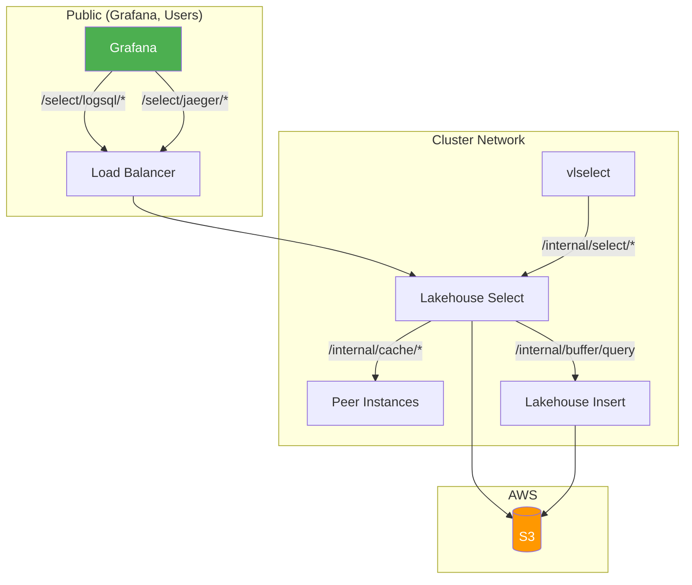

# Security

## Container Hardening

Victoria Lakehouse uses a hardened container image:

- **Base image**: `gcr.io/distroless/static-debian12:nonroot` — no shell, no package manager, no libc
- **Non-root execution**: runs as UID 65534 (`nonroot` user)
- **Stripped binary**: built with `-s -w` linker flags (no debug symbols)
- **Static binary**: `CGO_ENABLED=0` — no dynamic library dependencies
- **Multi-stage build**: builder stage discarded, only binary copied to runtime
- **FIPS 140-3 variant**: the default image (`vX.Y.Z`) is built with Go's standard crypto and is not FIPS. Only the `-fips` image (`vX.Y.Z-fips`, built with `--build-arg FIPS=1`) is compiled with the Go FIPS 140-3 module (`GOFIPS140=v1.0.0`) and runs with `fips140=on` by default; `lakehouse-logs fips-status` and `lakehouse-traces fips-status` report which one a binary is.

## Kubernetes Security Context

Default Helm chart values enforce a secure-by-default posture:

```yaml
securityContext:
  runAsNonRoot: true
  runAsUser: 65534
  runAsGroup: 65534
  fsGroup: 65534
  seccompProfile:
    type: RuntimeDefault

containerSecurityContext:
  readOnlyRootFilesystem: true
  allowPrivilegeEscalation: false
  capabilities:
    drop: ["ALL"]
  runAsNonRoot: true
  runAsUser: 65534
  runAsGroup: 65534
  seccompProfile:
    type: RuntimeDefault
```

- **Read-only root filesystem**: only `/data/lakehouse` (PVC mount) is writable
- **No privilege escalation**: `allowPrivilegeEscalation: false`
- **All capabilities dropped**: `capabilities.drop: ["ALL"]`
- **Seccomp**: `RuntimeDefault` profile active

## CI Security Gates

| Gate | Tool | What It Checks |
|---|---|---|
| Dependency vulnerabilities | `govulncheck` | Known CVEs in Go dependencies |
| Static analysis | `gosec` | Go-specific security issues (OWASP) |
| Container vulnerabilities | `Trivy` | OS-level + app-level CVEs in image |
| Secret scanning | `gitleaks` | Accidentally committed credentials |
| Code analysis | `CodeQL` | Semantic vulnerability patterns (weekly) |

## Credential Handling

### S3 Credentials

**Preferred**: IAM roles via IRSA (Kubernetes) or instance profiles (EC2). No credentials in config.

**Static credentials** (`--lakehouse.s3.access-key/secret-key`) are supported for development (MinIO) but should not be used in production. These values are never logged or exposed in metrics.

### Discovery Auth Key

`--lakehouse.discovery.partition-auth-key` authenticates requests to vlstorage/vtstorage `/internal/partition/list` endpoints (polled with `POST`, the only method VictoriaTraces v0.12.0 accepts there; the key stays in the URL query). Must match the `-partitionManageAuthKey` value on storage nodes.

### Peer Key

`peer.auth_key` (or `-lakehouse.peer.auth-key`, which overrides it) is the key the pods present to each other's
internal endpoints and require on their own: the buffer bridge (`/internal/buffer/query`), the peer cache, manifest
push, stats and tenant sync. Set the same key on every pod of a deployment. See
[Internal endpoints and the peer key](#internal-endpoints-and-the-peer-key).

## Network Boundaries



### Internal Endpoints (cluster-only)

These endpoints should NOT be exposed externally:

| Endpoint | Served by | Purpose | Protection |
|---|---|---|---|
| `/internal/select/*` | select pods | VictoriaLogs' cluster protocol (binary DataBlock), for a `vlselect`/`vtselect` in front | upstream's: network, `-httpAuth.*`, `-internalselect.disable` |
| `/internal/buffer/query` | insert pods | the select pods' buffer bridge: each tenant's not yet flushed rows | peer key (with `peer.auth_enabled`; `all_tenants=true` always needs it), `-internalselect.disable` |
| `/internal/cache/fetch`, `/internal/cache/has` | every pod | peer cache data transfer and probe | peer key (`X-Peer-Auth-Key`), with `peer.auth_enabled` |
| `/internal/cache/stats`, `/internal/cache/clear` | every pod | peer cache metrics and reset | peer key, with `peer.auth_enabled` |
| `/internal/manifest/update`, `/internal/stats/sync`, `/internal/tenant/sync` (logs binary) | every pod | manifest push, stats and tenant gossip | peer key, with `peer.auth_enabled` |
| `POST`/`DELETE /lakehouse/api/v1/tenants/aliases` | every pod | alias admin API (not cluster-internal, but guarded by the same key) | peer key, with `peer.auth_enabled` |

Use Kubernetes NetworkPolicy to restrict `/internal/*` to the cluster CIDR, and put vmauth in front of the
pods for clients (the chart's vmauth routes only `/insert/*` and `/internal/insert` to insert pods).

### Peer authentication (opt-in, off by default)

The pods call each other's internal endpoints (manifest push, stats and tenant gossip, the peer cache, the select
pods' buffer bridge). Peer authentication makes those endpoints refuse a request that does not carry the shared
peer key. **It is off by default, and with the defaults nothing changes:** every endpoint below answers a request
without a credential, as upstream's internal endpoints do. Off therefore means that any client that can reach a
pod's port can call them: keep the pods on a protected network (a NetworkPolicy, vmauth in front of the clients), or
turn peer authentication on.

What `peer.auth_enabled` (`-lakehouse.peer.auth-enabled`) requires the key on, in both binaries (the tenant row is the
logs binary's; the traces binary mounts no tenant sync):

| Endpoint | Kind | Why it takes the key |
|---|---|---|
| `POST /internal/manifest/update` | mutating | adds and removes files in the pod's view of the bucket |
| `POST /internal/cache/clear` | mutating | drops the pod's caches |
| `POST /internal/stats/sync` | mutating | merges another pod's tenant statistics |
| `POST /internal/tenant/sync` | mutating | merges another pod's tenant aliases |
| `POST`/`DELETE /lakehouse/api/v1/tenants/aliases` | mutating | the alias admin API, guarded by the same key |
| `GET /internal/buffer/query` | read-only | each tenant's not yet flushed rows |
| `GET /internal/cache/fetch`, `/internal/cache/has`, `/internal/cache/stats` | read-only | cached Parquet bytes and the pod's cache statistics |

The read-only endpoints follow the same key because they expose data of every tenant (cached blocks, unflushed rows)
and cluster internals. Not covered by the key, and unchanged: upstream's `/internal/select/*`, `/internal/insert` and
`/internal/delete/*` (protected as upstream does: network, `-httpAuth.*`; `-internalselect.disable` turns the
select endpoints off, and `/internal/delete/*` answers only when `-internaldelete.enable` is set, off by default); the cross-signal hints `/internal/prefetch/hint` and `/internal/cache/evict-hint` (their own
`cross_signal.auth_key`); `/internal/lifecycle/*` (the chart's preStop hook calls `/internal/lifecycle/drain` from
localhost without a key); and the admin writes outside `/internal` (`/lakehouse/drain`,
`/lakehouse/compaction/recompact`, `/lakehouse/api/v1/tenants/policy`, `/lakehouse/api/v1/admin/tenant/migrate`).

**Turning it on without a flag day.** The key and its enforcement are two settings, so a rolling restart never
refuses a pod:

1. Configure the key on every pod (`peer.auth_key`, or the chart's `peerAuth.existingSecret`) and leave
   `peer.auth_enabled` off. A pod sends the key on every peer call whenever it has one, but still accepts requests
   without it, so pods that have it and pods that do not (yet) work together. `/internal/buffer/query` also serves
   `all_tenants=true` to a caller that presents the key, so global-read queries see the unflushed rows from this step on.
2. Once every pod has restarted with the key, set `peer.auth_enabled: true` (`-lakehouse.peer.auth-enabled`, or
   `peerAuth.enabled: true`) and restart the pods again. The pods now refuse a request without the key (401). Pods that
   restarted early and pods that did not are still compatible, because all of them already send the key.

`peer.auth_enabled` without a key does not start: the process exits with
`peer.auth_enabled (-lakehouse.peer.auth-enabled) is true but peer.auth_key (-lakehouse.peer.auth-key) is empty`. With
Helm the key must come from a Secret (`peerAuth.existingSecret`); `peerAuth.enabled` with no Secret, or with a key in
`lakehouseConfig.peer.auth_key`, fails the render.

**What a key set before this setting existed does now.** Before `peer.auth_enabled`, setting `peer.auth_key` also made
the pod require it. Now a key on its own is only sent; a deployment that relied on it must also set
`peer.auth_enabled`. A pod that holds a key without enforcing it says so at startup (a warning), in
`lakehouse_peer_auth_enabled 0`, in `/lakehouse/info` and in `helm install`'s notes.

**Seeing the state.** Off or on, the state is visible in four places:

- one startup warning when the pod's internal endpoints take requests without a credential and it has peers or a
  split insert/select role;
- the gauge `lakehouse_peer_auth_enabled` (1 when the pod requires the key, 0 otherwise);
- `GET /lakehouse/info`, field `peer_auth`: `{"enabled": false, "key_configured": false}` (never the key);
- the chart's `peerAuth` values and `helm install` notes.

**Always on, whatever the setting.** Neither can refuse a legitimate peer:

- every key comparison is constant time (`internal/peerauth`);
- the request bodies of `/internal/manifest/update`, `/internal/stats/sync` and `/internal/tenant/sync` are capped at
  `peer.max_request_body_bytes` (`-lakehouse.peer.max-request-body-bytes`, default 64 MiB; larger bodies get 413), and a
  zstd stats body may not expand past the same size. Measured (see the tests): a stats push for 20 000 tenants is 9.6 MB
  (273 KB zstd), a tenant sync for 50 000 aliases is 3.8 MB, a manifest update of 2 000 fully annotated files is 3.7 MB,
  so the default leaves about 7 times the largest of them (the fleet sizes behind these bodies are assumed, not measured).

The default vmauth configuration in the chart is not changed by this setting: it forwards every path to the logs
select pods, `/internal/*` included. Put vmauth routes for the paths clients may use only, or a NetworkPolicy, in front
of the pods.

### Internal endpoints and the peer key

VictoriaLogs and VictoriaTraces protect their own internal endpoints (`/internal/select/*`, `/internal/insert`) by
the network: the cluster components "must run in a protected internal network", with
[vmauth](https://docs.victoriametrics.com/victoriametrics/vmauth/) in front for clients, `-httpAuth.*` for basic
auth, and `-internalselect.disable` / `-internalinsert.disable` to turn the endpoints off. Without these the
endpoints take no credential: anyone who can reach a `vlstorage` node can read any tenant through
`/internal/select/*`. Lakehouse follows that model and adds the peer key, because its insert pods are also the
ingest endpoint: clients that may only write reach the same port as `/internal/buffer/query`.

`/internal/buffer/query` answers like this:

| Pod's setting | Request | Answer |
|---|---|---|
| key set and `peer.auth_enabled` | no `Authorization: Bearer`, or another key | **401** `Expected to receive non-empty Authorization: Bearer <key> when peer.auth_key is set` / `The provided Bearer key doesn't match peer.auth_key` (upstream's status for a missing or wrong key) |
| key set and `peer.auth_enabled` | the key, one tenant (`account_id` + `project_id`) | 200, that tenant's unflushed rows only |
| key set and `peer.auth_enabled` | the key, `all_tenants=true` | 200, every tenant's unflushed rows (a select pod's global-read query) |
| key set, `peer.auth_enabled` off | one tenant, with or without a key | 200, that tenant's unflushed rows only, without a credential (as upstream's `/internal/select/*`) |
| key set, `peer.auth_enabled` off | `all_tenants=true` with the key | 200, every tenant's unflushed rows (step 1 of the rollout above) |
| key set, `peer.auth_enabled` off | `all_tenants=true` without the key, or with another | **403** `all_tenants=true is served only to an authenticated peer; set the same peer.auth_key on every pod` |
| not set (default) | one tenant | 200, that tenant's unflushed rows only, without a credential (as upstream's `/internal/select/*`) |
| not set (default) | `all_tenants=true` | **403** (same message) |
| any | `-internalselect.disable` on the insert pod | **400** `requests to /internal/buffer/query are disabled with -internalselect.disable command-line flag` (upstream's answer and status), before anything else is looked at |

The select pods' bridge sends `Authorization: Bearer <peer.auth_key>` on every request. A peer that refuses it
(401/403) is counted in `lakehouse_buffer_bridge_errors_total{reason="auth"}` and raises
`LakehouseBufferBridgeAuthRefused`: the queries that hit it were answered without that pod's unflushed rows.

**Risk without enforcement.** With peer authentication off (the default, as in upstream), anyone who can reach an insert pod's
port can read any single tenant's unflushed rows by naming its `AccountID`/`ProjectID`: the rows of the active and
sealed buffer segments plus the grace period after they are written (about 15 minutes at the defaults). Every
tenant at once (`all_tenants=true`) is never served without the key. This is the exposure of upstream's
`/internal/select/*` on `vlstorage`, on a port that ingest clients can reach. Keep the pods on a protected
network, or turn peer authentication on; global-read queries need the key to see unflushed rows at all.

With peer authentication on, the peer key guards the insert pods' direct `/internal/buffer/query` endpoint. A select pod's `/select/*` and
`/internal/select/*` still serve whatever tenant the request names (upstream's model), including the unflushed rows
it reads through the bridge, so the key does not close every buffer read: protect those routes with
`-httpAuth.*`, vmauth or the network, as for upstream.

**Setting the key.**

- Config file: `peer: {auth_key: <key>}` (and `auth_enabled: true` to enforce it), the same on every pod of both roles.
- Flag: `-lakehouse.peer.auth-key=<key>` (and `-lakehouse.peer.auth-enabled`), which override the config file. VictoriaMetrics' flag handling
  expands `%{ENV_VAR}` in it (`-lakehouse.peer.auth-key=%{LAKEHOUSE_PEER_AUTH_KEY}`) and hides flags named
  `*key*` from `/flags` and `/metrics`.
- Helm: create a Secret and set `peerAuth.existingSecret` (and `peerAuth.secretKey`, default `peer-auth-key`):

  ```sh
  kubectl create secret generic lakehouse-peer --from-literal=peer-auth-key="$(openssl rand -hex 32)"
  # step 1: every pod gets the key and sends it; nothing is refused yet
  helm upgrade --install lh charts/victoria-lakehouse --set peerAuth.existingSecret=lakehouse-peer
  # step 2, after step 1 has rolled out: the pods require it
  helm upgrade --install lh charts/victoria-lakehouse --set peerAuth.existingSecret=lakehouse-peer --set peerAuth.enabled=true
  ```

  Every Lakehouse pod gets the key as `LAKEHOUSE_PEER_AUTH_KEY` and passes it with the flag; it never enters the
  ConfigMap. `lakehouseConfig.peer.auth_key` also works for step 1 but renders the key into the ConfigMap, and
  `peerAuth.enabled` refuses it; setting both is refused. Rotate by updating the Secret and restarting every pod; pods holding different keys refuse each
  other's bridge requests until all have restarted.

**Turning the buffer query off.** Upstream's `-internalselect.disable` turns off `/internal/buffer/query` on insert pods and
`/internal/select/*` on select pods. Select pods then see an insert pod's rows only once they are in object
storage; set `select.buffer_query_enabled: false` on them so they do not ask. A select pod that does ask counts
each "disabled" answer as `lakehouse_buffer_bridge_errors_total{reason="disabled"}` (alert
`LakehouseBufferBridgeDisabled`) and still answers 200 without those rows. A `role=all` pod with
`discovery.peer_headless_service` is its own peer: with the flag set it refuses its own bridge call, so its own
unflushed rows are missing from the queries it serves (a warning is logged at startup). Run select pods apart from
the pods that ingest, or leave the flag unset there.

The peer key is trimmed of surrounding whitespace (a Secret file usually ends in a newline); a key with whitespace or
a control character inside is refused at startup, and so is a key that is only whitespace (it would otherwise
run the pod without a key).

**`-httpAuth.*`.** VictoriaMetrics' HTTP server applies `-httpAuth.username`/`-httpAuth.password` to every path
except `/health`, `/metrics`, `/flags` and a few others, including `/internal/*`. Lakehouse's peer clients (the
buffer bridge, the peer cache, manifest, stats and tenant sync) do not send basic auth, so on a deployment that
sets `-httpAuth.*` on its pods those channels are refused (tracked in #396). Use the peer key between pods and put
basic auth or vmauth in front for clients.

### Public Endpoints

| Endpoint | Purpose |
|---|---|
| `/select/logsql/*` | Query API (VL/VT compatible) |
| `/health` | Liveness |
| `/ready` | Readiness |
| `/manifest/range` | Data range info |
| `/lakehouse/info` | Build info |
| `/metrics` | Prometheus scrape |

## Tenant Isolation

Victoria Lakehouse uses **S3 prefix isolation** for multi-tenancy — the same pattern as Grafana Loki and Grafana Tempo. Each tenant's data lives in a separate S3 prefix, providing physical data separation.

### Prefix Isolation (Default)

```
--lakehouse.tenant.prefix-template="{AccountID}/{ProjectID}/"
--lakehouse.tenant.default-account=0
--lakehouse.tenant.default-project=0
```

`AccountID` and `ProjectID` are extracted from vmauth headers (`X-Scope-AccountID`, `X-Scope-ProjectID`). A query from tenant-A cannot access tenant-B's S3 prefix. Single-tenant deployments use the default `0/0/` prefix.

S3 layout per tenant:
```
s3://obs-archive/{AccountID}/{ProjectID}/logs/dt=YYYY-MM-DD/hour=HH/*.parquet
s3://obs-archive/{AccountID}/{ProjectID}/traces/dt=YYYY-MM-DD/hour=HH/*.parquet
```

### Enterprise: Bucket-Per-Tenant Isolation

For regulated environments requiring IAM-level hard isolation (HIPAA, SOC2, FedRAMP):

```
--lakehouse.tenant.isolation=bucket
--lakehouse.tenant.bucket-template="obs-{AccountID}-{ProjectID}"
```

Each tenant gets its own S3 bucket with independent:
- IAM policies (cross-account access control)
- KMS encryption keys
- Lifecycle rules (different retention per tenant)
- S3 Access Logs for compliance audit
- CloudTrail object-level logging

### Security Properties

| Property | Prefix Isolation | Bucket Isolation |
|---|---|---|
| Data separation | Physical (S3 path) | Physical (S3 bucket) |
| IAM boundary | Shared bucket IAM | Per-bucket IAM |
| Encryption keys | Shared KMS key | Per-tenant KMS |
| Audit trail | S3 Access Logs by prefix | Per-bucket Access Logs |
| Cost attribution | S3 Inventory by prefix | Per-bucket billing |
| Parquet tool access | Per-tenant glob pattern | Per-tenant bucket |

Full documentation: [Multi-Tenancy](multi-tenancy.md)

### Parquet footers read from the bucket are untrusted bytes

A Parquet footer is parsed before any data is read, and it comes from an object anyone with write access to the bucket (or a corrupted copy) controls. parquet-go v0.32.0 sizes its allocations from what the footer declares, and recurses with its nesting, before it validates any of it. On the prefetch and footer-cache path (`ParseFooterFromBytes`) the footer is therefore checked first, against the bytes that exist and against limits parquet-go enforces anyway:

- the declared footer length must fit the bytes in hand and the 64 MiB policy cap;
- every list or set the footer declares must fit the bytes that hold it, with one budget across the whole footer. A Thrift list is allocated from its declared size before one element is read, so an 850-byte footer could ask for 26 GiB (measured, `alloc_space`) and end the process with a Go runtime fatal error that no `recover` catches. Allocation for lists is then at most about 190 times the footer length (the largest element, a `ColumnChunk`, is 560 bytes for at least 3 encoded bytes; sizes from `unsafe.Sizeof`);
- containers (lists, sets, maps, structs) nest at most 32 levels. Real footers nest about 6. Before lists and maps counted, a footer of 8 MiB of nested list headers ended the process with a stack overflow (measured);
- the schema nests at most `parquet.MaxColumnDepth` (255) levels, and leaf columns times row groups times 3 is at most the footer length (every row group carries one `ColumnChunk` per leaf, at least 3 bytes each). parquet-go allocates one pointer per leaf and row group, and one path string per schema element and ancestor, before checking either. Measured with the list-size check alone: a 51 KB footer of 3000 leaves in 3000 row groups allocated 73.5 MB, 6000 by 6000 (102 KB) 291 MB, and a schema chain of 8000 groups (48 KB) 515 MB; all three are now rejected with under 3 KB allocated;
- a rejected footer counts under `lakehouse_footer_parse_rejected_total{reason}` (`thrift_bounds_exceeded` for the checks above) and the file is treated as unreadable, never as empty.

Files written by any standard Parquet writer pass unchanged; each check is a lower bound of the encoding or a limit parquet-go enforces itself.

What stays on parquet-go: a schema that is deep but within 255 levels still costs one string header per ancestor of each element. The worst shape the checks accept (a 255-deep chain with 4,000 leaves at the bottom, a 25.5 KB footer) allocated 18.5 MB, 724 times the footer (measured). Scaled to a footer at the 64 MiB cap that would be tens of GiB (assumed: linear extrapolation, not run). Closing it needs either a cap on the number of schema elements or the upstream parquet-go fix; the other `parquet.OpenFile` call sites are tracked in #744.

## S3 Access

Victoria Lakehouse requires read-only S3 access:

```json
{
  "Version": "2012-10-17",
  "Statement": [
    {
      "Effect": "Allow",
      "Action": [
        "s3:GetObject",
        "s3:ListBucket",
        "s3:HeadObject"
      ],
      "Resource": [
        "arn:aws:s3:::obs-archive",
        "arn:aws:s3:::obs-archive/*"
      ]
    }
  ]
}
```

No write access required. Victoria Lakehouse is a read-only consumer of Parquet files.

For SQS event notifications, add:

```json
{
  "Effect": "Allow",
  "Action": [
    "sqs:ReceiveMessage",
    "sqs:DeleteMessage",
    "sqs:GetQueueAttributes"
  ],
  "Resource": "arn:aws:sqs:us-east-1:123456:lakehouse-s3-events"
}
```
