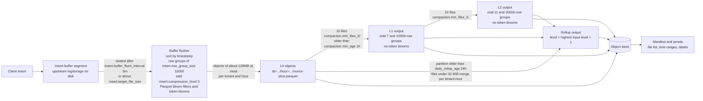
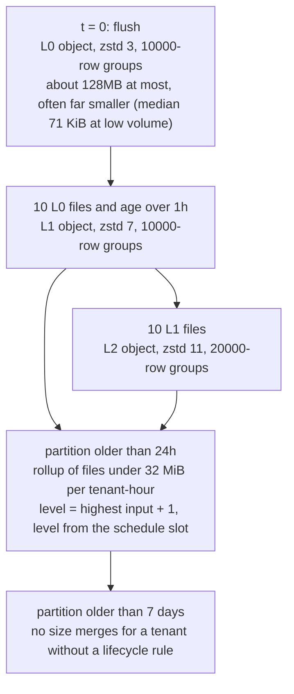
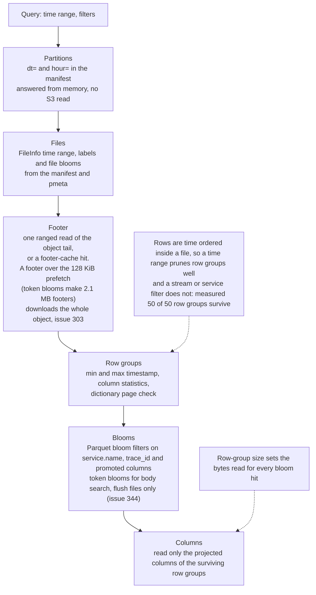

# Storage Efficiency: how Lakehouse writes and compresses data

This page is for operators and contributors. It describes how the Parquet files are written today (defaults, sort order, row groups, encodings, zstd levels, blooms, compaction), what each choice costs in bytes and CPU, how the sizes compare with VictoriaLogs and VictoriaTraces on the same data, what was tried and rejected, and which knobs change what.

Every number is labelled **measured** (m), **sourced** (s, with the file or URL) or **assumed** (a). A table without a label is measured.

## How the numbers were measured

| Item | Value |
|---|---|
| Datasets | 5, each 500,000 rows (the real Loghub set is 523,378 rows): a synthetic log generator (`logs-datagen`), a synthetic log generator with stable pods and a Zipf service mix (`logs-pool`), real logs (`logs-loghub`), a synthetic span generator (`traces-datagen`) and a synthetic span generator with fan-out traces and stable instances (`traces-pool`) |
| Real data | 523,378 lines from Loghub (CC-BY-4.0, https://zenodo.org/records/8196385): the first 60,000 lines each of Apache, Hadoop, HealthApp, HPC, Linux, Mac, OpenStack, Proxifier, SSH and Zookeeper. Timestamps are synthetic: each source spans one synthetic day in its own line order |
| Writers | The flush writers (`writeLogsParquet`, `writeTracesParquet`) of this repository, with the real insert field mapping. The compaction writers were used only for the flush-versus-compaction structure comparison |
| Libraries | parquet-go v0.32.0, klauspost/compress v1.20.0 (see `go.mod`) |
| Baselines | VictoriaLogs v1.53.0 and VictoriaTraces v0.12.0, built from the upstream tags with default flags except the data path and listen address, force-flushed and force-merged before the bytes were counted |
| Timings | Single-core wall time on a shared host, one run or the median of 2. Treat them as +-15 % noise. They are not comparable with CI runners |
| Row groups | 10,000 rows unless the table says otherwise (the shipped default) |

Dataset sizes as sent (m, one pass over the export):

| Dataset | Rows | Raw size as sent | Streams | Notes |
|---|---|---|---|---|
| `logs-datagen` | 500,000 | 682.3 MB NDJSON | 500,000 | Every row has its own random pod, container and instance, and the pod is a stream field, so every row is its own stream. This is a worst case for VictoriaLogs, whose documentation warns against high-cardinality stream fields, and for any stream ordering |
| `logs-pool` | 500,000 | 639.0 MB NDJSON | 480 | 40 services with a Zipf(1.1) mix, 3 stable pods each, 60 % INFO. Bodies are synthetic templates with random ids |
| `logs-loghub` | 523,378 | 72.7 MB of raw text lines (126.8 MB as NDJSON) | 324 | Real logs. Stream = host.name and service.name |
| `traces-datagen` | 500,000 spans | 1,150.8 MB OTLP/JSON | 50 | Call chains, random instance, pod and container per span, 71,240 traces |
| `traces-pool` | 500,018 spans | 1,198.9 MB OTLP/JSON | 750 | Fan-out trees, 25 Zipf services with 3 stable instances, 17,738 traces (28 spans per trace). OTLP/JSON repeats the resource on every span, so it overstates the raw size against batched OTLP (a). Prefer the uncompressed Parquet baseline for traces |

The sort-order tables in the measurement section use the raw size that the measurement harness counted for each run (696.8, 652.9, 72.7, 1,183.3 and 1,230.4 MB). It is 2 to 3 % above the as-sent size in the table above for four of the five datasets, so the two sets of ratios are not interchangeable. Each table says which denominator it uses.

## Summary

| Finding | Evidence |
|---|---|
| Real logs written by today's flush writer (time order, 10,000-row groups, zstd level 3) are 17.1 MB. VictoriaLogs stores the same 523,378 lines in 9.03 MB, so a freshly flushed Lakehouse file is **1.89x larger** | Comparison with VictoriaLogs and VictoriaTraces |
| On synthetic pooled logs the gap is small (1.07x larger). On traces Lakehouse files are smaller than VictoriaTraces (0.88x and 0.90x) | Same section |
| Sorting the rows by (hour slice, `_stream_id`, time) before writing shrinks real logs by 26 % (17.1 to 12.7 MB) and keeps time pruning. Today's flush sorts by timestamp only. This is a measured variant, not shipped | Sort order |
| Going from 10,000-row to 100,000-row groups saves 1 to 6 % but makes a needle lookup read about 10x more bytes | Row-group size |
| zstd level 7 instead of 3 saves 4 to 25 % for -7 % to +26 % write time (single runs, +-15 % noise). Level 11 instead of 7 saves a further 0.5 to 8 % for +23 % to +250 % write time. Levels 11 to 22 are byte-identical in the pure-Go codec | zstd levels |
| Parquet bloom filters on non-dictionary columns are sized by row count, not by distinct values. On real logs they are 2,571 KiB: about 15 % of today's 17.1 MB flush file (20 % of the 12.7 MB stream-ordered variant), mostly on columns that are empty | Bloom filter sizing |
| Compacted log files carry no body token blooms; flush files do (issue #344, open) | Flush and compaction structure |
| "10x to 16x" depends on the baseline. Today, against JSON as sent: pooled synthetic logs 13x, real logs 7.4x. Against raw text lines the real logs are 4.3x (VictoriaLogs 8.0x). Spans: 27x against OTLP/JSON, 8x against uncompressed Parquet | Compression ratio against different baselines |

## The write path today

The paths below are in the repository; line numbers are left out on purpose because they move.

| Topic | Where | Behaviour on `main` |
|---|---|---|
| Buffer and flush trigger | `internal/storage/parquets3/buffer_flusher.go`, `InsertConfig` in `internal/config/config.go` | The insert buffer is a sequence of upstream `logstorage` segments. A segment is sealed `insert.buffer_flush_interval` (default `5m`) after its first row, or earlier once it holds about `insert.target_file_size` of rows. The flusher drains a sealed segment completely to Parquet |
| Object size | `insert.target_file_size` (default `128MB`) | The flusher cuts a segment into objects of about this size, per tenant, never across an hour partition. The row-count estimate behind the cut is approximate, and low-volume deployments write much smaller files: the median object observed at low volume is about 71 KiB (s, [cost estimates](cost-estimates.md) and issue #281) |
| Partition and key | [Storage flow](storage-flow.md) | `{prefix}dt=YYYY-MM-DD/hour=HH/{nonce}-{slice}.parquet` |
| Flush sort | `buffer_flusher.go` | `sort.SliceStable` by `TimestampUnixNano` only, in both modules (`lakehouse-traces/internal/storage/parquets3/buffer_flusher.go` is the twin) |
| Compaction sort | `internal/compaction/compactor.go` (`mergeLogFiles`, `mergeTraceFiles`) | Logs: (timestamp, service). Traces: (timestamp, service, trace_id). Nanosecond ties are rare, so this is effectively a time sort: the measured size of "time" and "time, service" is the same within 0.1 % |
| Declared sort order | whole repository | No `SortingWriterConfig` and no `sorting_columns` in any file (m: 0 in every measured file) |
| Row groups | `insert.row_group_size` (default `10000`); `compaction.row_group_size_by_output_level` (default `[10000, 10000, 20000]`) | parquet-go cuts row groups by row count, not bytes. At 10,000 rows the measured row groups are 0.23 to 2.6 MiB (file size divided by the number of row groups; the top of the range is the stream-per-row `logs-datagen`) |
| zstd | `insert.compression_level` (default `3`); `compaction.compression_level_by_output_level` (default `[3, 7, 11]`); `zstdLevel` in `internal/storage/parquets3/writer.go` and its twin in `internal/compaction/compactor.go` | The codec is klauspost/compress through parquet-go. Four encoders only: level 1 is `SpeedFastest`, 2 to 5 `SpeedDefault`, 6 to 10 `SpeedBetterCompression`, 11 and above `SpeedBestCompression`. Config validation accepts 1 to 22 |
| Pages | parquet-go default | 256 KiB page buffer, one zstd frame per page. The compression window is a page, not a row group or a file |
| Encodings | `internal/schema/row.go` | `dict` on categorical columns (service, severity, namespace, `_stream`, `_stream_id`, and others), `delta` on `timestamp_unix_nano`. Columns without a tag (`body`, `trace_id`, `span_id`, `container.id`, `service.instance.id`, `http.url`, `db.statement`, attribute map keys and values) use parquet-go's string default, DELTA_LENGTH_BYTE_ARRAY |
| Promoted columns | `internal/schema/dedicated.go`, `internal/schema/row.go`, `<signal>.promoted_attributes` | Tier-1 dedicated columns (OTel semantic-convention attributes such as `container.id`, `service.instance.id`, `k8s.pod.name`, `server.address`) are first-class Parquet columns. Tier-2 slots `ded_s01` to `ded_s08` hold operator-chosen attributes from `<signal>.promoted_attributes` (each `{name, bloom}`); the slot-to-name binding is written to the footer key-value metadata so a file is self-describing. Compaction re-promotes older rows (`RepromoteLogRow` for logs, the injected trace re-promote for traces) so old files gain the dedicated columns. Encoding follows cardinality: high-cardinality id columns are plain strings with a bloom, high-byte low-cardinality columns use a dictionary |
| Dictionary cap | not set | parquet-go's `DictionaryMaxBytes` is 0, which means unlimited. The dictionary is per column chunk |
| Parquet bloom filters | `bloomFilters` in `writer.go` and `compactor.go`; column set from `LogBloomColumns` and `TraceBloomColumns` in `internal/schema/dedicated.go` | `SplitBlockFilter(10, column)`, about 10 bits per value (about 1 % false-positive rate). The set is `service.name`, `trace_id`, the strict per-signal set from the schema registry (for example `k8s.pod.name`, `span_id`), and any promoted attribute declared with `bloom: true` |
| Token blooms | `internal/storage/parquets3/token_bloom.go`, written by `writeLogsParquet` | One footer key-value entry `_bloom_body_rg_N` per row group over the body tokens, flush files only. The compaction writer does not write it (issue #344) |
| Compaction triggers | `internal/compaction/planner.go`, `CompactionConfig` | `min_files_l0` (10): L0 to L1. `min_files_l1` (10): L1 to L2. `min_age` (1h) keeps young files out. `daily_rollup_age` (24h): every file under 32 MiB (`manifest.MatureObjectBytes`) of a tenant-hour merges into one. `size_merge_max_age` (168h, that is 7 days) stops size merges when the tenant has no lifecycle rule. The scan runs every `compaction.interval` (5m) |
| Compaction output | `compactor.go` | One output object per tenant group, with no target size and no split. The output level is one above the highest input level, and levels are not capped. The compactor holds all inputs, the merged rows and the output buffer in memory at once |

### Diagram: the write path

This diagram shows existing behaviour. Nothing here is new.

### Diagram: the size and level ladder by age

The ladder below is what the defaults do. The only size target is the flush's `insert.target_file_size`; compaction has no output size target.

Two properties of this ladder matter for the numbers below.

- The level follows the **output level**, which is not bounded. A rollup output of level 2 or more gets zstd 11, and may be rewritten again by a later rollup or size merge, so the most expensive level can be spent on data that is merged again.
- Compaction cannot reach a size above what its inputs add up to, and it has no size target. Object counts therefore depend on the flush size, which is small at low volume (issue #281).

### Diagram: how a query narrows the data

This is the read path described in [Read path](read-path.md), reduced to the structure that the write choices feed. The notes in the boxes say what the writer contributes and where today's layout limits pruning.

## Measured effects

### Flush and compaction structure

Same 100,000 rows of `logs-pool` and 100,000 spans, 10,000-row groups, zstd 3. The compaction writers (`compaction.WriteLogs`, `compaction.WriteTraces`) were run on the same rows.

| Writer | Size (bytes) | Footer key-value entries | Parquet bloom columns | Bloom bytes | Token-bloom bytes |
|---|---|---|---|---|---|
| flush, logs | 9,788,061 | `_bloom_body_rg_0..9`, `lh.trace_id_hex` | 10 | 505,600 | 188,804 |
| compaction, logs | 9,599,027 | `lh.trace_id_hex` only | 10 | 505,600 | **0** |
| flush, traces | 9,014,566 | `_trace_idx`, `lh.trace_id_hex` | 14 | 881,958 | 0 (spans have no body) |
| compaction, traces | 9,014,566 | same | 14 | 881,958 | 0 |

Traces are aligned. Logs compaction drops the body token blooms, so every log compaction reduces body-search prunability. This is tracked in issue #344.

### Sort order

The flush writer, 10,000-row groups, zstd level 3, one file per dataset. Sort orders:

- **S0 time**: what flush does today.
- **S1 time, service**: what compaction does today (traces: time, service, trace_id).
- **S2 service, level, time**: service-first.
- **S4 `_stream_id`, time**: stream order. `_stream_id` starts with the tenant.
- **S4b hour slice, `_stream_id`, time**: stream order inside one-hour slices.

Survivor columns show **surviving row groups as exact / min-max-only** out of the total. "Exact" is the model of an ideal bloom or exact statistics. "Min-max-only" uses only the footer min and max. A real bloom with 1 % false positives adds about 1 % extra surviving row groups (a). Queries: 15 minutes of time; one service (the 4th most frequent); one stream (the 21st most frequent); that service plus one hour; one body token present in about 0.1 % of rows (logs) or one span name (traces); one trace id. The raw denominator is the harness raw size named in each heading.

#### Real logs: `logs-loghub` (523,378 rows, 324 streams, raw 72.7 MB of text lines, 53 row groups at 10,000 rows)

| Sort | File MB | Bytes per row | x raw text | Body MB | 15 min | Service | Stream | Service + 1h | Body token |
|---|---|---|---|---|---|---|---|---|---|
| S0 time | 17.1 | 33 | 4.26 | 9.8 | 1 / 1 | 53 / 53 | 52 / 52 | 3 / 3 | 3 / 3 |
| S1 time, service | 17.1 | 33 | 4.26 | 9.8 | 1 / 1 | 53 / 53 | 52 / 52 | 3 / 3 | 3 / 3 |
| S2 service-first | 12.1 | 23 | 6.02 | 6.3 | 17 / 24 | 7 / 7 | 6 / 14 | 3 / 4 | 1 / 1 |
| S4 stream | 12.2 | 23 | 5.96 | 6.4 | 15 / 27 | 12 / 18 | 1 / 1 | 4 / 18 | 2 / 2 |
| S4b hour slice, stream | 12.7 | 24 | 5.71 | 6.7 | 3 / 3 | 51 / 53 | 24 / 27 | 3 / 3 | 1 / 1 |

#### Pooled logs: `logs-pool` (500,000 rows, 480 streams, harness raw 652.9 MB, 50 row groups)

| Sort | File MB | Bytes per row | x raw | Body MB | 15 min | Service | Stream | Service + 1h | Body token | trace_id |
|---|---|---|---|---|---|---|---|---|---|---|
| S0 time | 49.2 | 98 | 13.28 | 23.0 | 1 / 1 | 50 / 50 | 50 / 50 | 3 / 3 | 50 / 50 | 1 / 1 |
| S1 time, service | 49.2 | 98 | 13.28 | 23.0 | 1 / 1 | 50 / 50 | 50 / 50 | 3 / 3 | 50 / 50 | 1 / 1 |
| S2 service-first | 42.1 | 84 | 15.52 | 21.6 | 37 / 41 | 4 / 4 | 2 / 49 | 4 / 4 | 50 / 50 | 1 / 1 |
| S4 stream | 40.6 | 81 | 16.09 | 22.0 | 47 / 48 | 13 / 44 | 2 / 2 | 11 / 44 | 50 / 50 | 1 / 1 |
| S4b hour slice, stream | 42.7 | 85 | 15.30 | 22.5 | 3 / 3 | 50 / 50 | 26 / 39 | 3 / 3 | 50 / 50 | 1 / 1 |

The S4b figure of 26 row groups for one stream is for a file that spans a whole synthetic day (24 hour slices). A flushed or hour-compacted object holds one hour, where the slice is the object (a).

#### Stream-per-row logs: `logs-datagen` (500,000 rows, 500,000 streams, harness raw 696.8 MB, 50 row groups)

| Sort | File MB | Bytes per row | x raw | Body MB | 15 min | Service | Stream | Service + 1h | Body token | trace_id |
|---|---|---|---|---|---|---|---|---|---|---|
| S0 time | 134.1 | 268 | 5.20 | 33.1 | 1 / 1 | 50 / 50 | 1 / 17 | 3 / 3 | 50 / 50 | 1 / 1 |
| S1 time, service | 134.1 | 268 | 5.19 | 33.1 | 1 / 1 | 50 / 50 | 1 / 17 | 3 / 3 | 50 / 50 | 1 / 1 |
| S2 service-first | 128.3 | 257 | 5.43 | 31.8 | 20 / 39 | 11 / 11 | 1 / 17 | 4 / 9 | 50 / 50 | 1 / 1 |
| S4 stream | 136.6 | 273 | 5.10 | 34.5 | 50 / 50 | 50 / 50 | 1 / 1 | 50 / 50 | 50 / 50 | 1 / 1 |
| S4b hour slice, stream | 136.1 | 272 | 5.12 | 33.9 | 3 / 3 | 50 / 50 | 1 / 14 | 3 / 3 | 50 / 50 | 1 / 1 |

Every row is its own stream here, so no stream order can cluster anything: S4 is 1.9 % larger than S0. This dataset cannot test stream clustering.

#### Spans: `traces-pool` (500,018 spans, 750 streams, harness raw 1,230.4 MB, 51 row groups)

Stream = (service.name, span name). The trace_id lookup also reads the span-tree columns.

| Sort | File MB | Bytes per row | x raw | 15 min | Service | Stream | Service + 1h | Span name | trace_id |
|---|---|---|---|---|---|---|---|---|---|
| S0 time | 45.1 | 90 | 27.26 | 1 / 1 | 50 / 51 | 50 / 51 | 3 / 3 | 51 / 51 | 2 / 2 |
| S1 time, service, trace_id | 45.0 | 90 | 27.31 | 1 / 1 | 50 / 51 | 50 / 51 | 3 / 3 | 51 / 51 | 2 / 2 |
| S2 service-first | 42.8 | 86 | 28.72 | 51 / 51 | 4 / 4 | 1 / 45 | 4 / 4 | 16 / 21 | 23 / 23 |
| S4 stream | 44.6 | 89 | 27.57 | 50 / 50 | 24 / 48 | 2 / 2 | 22 / 48 | 17 / 25 | 25 / 25 |
| S4b hour slice, stream | 42.1 | 84 | 29.21 | 3 / 3 | 50 / 50 | 24 / 46 | 3 / 3 | 50 / 50 | 3 / 3 |

#### Spans: `traces-datagen` (500,000 spans, 50 streams, harness raw 1,183.3 MB, 50 row groups)

| Sort | File MB | Bytes per row | x raw | 15 min | Service | Stream | Service + 1h | Span name | trace_id |
|---|---|---|---|---|---|---|---|---|---|
| S0 time | 82.2 | 164 | 14.39 | 1 / 1 | 50 / 50 | 50 / 50 | 3 / 3 | 50 / 50 | 2 / 2 |
| S1 time, service, trace_id | 82.2 | 164 | 14.39 | 1 / 1 | 50 / 50 | 50 / 50 | 3 / 3 | 50 / 50 | 2 / 2 |
| S2 service-first | 83.8 | 168 | 14.13 | 50 / 50 | 11 / 11 | 2 / 22 | 10 / 11 | 10 / 14 | 4 / 4 |
| S4 stream | 83.8 | 168 | 14.11 | 50 / 50 | 16 / 35 | 2 / 2 | 10 / 35 | 9 / 26 | 4 / 4 |
| S4b hour slice, stream | 80.9 | 162 | 14.63 | 3 / 3 | 50 / 50 | 24 / 41 | 2 / 3 | 50 / 50 | 2 / 2 |

What the tables show:

- **Real logs:** stream order (S4) is 29 % smaller than time order (S0): the body column goes from 9.8 to 6.4 MB. Service-first (S2) compresses the same (12.1 MB). Pure stream order loses time pruning (15 of 53 row groups for 15 minutes). The hour slice (S4b) restores it (3 row groups) for +4 % size over S4.
- **Pooled logs:** S4 is -17 % and S4b -13 %. A stream filter goes from 50 of 50 row groups (S0) to 2 (S4).
- **Spans:** S4b is -7 % on `traces-pool`. Service-first is -5 % but scatters one trace over 23 row groups and loses time pruning. Trace-first order (S5 in the measurement, not in the tables) keeps a trace in 1 row group at +3 % size, but loses time and stream pruning.
- **S1 equals S0** to within 0.1 % on every dataset: today's compaction sort is a time sort.
- **Today's layout has no stream or service clustering.** A stream or service filter on a time-ordered file reaches almost every row group (50 of 50, 52 of 53), so those filters depend on the label pre-filter, dictionary checks and blooms, not on row-group pruning.

### Row-group size

Real flush writer, zstd 3, one file per dataset. Footer KiB includes the token-bloom entries. The "needle" column is a body token (logs-loghub) or a trace id (the other two); each cell is surviving row groups and the compressed MB read from them.

| Dataset | Sort | Rows per group | MiB per group | File MB | vs 10k | Footer KiB | Bloom KiB | 15 min | Stream | Needle |
|---|---|---|---|---|---|---|---|---|---|---|
| logs-loghub | S0 | 2,000 | 0.07 | 20.3 | +19.0 % | 2252 | 2648 | 4 (0.20) | 258 (12.65) | 11 (0.53) |
| logs-loghub | S0 | 10,000 | 0.31 | 17.1 | 0 | 943 | 2571 | 1 (0.23) | 52 (12.04) | 3 (0.69) |
| logs-loghub | S0 | 100,000 | 2.61 | 16.4 | -3.8 % | 515 | 2557 | 1 (2.21) | 6 (12.08) | 1 (2.25) |
| logs-loghub | S0 | 1 group | 15.46 | 16.2 | -5.0 % | 363 | 2556 | 1 (11.66) | 1 (12.06) | 1 (11.66) |
| logs-loghub | S4b | 2,000 | 0.06 | 15.5 | +21.4 % | 2039 | 2648 | 11 (0.39) | 25 (1.18) | 2 (0.07) |
| logs-loghub | S4b | 10,000 | 0.23 | 12.7 | 0 | 919 | 2571 | 3 (0.54) | 24 (4.24) | 1 (0.18) |
| logs-loghub | S4b | 100,000 | 1.91 | 12.0 | -5.6 % | 514 | 2557 | 1 (1.67) | 6 (8.75) | 1 (1.69) |
| logs-loghub | S4b | 1 group | 11.24 | 11.8 | -7.4 % | 363 | 2556 | 1 (8.68) | 1 (8.69) | 1 (8.68) |
| logs-pool | S0 | 2,000 | 0.22 | 56.7 | +15.4 % | 2911 | 2592 | 3 (0.30) | 250 (27.49) | 1 (0.11) |
| logs-pool | S0 | 10,000 | 0.94 | 49.2 | 0 | 1386 | 2468 | 1 (0.50) | 50 (25.85) | 1 (0.55) |
| logs-pool | S0 | 100,000 | 9.17 | 48.1 | -2.2 % | 868 | 2444 | 1 (4.95) | 5 (25.30) | 1 (5.63) |
| logs-pool | S0 | 1 group | 45.70 | 47.9 | -2.5 % | 769 | 2442 | 1 (24.75) | 1 (25.32) | 1 (28.03) |
| logs-pool | S4b | 2,000 | 0.18 | 47.4 | +11.0 % | 2909 | 2567 | 11 (1.12) | 26 (2.68) | 1 (0.11) |
| logs-pool | S4b | 10,000 | 0.81 | 42.7 | 0 | 1385 | 2468 | 3 (1.50) | 26 (13.15) | 1 (0.55) |
| logs-pool | S4b | 100,000 | 8.04 | 42.2 | -1.2 % | 867 | 2444 | 1 (5.00) | 5 (25.06) | 1 (5.69) |
| logs-pool | S4b | 1 group | 40.06 | 42.0 | -1.5 % | 769 | 2442 | 1 (24.94) | 1 (25.01) | 1 (28.36) |
| traces-pool | S0 | 2,000 | 0.20 | 52.0 | +15.1 % | 2645 | 4452 | 3 (0.13) | 250 (13.03) | 2 (0.22) |
| traces-pool | S0 | 10,000 | 0.84 | 45.1 | 0 | 1265 | 4303 | 1 (0.20) | 50 (11.28) | 2 (1.09) |
| traces-pool | S0 | 100,000 | 6.85 | 43.1 | -4.6 % | 945 | 4276 | 1 (1.88) | 5 (10.39) | 1 (5.30) |
| traces-pool | S0 | 1 group | 41.05 | 43.0 | -4.6 % | 910 | 4273 | 1 (9.84) | 1 (10.48) | 1 (26.94) |
| traces-pool | S4b | 2,000 | 0.18 | 47.9 | +13.8 % | 2645 | 4451 | 11 (0.67) | 27 (1.71) | 11 (1.30) |
| traces-pool | S4b | 10,000 | 0.79 | 42.1 | 0 | 1265 | 4303 | 3 (0.82) | 24 (6.72) | 3 (1.66) |
| traces-pool | S4b | 100,000 | 6.38 | 40.1 | -4.8 % | 945 | 4276 | 1 (2.53) | 5 (13.26) | 1 (5.32) |
| traces-pool | S4b | 1 group | 38.07 | 39.9 | -5.2 % | 910 | 4273 | 1 (13.11) | 1 (13.22) | 1 (26.99) |

- Going from 10,000 to 100,000 rows saves 1 to 6 % of the file. Going to one group of 500,000 rows saves 1.5 to 7 % in total. Most of the gain is in by 100,000 rows, and 2,000-row groups cost 11 to 21 %.
- The bytes read for a needle grow with the rows per group, because a bloom hit reads the needed columns of the whole row group. A trace-id lookup on `logs-pool` reads 0.55 MB at 10,000 rows, 5.6 MB at 100,000 and 28 MB with one group.
- The footer shrinks by 25 to 45 % from 10,000 to 100,000 rows, because the token-bloom entries and statistics are per row group.
- Unit conversion: 10,000 rows is 0.23 to 2.6 MiB on these datasets (file size divided by the number of row groups). A byte-based row-group target is not implemented; the writer cuts by rows only.

### zstd levels

#### The codec in this repository, inside the real flush writer

File MB and write time in seconds (median of 2 runs, single core). L1, L3, L7, L11 are the configured levels. Levels 12 to 22 were not tabulated because they are byte-identical to 11: files written at levels 11, 15 and 19 were the same 102,850,038 bytes on `logs-datagen` S0 with 10,000-row groups (m, 3 runs each, 13.6 to 15.9 s).

| Dataset | Sort | Rows per group | L1 MB | L3 MB | L7 MB | L11 MB | L7 vs L3 | L11 vs L7 | Write s L1 / L3 / L7 / L11 |
|---|---|---|---|---|---|---|---|---|---|
| logs-datagen | S0 | 10,000 | 138.1 | 134.1 | 103.4 | 102.9 | -22.9 % | -0.5 % | 4.5 / 4.5 / 5.4 / 14.6 |
| logs-datagen | S0 | 100,000 | 137.5 | 133.4 | 102.9 | 102.1 | -22.9 % | -0.8 % | 5.1 / 5.6 / 5.7 / 17.3 |
| logs-datagen | S4b | 10,000 | 139.7 | 136.1 | 105.1 | 104.2 | -22.8 % | -0.8 % | 5.0 / 4.9 / 5.4 / 15.4 |
| logs-datagen | S4b | 100,000 | 139.1 | 135.8 | 104.7 | 103.9 | -22.9 % | -0.8 % | 5.7 / 5.9 / 6.9 / 17.8 |
| logs-pool | S0 | 10,000 | 51.1 | 49.2 | 46.0 | 45.4 | -6.3 % | -1.4 % | 3.5 / 3.1 / 3.9 / 6.4 |
| logs-pool | S0 | 100,000 | 50.5 | 48.1 | 44.1 | 43.4 | -8.2 % | -1.6 % | 2.9 / 3.3 / 3.3 / 6.2 |
| logs-pool | S4b | 10,000 | 44.5 | 42.7 | 40.7 | 40.3 | -4.5 % | -1.0 % | 3.3 / 3.1 / 3.4 / 5.3 |
| logs-pool | S4b | 100,000 | 44.3 | 42.2 | 39.2 | 38.8 | -7.0 % | -1.1 % | 2.7 / 2.6 / 2.7 / 4.9 |
| logs-loghub | S0 | 10,000 | 18.2 | 17.1 | 16.0 | 15.5 | -6.0 % | -3.5 % | 1.2 / 1.4 / 1.3 / 1.9 |
| logs-loghub | S0 | 100,000 | 17.8 | 16.4 | 15.4 | 14.7 | -6.4 % | -4.0 % | 1.2 / 1.3 / 1.3 / 1.9 |
| logs-loghub | S4b | 10,000 | 12.8 | 12.7 | 12.2 | 11.4 | -4.0 % | -6.5 % | 1.1 / 1.1 / 1.3 / 1.6 |
| logs-loghub | S4b | 100,000 | 12.1 | 12.0 | 11.5 | 10.6 | -4.4 % | -8.0 % | 1.1 / 1.1 / 1.1 / 1.8 |
| traces-datagen | S0 | 10,000 | 85.8 | 82.2 | 62.0 | 61.2 | -24.6 % | -1.2 % | 1.6 / 1.7 / 1.9 / 6.5 |
| traces-datagen | S0 | 100,000 | 85.2 | 81.0 | 61.0 | 60.2 | -24.7 % | -1.3 % | 1.6 / 1.7 / 2.0 / 6.3 |
| traces-datagen | S4b | 10,000 | 85.6 | 80.9 | 61.6 | 61.1 | -23.9 % | -0.8 % | 1.9 / 1.9 / 2.1 / 7.0 |
| traces-datagen | S4b | 100,000 | 84.3 | 80.5 | 60.4 | 59.6 | -24.9 % | -1.3 % | 1.8 / 2.0 / 2.2 / 7.7 |
| traces-pool | S0 | 10,000 | 46.6 | 45.1 | 39.4 | 38.0 | -12.8 % | -3.4 % | 1.6 / 1.7 / 1.9 / 3.9 |
| traces-pool | S0 | 100,000 | 44.8 | 43.1 | 37.6 | 36.3 | -12.7 % | -3.5 % | 1.6 / 1.7 / 1.8 / 3.9 |
| traces-pool | S4b | 10,000 | 44.9 | 42.1 | 37.0 | 36.1 | -12.1 % | -2.6 % | 1.7 / 1.8 / 2.0 / 4.1 |
| traces-pool | S4b | 100,000 | 43.5 | 40.1 | 35.3 | 34.3 | -12.0 % | -2.9 % | 1.7 / 2.0 / 2.0 / 4.2 |

Reading the table:

- **Level 7 against level 3:** 4 to 25 % smaller. Write time ranged from -7 % to +26 % across these 20 single-core, 2-run-median rows (median about +10 %), which is the size of the +-15 % noise, so treat it as "roughly 0 to 25 % more writer time".
- **Level 11 against level 7:** 0.5 to 8 % smaller for +23 % to +250 % write time (median about +110 %; +36 % to +285 % against level 3). The gain is largest on sorted real text (up to 8 %) and smallest on identifiers.
- **Level 1 and level 3 write at the same speed** inside the parquet-go writer, so the writer, not the codec, dominates CPU at those levels.
- **Decoding does not depend on the level.** With reference libzstd, text decompresses at 1.5 to 3.5 GB/s at every level (m, table below). For this repository's reader, the read benchmark in [ZSTD Compression Benchmark](zstd-compression-benchmark.md) varies by 1.3x across levels (s). Higher levels cost write CPU, not read latency.
- The 12 to 22 range of the config accepts a value but buys nothing: levels 11 and above all select the same encoder.

#### Why level 3 leaves hex identifiers almost uncompressed

klauspost's `SpeedDefault` (levels 2 to 5) barely compresses hex strings, while `SpeedBetterCompression` (6 to 10) halves them. Compression ratio of the same column bytes, 256 KiB frames (m):

| Column | Level 1 | Level 3 | Level 7 | Level 11 |
|---|---|---|---|---|
| traces-pool `span_id` | 1.000 | 1.116 | 1.968 | 1.957 |
| logs-loghub S4b `body` | 11.11 | 10.93 | 11.78 | 12.76 |
| logs-pool S0 `body` | 6.09 | 6.10 | 6.63 | 6.78 |
| traces-pool S4b `span.attributes` | 14.20 | 14.39 | 15.58 | 16.84 |

This is why level 7 saves 23 to 25 % on the two synthetic generators whose rows are mostly random hex identifiers, and only 4 to 8 % on text.

#### Reference libzstd, for the ceiling

libzstd 1.5.7 `zstd -b` on 256 KiB frames (one frame per Parquet page) over the uncompressed column-chunk bytes of the first 32 MiB of each column (m). Ratio per level and throughput in MB/s. This is a tool measurement, not something the binaries ship: the binaries are static builds with `CGO_ENABLED=0` (see `Dockerfile.logs`, `Dockerfile.traces`), and the pure-Go codec has no level above 11.

| Column | L1 | L3 | L7 | L11 | L15 | L19 | Compress MB/s L3 / L7 / L11 / L19 | Decompress MB/s L1 / L3 / L11 / L19 |
|---|---|---|---|---|---|---|---|---|
| logs-loghub S4b body | 11.35 | 10.86 | 12.36 | 12.85 | 13.90 | 14.39 | 1327 / 297 / 84 / 3.0 | 3053 / 2964 / 3530 / 3395 |
| logs-pool S4b body | 6.30 | 5.95 | 6.66 | 6.93 | 7.55 | 7.58 | 839 / 212 / 67 / 4.5 | 2604 / 2299 / 3038 / 2866 |
| traces-pool S4b `span_attributes` | 14.55 | 14.19 | 16.18 | 16.93 | 22.71 | 23.34 | 1305 / 332 / 73 / 6.3 | 3647 / 2822 / 3950 / 3849 |
| logs-pool S0 `trace_id` | 1.98 | 1.80 | 1.85 | 1.85 | 1.93 | 1.89 | 173 / 76 / 29 / 9.4 | 1878 / 714 / 700 / 504 |
| traces-pool S0 `span_id` | 1.97 | 1.76 | 1.80 | 1.81 | 1.98 | 1.98 | 125 / 80 / 28 / 10.0 | 1769 / 524 / 644 / 2089 |

Reference level 19 beats level 11 by 5 to 12 % on text, at 3 to 6 MB/s of compression (about 28x slower than level 11 in this measurement). Reference level 3 is sometimes worse than level 1 on these frames.

#### When higher levels pay back

CPU price is **assumed** to be equal per core between the measurement host and a cloud core: $0.0408 per vCPU-hour (s, derived from m7g.xlarge on-demand $0.1632/h, us-east-1, as used in `scripts/cost/cost_model_scale.py`). S3 prices are sourced from the AWS price feed used in `scripts/cost/cost_tiering.py` (STANDARD $0.023 per GB-month, Glacier Instant Retrieval $0.004). Extra CPU per GB of output is measured.

| Step | Extra CPU per GB of output (m) | Bytes saved (m) | Break-even on STANDARD | Break-even on Glacier IR |
|---|---|---|---|---|
| level 3 to 7 | 0 to 15 s | 4 to 25 % | under 1 day | under 1 week |
| level 7 to 11, real logs | 61 s | 8 % | 0.4 months | 2.2 months |
| level 7 to 11, pooled logs | 56 s | 1.1 % | 2.5 months | 14 months |
| level 7 to 11, `traces-pool` | 62 s | 2.9 % | 1.0 months | 6 months |

Level 11 only pays when the data is not rewritten afterwards and then stays stored for months. With today's ladder an L2 output is written at level 11 and can be rewritten by a later rollup (see the ladder diagram), so some level-11 work is wasted.

### Bloom filter sizing

A Parquet split-block bloom filter (SBBF) written by parquet-go is sized by the number of **values in the column chunk** for non-dictionary columns, and by the dictionary length for dictionary columns. The effective bits per distinct value differ widely (m for bytes; modelled for the sizes in the second table):

- `span_id` (all unique): about 10 bits per value, about 1 % false positives.
- Dictionary columns: about 10 bits per distinct value.
- Repeated non-dictionary columns (`container.id` with 3 distinct values per row group; traces `trace_id` with about 1,000 distinct per row group; an empty logs `trace_id`): 100 to more than 10,000 bits per distinct value, so a false-positive rate near 0 and a large filter.

Real logs show the cost. On `logs-loghub` the `trace_id`, `span_id`, `container.id` and `service.instance.id` columns carry 656 KB of blooms each (12.4 KB per row group), although the dataset has no such values.

Modelled size if each filter were sized by exact distinct counts at 10.5 bits per value and rounded to a power of two (a model, **assumed**, not something the writer can produce today; parquet-go has no such option, issue #570):

| Dataset (S4b) | Rows per group | Bloom bytes today (m) | Modelled, sized by distinct values | Change |
|---|---|---|---|---|
| logs-loghub | 10,000 | 2,571 KiB (20 % of the file) | 3 KiB | -99.9 % |
| logs-pool | 10,000 | 2,468 KiB (5.8 %) | 446 KiB | -82 % |
| traces-pool | 10,000 | 4,303 KiB (10.2 %) | 905 KiB | -79 % |
| logs-datagen (all unique) | 10,000 | 3,070 KiB | 4,007 KiB | +31 % (power-of-two rounding) |
| logs-pool | 100,000 | 2,444 KiB | 644 KiB | -74 % |
| traces-pool | 100,000 | 4,276 KiB | 1,323 KiB | -69 % |

Sizing by distinct values is **not selectivity-neutral**: it would raise the false-positive rate from near 0 to about 1 % on the repeated columns, and it changes the number of S3 reads a lookup costs. Related open issues: #341 (the filter size is not a power of two, ClickHouse refuses it) and #570.

### Memory: rows in RAM against compressed bytes

The compactor decodes inputs into `[]schema.LogRow` or `[]schema.TraceRow`. Heap per row was measured with `HeapAlloc` after a GC:

| Dataset | Heap per row (m) | Compressed per row at zstd 3 (m) | RAM / compressed (m) |
|---|---|---|---|
| logs-loghub | 864 B | 32.6 B | 26.5x |
| logs-pool | 1,953 B | 98.3 B | 19.9x |
| logs-datagen | 1,878 B | 268 B | 7.0x |
| traces-pool | 2,954 B | 90.3 B | 32.7x |
| traces-datagen | 2,772 B | 164 B | 16.9x |

For realistic data (20x to 33x) the rows alone, for one output of the given compressed size (derived from the measured ratio; the compactor also holds its inputs and the output buffer):

| Compressed output | 64 MiB | 128 MiB | 256 MiB | 512 MiB | 1 GiB | 2 GiB |
|---|---|---|---|---|---|---|
| Rows in RAM | 1.3 to 2.1 GiB | 2.5 to 4.1 GiB | 5 to 8 GiB | 10 to 16 GiB | 20 to 33 GiB | 40 to 65 GiB |

A higher level makes the factor worse because the file gets smaller. The compactor today has no streaming merge and no output size cap, which is why larger target sizes are not a setting you can turn on.

### Encodings

One free-text column, one identifier column, one medium-cardinality column and one attribute map were written in a mirror schema at zstd 3. Each column compresses independently, so the per-column sizes transfer to the full schema. Each cell is MB for DELTA_LENGTH_BYTE_ARRAY (today's default for untagged strings) / PLAIN / dictionary / DELTA_BYTE_ARRAY.

| Dataset, sort, rows per group | Text | Identifier (trace_id) | Medium cardinality | Attribute map |
|---|---|---|---|---|
| loghub S0 10k | 9.79 / 8.85 / **8.17** / 10.13 | n/a | 0.80 / 0.59 / **0.27** / 1.07 | n/a |
| loghub S4b 10k | 6.71 / 6.55 / 6.89 / **6.37** | n/a | 0.03 / 0.02 / 0.02 / 0.03 | n/a |
| pool S0 10k | 22.98 / 22.99 / 23.02 / 23.40 | 2.60 / 2.95 / 3.09 / 2.66 | 1.99 / 1.71 / **0.50** / 2.26 | 7.37 / 6.31 / **5.80** / 7.84 |
| pool S4b 100k | 22.41 / 22.35 / 22.71 / 22.83 | 3.39 / 2.96 / 3.18 / 3.47 | 0.20 / 0.14 / **0.07** / 0.23 | 7.35 / 6.30 / **5.72** / 7.81 |
| datagen S0 10k (random hex ids) | 33.05 / 32.79 / 32.81 / 33.50 | 15.25 / **9.01** / 9.90 / 12.93 | 3.31 / **2.86** / 3.74 / 3.53 | 7.37 / 6.31 / **5.80** / 7.84 |
| traces-pool S0 10k (text = `http.url` + `db.statement`) | 2.28 / 2.01 / **0.85** / 2.53 | 0.36 / 0.37 / 0.48 / 0.45 | 1.72 / 1.42 / **0.48** / 1.97 | 12.00 / 9.40 / **7.61** / 13.11 |
| traces-pool S4b 100k | 1.21 / 1.23 / **0.55** / 1.09 | 1.95 / 2.09 / **1.14** / 2.32 | 0.74 / 0.67 / **0.34** / 0.92 | 8.75 / 8.46 / **7.57** / 9.21 |

- Sorting is what makes the existing encodings pay: on pooled logs `_stream_id` falls from 2.0 to 0.5 bytes per row and `service.instance.id` from 4.0 to 0.4 when the rows are in stream order.
- On sorted real text the encodings are within +-5 % of each other. Free text is mostly unique, so a dictionary only helps on unsorted real text (-17 % at level 3 on unsorted Loghub, +3 % once sorted).
- Medium-cardinality columns (pod, host, instance, server address) shrink 3x to 4x with a dictionary. In the schema, `container.id` and `service.instance.id` are not dictionary columns today.
- On spans a dictionary wins on every span column at level 3 (URLs and statements -55 %, attributes -14 to -37 %), because span values repeat within a trace and a service. Those numbers are at level 3 and were not re-measured at level 7.
- PLAIN beats DELTA_LENGTH_BYTE_ARRAY on hex identifiers at level 3 (-41 % on `datagen` ids). That is the level-3 artefact above: at level 7 the difference disappears, so level 7 is the fix for it.
- `DictionaryMaxBytes` at 1 MiB gave the same bytes as unlimited at 10,000 rows, and within +-3 % at 100,000 rows.

### Page size

Pages are 256 KiB by default (parquet-go). The flush writer without the token entries, stream order (S4b), file MB:

| Dataset | Rows per group | Level | 64 KiB | 256 KiB | 1 MiB | 4 MiB |
|---|---|---|---|---|---|---|
| logs-pool | 10,000 | 3 | 45.29 | 41.56 | 40.59 | 40.45 |
| logs-loghub | 10,000 | 3 | 13.37 | 12.05 | 11.64 | 11.52 |
| traces-pool | 10,000 | 3 | 44.83 | 41.20 | 40.16 | 40.06 |
| logs-pool | 10,000 | 7 | 43.75 | 39.62 | 38.27 | 38.01 |
| logs-loghub | 10,000 | 7 | 12.87 | 11.53 | 11.10 | 10.95 |
| traces-pool | 10,000 | 7 | 40.05 | 36.10 | 34.94 | 34.82 |
| logs-pool | 100,000 | 7 | 42.73 | 38.36 | 36.68 | 36.04 |
| logs-loghub | 100,000 | 7 | 12.41 | 10.98 | 10.46 | 10.21 |
| traces-pool | 100,000 | 7 | 38.82 | 34.38 | 32.76 | 32.16 |

256 KiB to 1 MiB saves 2 to 5 %, and 4 MiB adds little. The page size is not a configuration key; this table is context for why the compression window is a page.

## Comparison with VictoriaLogs and VictoriaTraces on the same data

Method: VictoriaLogs v1.53.0 and VictoriaTraces v0.12.0 built from the upstream tags, default flags, logs ingested through `/insert/jsonline?_stream_fields=...` (the generator's field list, or `service.name,host.name` for Loghub), spans through `/insert/opentelemetry/v1/traces` as OTLP/JSON, 500 spans per request. After `/internal/force_flush` and `/internal/force_merge`, the data directory size was read when it had been stable for 20 s and merges were 0 (`du -sk` and per-file sizes).

What is and is not in the numbers:

- VictoriaLogs bytes include its `indexdb`. VictoriaTraces bytes include its `trace_id_idx` stream rows (17,738 index rows on `traces-pool`). The Lakehouse file has no such table in the measured file (a: about 0.5 MB).
- Lakehouse bytes are the Parquet object only; the manifest and pmeta are excluded.
- Query latency was not compared on this page. See [VL comparison](vl-comparison.md) and [Full-scope S3 benchmark](benchmarks/full-scope-s3.md).

| Dataset | VL / VT on disk | Bytes per row | Ratio against raw as sent | Notes |
|---|---|---|---|---|
| logs-loghub | 9.03 MB | 17.3 | 14.0x (NDJSON), 8.0x (raw text) | message values 65.7 %, timestamps 20.6 %, message bloom 12.7 % |
| logs-pool | 45.8 MB | 91.6 | 14.0x | message values 47.3 %, other values 34.7 %, message bloom 6.3 %, timestamps 6.0 % |
| logs-datagen | 525.3 MB | 1,051 | 1.3x | stream-per-row worst case: column headers 53 %, indexdb 20.6 %. VictoriaLogs documentation warns against high-cardinality stream fields |
| traces-pool | 51.15 MB (incl. index rows) | 102.3 | 23.4x (OTLP/JSON) | values 72.8 %, bloom 10.2 %, column headers 9.6 % |
| traces-datagen | 91.6 MB | 183.3 | 12.6x | values 83.3 %, bloom 9.2 % |

Against Lakehouse, same rows. "Flush today" is the file the shipped flush writer produces (time order, 10,000-row groups, zstd 3, token blooms). "Variant: S4b sort" is the same writer with only the sort changed to stream order inside hour slices; it is **not shipped** and is shown because it is a single measured lever.

| Dataset | VL / VT (MB) | Lakehouse flush today (MB) | Flush today / VL or VT | Variant: S4b sort, not shipped (MB) | S4b / VL or VT |
|---|---|---|---|---|---|
| logs-loghub (real) | 9.03 | 17.1 | **1.89x larger** | 12.7 | 1.41x larger |
| logs-pool | 45.8 | 49.2 | 1.07x larger | 42.7 | 0.93x |
| logs-datagen | 525.3 | 134.1 | 0.26x | 136.1 | 0.26x |
| traces-pool | 51.15 | 45.1 | 0.88x | 42.1 | 0.82x |
| traces-datagen | 91.6 | 82.2 | 0.90x | 80.9 | 0.88x |

The next table is the same real-logs file at the higher levels the compaction schedule uses. These files were produced by the flush writer at that level, not by the compactor (the compactor has no token blooms, and its row-group size at level 2 is 20,000, which was not measured):

| Real logs (`logs-loghub`), 10,000-row groups, time order | MB | Against VictoriaLogs (9.03 MB) |
|---|---|---|
| level 3 (L0 flush) | 17.1 | 1.89x |
| level 7 (L1 output) | 16.0 | 1.77x |
| level 11 (L2 output) | 15.5 | 1.72x |

Per column group on real logs:

- VictoriaLogs: message 5.94 MB plus its bloom 1.14 MB, timestamps 1.86 MB.
- Lakehouse today: body 9.8 MB, timestamps 2.0 MB, token blooms 0.69 MB (about 1 % false positives), and about 2.6 MB (2,571 KiB) of Parquet bloom filters, mostly on empty columns.
- **VictoriaLogs beats Lakehouse on the message column by 1.65x** (5.94 MB against 9.8 MB).
- Lakehouse's token bloom is about 2x smaller than VictoriaLogs' because it is about 10x less selective: about 1 % false positives against about 0.1 % for VictoriaLogs' 16 bits and 6 hashes per token (s, `bloomFilterBitsPerItem` and `bloomFilterHashesCount` in VictoriaLogs `lib/logstorage/bloomfilter.go`). Making ours equally selective would add bytes (a: about 0.3 to 0.4 MB on this dataset, 1.5x the bits). Part of the size gap is therefore bought with weaker body-search pruning.

Where Lakehouse is larger today, plainly:

- On real log text (1.89x larger as flushed, about 1.7x after the level schedule, before accounting for the missing token blooms on compacted files).
- On the message column specifically (1.65x).
- VictoriaLogs ingests the 523,378 real lines with 1.3 s of CPU plus 0.5 s of merge (m). Lakehouse buffers rows in an upstream storage segment first, then writes Parquet: 1.1 to 1.4 s of single-core writer time on the real-logs set in the flush-writer runs (m). The two numbers are not a like-for-like ingest benchmark.

Where it is smaller: traces (0.88x and 0.90x as flushed), pooled synthetic logs once the rows are stream-sorted (0.93x, an unshipped variant), and the stream-per-row worst case (0.26x), a shape VictoriaLogs' documentation warns against.

VictoriaLogs' published claim is "usually compresses logs by 10x or more" and "up to 15x less disk space" than Elasticsearch and Loki (s, https://docs.victoriametrics.com/victorialogs/). It reproduces here at 14.0x against JSON as sent on Loghub and the pooled logs, and at 8.0x against raw text lines. It does not reproduce on stream-per-row data (1.3x).

## Compression ratio against different baselines

"10x to 16x" is only meaningful with the baseline named. The same files, four baselines:

| Dataset | Raw as sent | Uncompressed Parquet (m) | VL / VT (ratio against raw) | Lakehouse flush today |
|---|---|---|---|---|
| logs-loghub (real) | 72.7 MB raw text, 126.8 MB NDJSON | 81.1 MB | 9.03 MB: 8.0x raw text, 14.0x NDJSON | 17.1 MB: 4.3x raw text, 7.4x NDJSON |
| logs-pool | 639.0 MB NDJSON | 242.1 MB | 45.8 MB: 14.0x | 49.2 MB: 13.0x |
| logs-datagen | 682.3 MB NDJSON | 447.1 MB | 525 MB: 1.3x | 134.1 MB: 5.1x |
| traces-pool | 1,198.9 MB OTLP/JSON | 363.7 MB | 51.15 MB: 23.4x (7.1x against uncompressed Parquet) | 45.1 MB: 26.6x (8.1x against uncompressed Parquet) |
| traces-datagen | 1,150.8 MB OTLP/JSON | 358.8 MB | 91.6 MB: 12.6x | 82.2 MB: 14.0x (4.4x against uncompressed Parquet) |

- Against **JSON as sent** (what a client posts) logs reach 13x on pooled logs and 7.4x on the terse real logs.
- Against **raw text lines**, terse real logs are 4.3x for Lakehouse and 8.0x for VictoriaLogs. Raw text is much smaller than the JSON that wraps it, so the same bytes give a lower ratio.
- Against **OTLP/JSON** spans reach 26x because OTLP/JSON repeats the resource on every span. Against uncompressed Parquet the same spans are 8x.
- Datagen-style rows with a random pod, container and instance per row understate the ratio (5x), because those columns are incompressible. The pooled generators, with stable instances, are closer to production for ratio claims.
- The configuration comment ratios (about 2.8x, 3.1x, 3.3x for the three schedule slots) have no recorded baseline or method; the figures in [ZSTD Compression Benchmark](zstd-compression-benchmark.md) (4.6x, 6.1x, 6.2x) were taken against a different corpus and baseline. Do not compare them with the tables above.

Identifiers have a floor. A random trace id is 16 B of entropy per distinct trace (stored as 32 hex characters), about 0.6 B per span amortised over 28 spans per trace when a trace is clustered. A span id is 8 B of entropy per span and a parent span id about 8 B, so random ids cost at least 16 to 17 B per span, and 20 B were measured at level 7. Storing ids as binary would remove the hex expansion, but it would break `trace_id = '...'` bloom push-down in external readers and the equality of stored values with VictoriaTraces' text ids, so it is not done.

## What was tried and rejected, and why

| Idea | Result | Reason it is not used |
|---|---|---|
| Sort by service (and level) first, then time | Same size as stream order on real logs (12.1 against 12.2 MB), but a 15-minute query touches 17 of 53, 37 of 50 and 20 of 50 row groups (real, pooled and stream-per-row logs) against 1 with time order | It breaks time pruning. VictoriaLogs orders blocks by stream and then time within a day, and rows of one service are not adjacent in `_stream_id` order, since the id is a hash |
| Trace id first for spans | Best for trace-by-ID (1 row group against 2 to 3), +3 % size over time order | Loses time and stream pruning for every other span query. VictoriaTraces answers trace-by-ID from a separate `trace_id_idx` table, and Lakehouse has the matching index rows (`_trace_idx`) |
| Row groups of 100,000 to 1,000,000 rows | 1 to 7 % smaller | Needle reads grow 10x to 100x (0.55 MB to 28 MB for one trace id on pooled logs). Pre-sorting by a high-cardinality column to help lookups destroys time and stream pruning |
| Trained zstd dictionaries for old data | +9 to 21 % on real log text at 256 KiB pages, +4 to 6 % at 1 MiB, about 0 at 8 MiB (table below) | The Parquet ZSTD codec is a plain zstd frame with no field naming an external dictionary. A file written with a trained dictionary cannot be read by pyarrow, DuckDB or parquet-go (table below). This breaks open Parquet |
| `LZ4_RAW` for young data | 26 % larger than zstd 3 (3.38 MB against 2.67 MB on a 50,000-row file) | parquet-go v0.32.0 writes it but fails to read it back: "decoding page 0 of column timestamp_unix_nano: DELTA_BINARY_PACKED: invalid block size is not a multiple of 128". Lakehouse could not read its own young data |
| Stripping blooms from older data | Saves about 5 to 8 % of bytes before distinct-value sizing, 1 to 2 % after (the second figure is modelled) | A trace-id lookup would become a scan of the `trace_id` column of every row group. Modelled for a tenant with 1 TB/day raw (about 77 GB stored at pool ratios): with blooms 1 to 2 row groups, about 0.5 to 1 MB, 1 to 3 GETs; without, about 4 GB read and at least 77 to 600 GETs (modelled, **assumed**). Body token search behaves the same way |
| Bigger dictionary page limit (2 to 4 MB) | No effect | parquet-go has no cap by default, a dictionary holds whole values and free-text bodies are mostly unique, so the limit is not what binds |
| zstd levels above 11 (cgo libzstd) | Reference level 19 adds 5 to 12 % over 11 on text, at about 28x the CPU | Needs cgo and a static libzstd in the images. The binaries are static `CGO_ENABLED=0` builds. Levels 12 to 22 of the pure-Go codec write identical bytes to 11 |
| Different sort per age | Not measured as a layout | The sort order should be the same in every tier so that compacted files prune exactly like flushed files |

### Reader compatibility measurements

50,000 rows written by parquet-go v0.32.0. Readers: pyarrow 26.0.0 and DuckDB 1.5.6 (m). ClickHouse, Spark, Trino, Polars and DataFusion were not run for these cases; they use ordinary zstd frame decoding, so the same dictionary failure is expected (a).

| File | parquet-go reads it back | pyarrow | DuckDB |
|---|---|---|---|
| zstd (baseline) | OK | OK | OK |
| `LZ4_RAW` | **fails** (message above) | OK | OK |
| zstd + `sorting_columns` (`_stream_id`, timestamp) | OK | OK, `sorting_columns` visible | OK |
| zstd with a trained 64 KiB dictionary | **fails** ("unknown dictionary") | **fails** ("ZSTD decompression failed: Dictionary mismatch") | **fails** ("Failed to read file") |

### Trained zstd dictionary gain by compression unit

Held-out half of each column, dictionary trained on the other half, zstd level 3, 64 KiB dictionary. Gain over no dictionary (m):

| Column | 16 KiB frame | 256 KiB frame (our page) | 1 MiB | 8 MiB |
|---|---|---|---|---|
| logs-loghub S0 body | +57.7 % | +13.4 % | +3.6 % | +0.7 % |
| logs-loghub S4b body | +29.5 % | +8.4 % | +3.2 % | +0.9 % |
| logs-pool S0 body | +40.9 % | +7.7 % | +0.5 % | +1.2 % |
| logs-pool S0 `log_attributes` | +5.6 % | +5.1 % | +0.4 % | +0.6 % |
| traces-pool S0 `span_attributes` | +3.8 % | -0.8 % | +0.3 % | 0.0 % |

The gain falls as the compression unit grows. Compatible alternatives reach comparable gains without a dictionary: stream-ordered rows (-26 % on real logs), 1 MiB pages (-4 %), level 7 (-4 % on text to -25 % on identifiers) and level 11 on a final rewrite (-0.5 to -8 %).

## Tuning guide

All of these keys exist on `main` (see [Configuration](configuration.md) for the full reference). Sorting, page size, dictionary choices and the Parquet bloom sizing are **not** configuration keys.

| Knob | Default | What it trades | Measured cost and benefit |
|---|---|---|---|
| `insert.compression_level` | `3` | CPU on the ingest and flush path against bytes of every freshly flushed (L0) file. Valid values are 1 to 22, but only four encoders exist: 1, 2 to 5, 6 to 10, 11 to 22 | Level 7 against 3: 4 to 25 % smaller, write time -7 % to +26 % (single runs, +-15 % noise). Level 11 against 7: a further 0.5 to 8 % smaller for +23 % to +250 % write time. Level 1 and 3 write at the same speed. Reading is not slower |
| `compaction.compression_level_by_output_level` | `[3, 7, 11]` | The level of compacted files by output level (slot N is the file at compaction level N). Levels deeper than the last slot use the last slot. An empty list falls back to `insert.compression_level` | A rollup or L2 output at 11 spends the most CPU on data that a later rollup can rewrite. `[7]` gives a uniform level 7 for all outputs. Per-tenant override below |
| per-tenant `compaction.compression_level_by_output_level` | inherit | Lets a cost-sensitive tenant use more CPU for bytes, or a throughput-sensitive tenant use less. See [Multi-tenancy](multi-tenancy.md) | Same per-level numbers as above |
| `insert.row_group_size` | `10000` rows | Rows per row group in flushed files. Bigger groups give slightly better compression and a smaller footer, and make every bloom or statistics hit read more | 10,000 to 100,000 rows: -1 to -6 % size, footer 25 to 45 % smaller, needle reads about 10x more bytes (0.55 MB to 5.6 MB for one trace id on pooled logs). 2,000 rows: +11 to +21 % size |
| `compaction.row_group_size_by_output_level` | `[10000, 10000, 20000]` | Same trade for compacted files, by output level. An empty list falls back to `insert.row_group_size` | The 20,000-row slot at L2 was not measured separately. The configuration reference records -0.15 % bytes on real L2 files (s, [Configuration](configuration.md)) |
| `insert.target_file_size` | `128MB` | The size at which a segment is cut or sealed early. Bigger objects mean fewer objects, listings and requests; the compression ratio is set by the page and row group, not by the object size | A 500,000-row file written as one row group is only 1.5 to 7 % smaller than the same rows in 10,000-row groups. Object count per TB stored at 71 KiB is 14.1 million (s), against 7,800 at 128 MiB (arithmetic). Compactor RAM scales with the output (see the memory table), and the read path reserves each object's size against a process-wide resident-file budget (256 MiB by default, `query_memory_budget.go`), so very large objects limit read concurrency |
| `insert.buffer_flush_interval` | `5m` | How long a row waits before its segment is sealed. A longer interval gives bigger L0 objects and a larger buffer volume; a shorter one gives more, smaller objects | Not measured here. The 71 KiB median object at low volume (s) is the symptom of too little data per interval |
| `compaction.min_files_l0`, `min_files_l1` | `10`, `10` | How many files are merged at once, and how many rewrites a byte sees | Each rewrite re-compresses the data once (write amplification, CPU). Not measured on this page |
| `compaction.daily_rollup_age`, `compaction.size_merge_max_age` | `24h`, `168h` | When small files in a closed hour merge, and when size merges stop for a tenant without a lifecycle rule | Not measured on this page |
| `insert.bloom_columns`, `logs.bloom_columns`, `traces.bloom_columns` | `[service.name, trace_id]` | **These keys do not change which Parquet bloom filters the writer writes.** The writer takes its set from the schema (`LogBloomColumns` and `TraceBloomColumns`, plus promoted attributes declared with `bloom: true`). The keys feed the statistics and bloom-status API, which report the written set **plus the listed columns**, so the API can report a bloom column that no file contains (issue #869) | To add a bloom column to written files, promote the attribute with `<signal>.promoted_attributes` and `bloom: true`. A bloom column costs bytes (see the sizing section: about 15 % of today's real-logs flush file) |

Which settings keep files readable by other tools:

- Any zstd level (1 to 22), any row-group size and any target file size produce standard Parquet with standard zstd frames. They change size and CPU, not readability.
- Do not try to switch the codec to `LZ4_RAW` or add zstd dictionaries; neither is a knob here and both break readers (see the compatibility table above).
- Known gaps in the files written **today**, independent of these knobs: footer key-value entries hold binary data that Polars and DataFusion cannot open (issue #340); bloom filters are not a power-of-two size, which ClickHouse refuses for `trace_id` equality (issue #341); Spark 4.0.0 cannot read DELTA_LENGTH_BYTE_ARRAY string columns of production-size files (issue #565) and returns wrong values for point lookups on DELTA_BINARY_PACKED integer columns with a page index (issue #566). See [Open Parquet format](open-parquet-format.md) for the external-reader matrix.

## What is shipped and what is tracked

Shipped and visible in the code on `main`:

- Flush writes time-ordered files with zstd level 3, 10,000-row groups, Parquet bloom filters on the schema's bloom columns and per-row-group body token blooms.
- Compaction rewrites with a progressive level schedule (`[3, 7, 11]` by output level), a row-group schedule (`[10000, 10000, 20000]`), a per-tenant level override, and a rollup of small files in closed hours.
- All files stay standard Parquet readable by pyarrow and DuckDB.

Tracked in issues (open as of this writing; there is no commitment here to ship any of them):

| Issue | Subject |
|---|---|
| #344 | Compaction drops the body token blooms the flush writer adds |
| #341 | Split-block bloom filters are not a power-of-two size, so ClickHouse fails on `trace_id` equality |
| #570 | parquet-go cannot write a bloom filter sized by distinct values and a power of two |
| #281 | Small files are never rolled up across hours (median about 70 KB at low volume) |
| #303 | Cold reads download the whole object when the footer exceeds the 128 KiB prefetch (token blooms make 2.1 MB footers) |
| #340 | Footer key-value entries hold non-UTF-8 binary; Polars and DataFusion cannot open the files |
| #565, #566 | Spark 4.0.0 read problems on DELTA_LENGTH_BYTE_ARRAY and DELTA_BINARY_PACKED columns |

There is no open issue for the sort order, the default level or a streaming compaction merge. This page does not assume that any of them will change.

## Honest limits of these numbers

- **One host, five datasets.** All timings are single-core wall time on a shared host, one run or the median of 2, +-15 % noise, and not comparable with CI runners. Sizes are deterministic for a given input but come from five datasets of about 500,000 rows each, one file per dataset. Production objects are cut by the flusher and look different (and at low volume are tiny).
- **Real data is one corpus.** The real-log result (1.89x larger than VictoriaLogs) comes from 523,378 lines of ten Loghub systems with synthetic timestamps. Other real logs will differ. The synthetic generators have invented value distributions.
- **Flush-writer files, not compaction output.** The level, row-group and sort tables use the flush writer. Real L1 and L2 files come from the compaction writer, which has no token blooms and, at L2, 20,000-row groups. That combination was not measured.
- **The numbers cannot be reproduced from this repository alone.** The measurement harness (dataset generators, the sort variants, the VictoriaLogs and VictoriaTraces runs) is not part of it. The writers it exercised are part of the repository, but a reader cannot regenerate the tables from a checkout.
- **Models are labelled.** The bloom sizing by distinct values, the compactor RAM per output size, the break-even months, the 1 TB/day lookup cost without blooms and the "about 0.5 MB" index-table size are models or assumptions, not measurements.
- **Raw denominators differ between tables.** The sort tables use the harness raw size; the comparison and ratio tables use the as-sent size. Compare only within one table.
- **Other tools were not all run.** Only parquet-go, pyarrow and DuckDB were run for the codec and dictionary tests. ClickHouse, Spark, Trino, Polars and DataFusion were not.
- **Other pages report different compression ratios.** The README line "Level 11+ buys <2% better ratio at 5x CPU cost - never recommended", the 11 to 22 range in [ZSTD Compression Benchmark](zstd-compression-benchmark.md), the 6.1x and 9.4x figures in [Cost estimates](cost-estimates.md) and the -0.15 % in the compaction schedule note come from other corpora and baselines. This page's measurements show a wider spread (level 11 saves up to 8 % over level 7 on sorted real text; levels above 11 do not exist in the pure-Go codec). Those pages have not been updated (issue #870).
- **The configuration reference describes `insert.bloom_columns` as "extra columns to bloom-index on write"**; the code shows the writer does not read it (see the tuning guide; issue #869).
