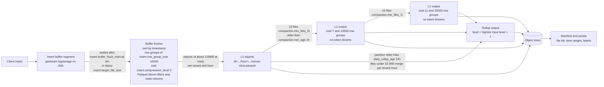
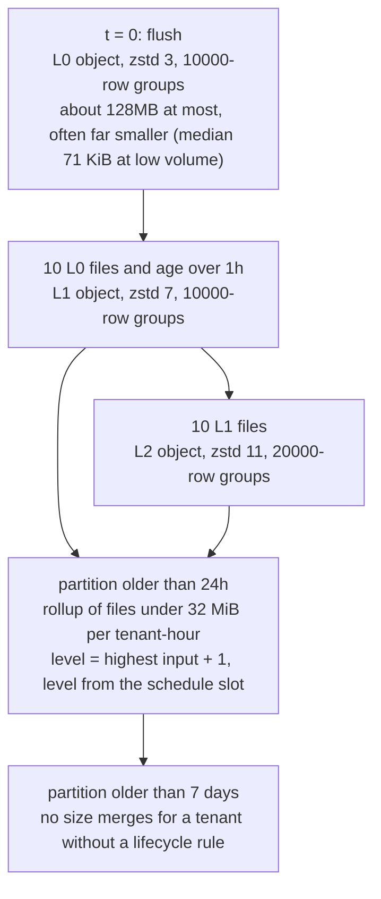
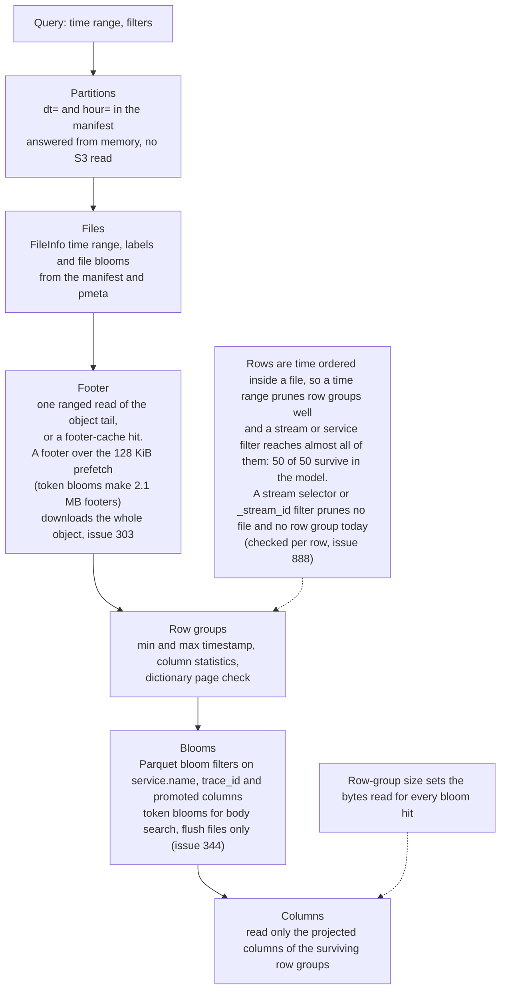
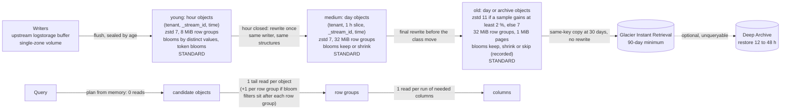
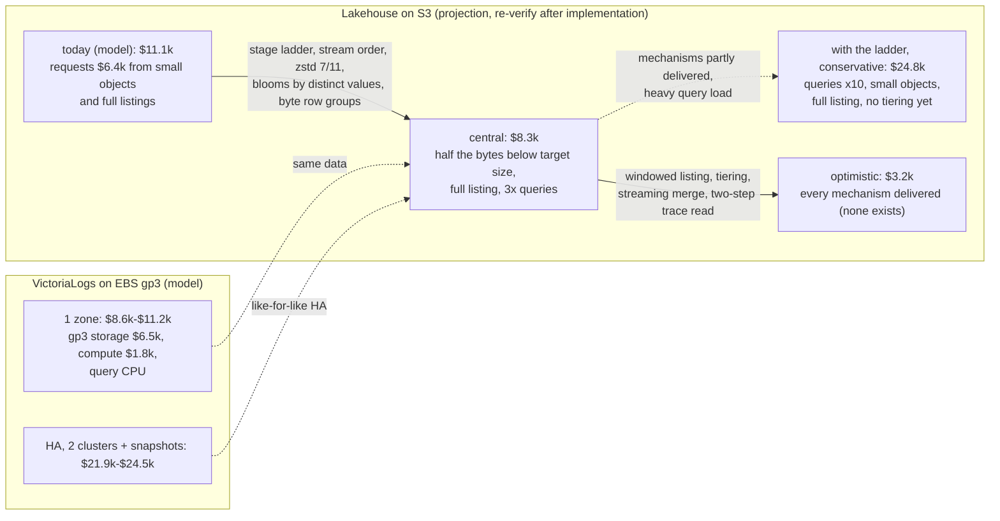

# Storage Efficiency: how Lakehouse writes and compresses data

This page is for operators and contributors. It describes how the Parquet files are written today (defaults, sort order, row groups, encodings, zstd levels, blooms, compaction), what each choice costs in bytes and CPU, how the sizes compare with VictoriaLogs and VictoriaTraces on the same data, what was tried and rejected, and which knobs change what.

Every number is labelled **measured** (m), **sourced** (s, with the file or URL) or **assumed** (a). A table without a label is measured.

Three kinds of content are mixed on this page, and each section says which one it is:

- **Shipped (today):** what the code on `main` writes and does. The write-path section, the comparison with VictoriaLogs and VictoriaTraces, and the tuning guide describe this.
- **Measured variant (not shipped):** what files would look like with a different sort order, level, row-group size or bloom sizing, measured with variant writers. These are measurements, not plans and not defaults.
- **Projection:** a total that assumes work that does not exist yet (the stage ladder, a streaming merge, windowed listing of the object store). The cost section marks these columns.

## How the numbers were measured

| Item | Value |
|---|---|
| Datasets | 5, each 500,000 rows (the real Loghub set is 523,378 rows): a synthetic log generator (`logs-datagen`), a synthetic log generator with stable pods and a Zipf service mix (`logs-pool`), real logs (`logs-loghub`), a synthetic span generator (`traces-datagen`) and a synthetic span generator with fan-out traces and stable instances (`traces-pool`) |
| Real data | 523,378 lines from Loghub (CC-BY-4.0, https://zenodo.org/records/8196385): the first 60,000 lines each of Apache, Hadoop, HealthApp, HPC, Linux, Mac, OpenStack, Proxifier, SSH and Zookeeper. Timestamps are synthetic: each source spans one synthetic day in its own line order |
| Writers | The flush writers (`writeLogsParquet`, `writeTracesParquet`) of this repository, with the real insert field mapping. The compaction writers were used only for the flush-versus-compaction structure comparison |
| Variant writers | The layout-variant, bloom-option and cost sections use variant writers that replicate the shipped flush writers (byte-identical on today's layout) with a different sort, level, row-group, page and bloom setting. Write CPU there is process CPU time including garbage collection, median of 2 runs |
| Libraries | parquet-go v0.32.0, klauspost/compress v1.20.0 (see `go.mod`) |
| Baselines | VictoriaLogs v1.53.0 and VictoriaTraces v0.12.0, built from the upstream tags with default flags except the data path and listen address, force-flushed and force-merged before the bytes were counted |
| Timings | Single-core wall time on a shared host, one run or the median of 2. Treat them as +-15 % noise. They are not comparable with CI runners |
| Prices | AWS us-east-1 on-demand list prices read on 2026-11-03 (cost section only) |
| Row groups | 10,000 rows unless the table says otherwise (the shipped default) |

Dataset sizes as sent (m, one pass over the export):

| Dataset | Rows | Raw size as sent | Streams | Notes |
|---|---|---|---|---|
| `logs-datagen` | 500,000 | 682.3 MB NDJSON | 500,000 | Every row has its own random pod, container and instance, and the pod is a stream field, so every row is its own stream. This is a worst case for VictoriaLogs, whose documentation warns against high-cardinality stream fields, and for any stream ordering |
| `logs-pool` | 500,000 | 639.0 MB NDJSON | 480 | 40 services with a Zipf(1.1) mix, 3 stable pods each, 60 % INFO. Bodies are synthetic templates with random ids |
| `logs-loghub` | 523,378 | 72.7 MB of raw text lines (126.8 MB as NDJSON) | 324 | Real logs. Stream = host.name and service.name |
| `traces-datagen` | 500,000 spans | 1,150.8 MB OTLP/JSON | 50 | Call chains, random instance, pod and container per span, 71,240 traces |
| `traces-pool` | 500,018 spans | 1,198.9 MB OTLP/JSON | 750 | Fan-out trees, 25 Zipf services with 3 stable instances, 17,738 traces (28 spans per trace). OTLP/JSON repeats the resource on every span, so it overstates the raw size against batched OTLP (a). Prefer the uncompressed Parquet baseline for traces |

The sort-order tables in the measurement section use the raw size that the measurement harness counted for each run (696.8, 652.9, 72.7, 1,183.3 and 1,230.4 MB). It is 2 to 3 % above the as-sent size in the table above for four of the five datasets, so the two sets of ratios are not interchangeable. Each table says which denominator it uses.

## Summary

| Finding | Evidence |
|---|---|
| Real logs written by today's flush writer (time order, 10,000-row groups, zstd level 3) are 17.1 MB. VictoriaLogs stores the same 523,378 lines in 9.03 MB, so a freshly flushed Lakehouse file is **1.89x larger** | Comparison with VictoriaLogs and VictoriaTraces |
| On synthetic pooled logs the gap is small (1.07x larger). On traces Lakehouse files are smaller than VictoriaTraces (0.88x and 0.90x) | Same section |
| Sorting the rows by (hour slice, `_stream_id`, time) before writing shrinks real logs by 26 % (17.1 to 12.7 MB) and keeps time pruning. Today's flush sorts by timestamp only. This is a measured variant, not shipped. The stream-order layout gives the **size** reduction as soon as it ships; the **read** reduction for a stream filter needs stream-predicate pruning, which does not exist yet (see the next row) | Sort order |
| The row-group counts on this page for a stream filter under the stream-ordered variants (for example 50 of 50 down to 2) are an **ideal-read-path model** with exact statistics, not a measurement of the code. Today a `_stream` or `_stream_id` predicate prunes no file and no row group: file pruning matches only field predicates of the forms `:="x"`, `:>"x"` and `:<"x"` in the query text, the stream filters are ignored by pruning and by the bloom value walker, and the stream predicate is checked per row after `_stream` is read. Tracked in #888 and the program issue #875 | Sort order, Reading the stream numbers |
| Going from 10,000-row to 100,000-row groups saves 1 to 6 % but makes a needle lookup read about 10x more bytes | Row-group size |
| zstd level 7 instead of 3 saves 5 to 25 % for -7 % to +26 % write CPU (median +8 %), with no measurable change in the writer's peak heap or in decode time. Level 11 instead of 7 saves a further 0.5 to 8 % for +23 % to +250 % write time. Levels 11 to 22 are byte-identical in the pure-Go codec | zstd levels |
| Parquet bloom filters on non-dictionary columns are sized by row count, not by distinct values. On real logs they are 2,571 KiB: about 15 % of today's 17.1 MB flush file, mostly on columns that are empty. Sized by distinct values, in the old-stage variant (not shipped, 7 to 25 row groups), the same filters are 1 KB on the real logs, 815 KB on pooled logs and 1,653 KB on `traces-pool` | Bloom filter sizing |
| Compacted log files carry no body token blooms; flush files do (issue #344, open) | Flush and compaction structure |
| Measured stage-ladder variant (stream order, zstd 7 then 11, blooms sized by distinct values, byte row groups, 1 MiB pages; **not shipped**): real logs 17.1 to 7.3 MB (0.81x VictoriaLogs), pooled logs 49.2 to 36.4 MB (0.80x), `traces-pool` 45.1 to 30.0 MB (0.59x) | Layout variants measured per stage |
| Dropping all blooms from old data would save 5 to 11 % of its bytes (measured) and turn a `trace_id` lookup into a scan of every row group of the object. The default stays keep; these are documented trade-offs, not settings | Bloom options measured |
| Cost: VictoriaLogs/VictoriaTraces on EBS and Lakehouse as it is today are modelled on AWS list prices of 2026-11-03. The Lakehouse stage-ladder figures are a **projection** that assumes mechanisms which do not exist (windowed listing, streaming merge, byte row groups, the stage ladder, a storage-class mover). They are given only as conservative / central / optimistic ranges, labelled to be re-verified after implementation, and are not an outcome. Lakehouse today is not operable at 100 TB/day | Cost |
| Where Lakehouse loses: ingest CPU per TB (about 4.5x VictoriaLogs on real logs, 1.5x on spans), token-bloom selectivity (about 1 % against about 0.1 %), small-object request cost, cold query latency, restore latency | Cost |
| "10x to 16x" depends on the baseline. Today, against JSON as sent: pooled synthetic logs 13x, real logs 7.4x. Against raw text lines the real logs are 4.3x (VictoriaLogs 8.0x). Spans: 27x against OTLP/JSON, 8x against uncompressed Parquet | Compression ratio against different baselines |

## The write path today

The paths below are in the repository; line numbers are left out on purpose because they move.

| Topic | Where | Behaviour on `main` |
|---|---|---|
| Buffer and flush trigger | `internal/storage/parquets3/buffer_flusher.go`, `InsertConfig` in `internal/config/config.go` | The insert buffer is a sequence of upstream `logstorage` segments. A segment is sealed `insert.buffer_flush_interval` (default `5m`) after its first row, or earlier once it holds about `insert.target_file_size` of rows. The flusher drains a sealed segment completely to Parquet |
| Object size | `insert.target_file_size` (default `128MB`) | The flusher cuts a segment into objects of about this size, per tenant, never across an hour partition. The row-count estimate behind the cut is approximate, and low-volume deployments write much smaller files: the median object observed at low volume is about 71 KiB (s, [cost estimates](cost-estimates.md) and issue #281) |
| Partition and key | [Storage flow](storage-flow.md) | `{prefix}dt=YYYY-MM-DD/hour=HH/{nonce}-{slice}.parquet` |
| Flush sort | `buffer_flusher.go` | `sort.SliceStable` by `TimestampUnixNano` only, in both modules (`lakehouse-traces/internal/storage/parquets3/buffer_flusher.go` is the twin) |
| Compaction sort | `internal/compaction/compactor.go` (`mergeLogFiles`, `mergeTraceFiles`) | Logs: (timestamp, service). Traces: (timestamp, service, trace_id). Nanosecond ties are rare, so this is effectively a time sort: the measured size of "time" and "time, service" is the same within 0.1 % |
| Declared sort order | whole repository | No `SortingWriterConfig` and no `sorting_columns` in any file (m: 0 in every measured file) |
| Row groups | `insert.row_group_size` (default `10000`); `compaction.row_group_size_by_output_level` (default `[10000, 10000, 20000]`) | parquet-go cuts row groups by row count, not bytes. At 10,000 rows the measured row groups are 0.23 to 2.6 MiB (file size divided by the number of row groups; the top of the range is the stream-per-row `logs-datagen`) |
| zstd | `insert.compression_level` (default `3`); `compaction.compression_level_by_output_level` (default `[3, 7, 11]`); `zstdLevel` in `internal/storage/parquets3/writer.go` and its twin in `internal/compaction/compactor.go` | The codec is klauspost/compress through parquet-go. Four encoders only: level 1 is `SpeedFastest`, 2 to 5 `SpeedDefault`, 6 to 10 `SpeedBetterCompression`, 11 and above `SpeedBestCompression`. Config validation accepts 1 to 22 |
| Pages | parquet-go default | 256 KiB page buffer, one zstd frame per page. The compression window is a page, not a row group or a file |
| Encodings | `internal/schema/row.go` | `dict` on categorical columns (service, severity, namespace, `_stream`, `_stream_id`, and others), `delta` on `timestamp_unix_nano`. Columns without a tag (`body`, `trace_id`, `span_id`, `container.id`, `service.instance.id`, `http.url`, `db.statement`, attribute map keys and values) use parquet-go's string default, DELTA_LENGTH_BYTE_ARRAY |
| Promoted columns | `internal/schema/dedicated.go`, `internal/schema/row.go`, `<signal>.promoted_attributes` | Tier-1 dedicated columns (OTel semantic-convention attributes such as `container.id`, `service.instance.id`, `k8s.pod.name`, `server.address`) are first-class Parquet columns. Tier-2 slots `ded_s01` to `ded_s08` hold operator-chosen attributes from `<signal>.promoted_attributes` (each `{name, bloom}`); the slot-to-name binding is written to the footer key-value metadata so a file is self-describing. Compaction re-promotes older rows (`RepromoteLogRow` for logs, the injected trace re-promote for traces) so old files gain the dedicated columns. Encoding follows cardinality: high-cardinality id columns are plain strings with a bloom, high-byte low-cardinality columns use a dictionary |
| Dictionary cap | not set | parquet-go's `DictionaryMaxBytes` is 0, which means unlimited. The dictionary is per column chunk |
| Parquet bloom filters | `bloomFilters` in `writer.go` and `compactor.go`; column set from `LogBloomColumns` and `TraceBloomColumns` in `internal/schema/dedicated.go` | `SplitBlockFilter(10, column)`, about 10 bits per value (about 1 % false-positive rate). The set is `service.name`, `trace_id`, the strict per-signal set from the schema registry (for example `k8s.pod.name`, `span_id`), and any promoted attribute declared with `bloom: true` |
| Token blooms | `internal/storage/parquets3/token_bloom.go`, written by `writeLogsParquet` | One footer key-value entry `_bloom_body_rg_N` per row group over the body tokens, flush files only. The compaction writer does not write it (issue #344) |
| Compaction triggers | `internal/compaction/planner.go`, `CompactionConfig` | `min_files_l0` (10): L0 to L1. `min_files_l1` (10): L1 to L2. `min_age` (1h) keeps young files out. `daily_rollup_age` (24h): every file under 32 MiB (`manifest.MatureObjectBytes`) of a tenant-hour merges into one. `size_merge_max_age` (168h, that is 7 days) stops size merges when the tenant has no lifecycle rule. The scan runs every `compaction.interval` (5m) |
| Compaction output | `compactor.go` | One output object per tenant group, with no target size and no split. The output level is one above the highest input level, and levels are not capped. The compactor holds all inputs, the merged rows and the output buffer in memory at once |

### Diagram: the write path

This diagram shows existing behaviour. Nothing here is new.



### Diagram: the size and level ladder by age

The ladder below is what the defaults do. The only size target is the flush's `insert.target_file_size`; compaction has no output size target.



Two properties of this ladder matter for the numbers below.

- The level follows the **output level**, which is not bounded. A rollup output of level 2 or more gets zstd 11, and may be rewritten again by a later rollup or size merge, so the most expensive level can be spent on data that is merged again.
- Compaction cannot reach a size above what its inputs add up to, and it has no size target. Object counts therefore depend on the flush size, which is small at low volume (issue #281).

### Diagram: how a query narrows the data

This is the read path described in [Read path](read-path.md), reduced to the structure that the write choices feed. The notes in the boxes say what the writer contributes and where today's layout limits pruning.



## Measured effects

### Flush and compaction structure

Same 100,000 rows of `logs-pool` and 100,000 spans, 10,000-row groups, zstd 3. The compaction writers (`compaction.WriteLogs`, `compaction.WriteTraces`) were run on the same rows.

| Writer | Size (bytes) | Footer key-value entries | Parquet bloom columns | Bloom bytes | Token-bloom bytes |
|---|---|---|---|---|---|
| flush, logs | 9,788,061 | `_bloom_body_rg_0..9`, `lh.trace_id_hex` | 10 | 505,600 | 188,804 |
| compaction, logs | 9,599,027 | `lh.trace_id_hex` only | 10 | 505,600 | **0** |
| flush, traces | 9,014,566 | `_trace_idx`, `lh.trace_id_hex` | 14 | 881,958 | 0 (spans have no body) |
| compaction, traces | 9,014,566 | same | 14 | 881,958 | 0 |

Traces are aligned. Logs compaction drops the body token blooms, so every log compaction reduces body-search prunability. This is tracked in issue #344.

### Sort order

The flush writer, 10,000-row groups, zstd level 3, one file per dataset. Sort orders:

- **S0 time**: what flush does today.
- **S1 time, service**: what compaction does today (traces: time, service, trace_id).
- **S2 service, level, time**: service-first.
- **S4 `_stream_id`, time**: stream order. `_stream_id` starts with the tenant.
- **S4b hour slice, `_stream_id`, time**: stream order inside one-hour slices.

Survivor columns show **surviving row groups as exact / min-max-only** out of the total. "Exact" is the model of an ideal bloom or exact statistics. "Min-max-only" uses only the footer min and max. A real bloom with 1 % false positives adds about 1 % extra surviving row groups (a). Queries: 15 minutes of time; one service (the 4th most frequent); one stream (the 21st most frequent); that service plus one hour; one body token present in about 0.1 % of rows (logs) or one span name (traces); one trace id. The raw denominator is the harness raw size named in each heading.

#### Reading the stream numbers

The survivor counts are a model of what a read path with exact statistics would keep, computed from the row groups of the variant files. They are not counts of what the shipped code reads, and the **Stream** columns (and the stream rows of the later tables) cannot be reached by today's read path at all:

- **What prunes today.** File pruning builds its checks from the query text and matches only field predicates of the forms `field:="x"` (and the prefix form), `field:>"x"` and `field:<"x"` on columns the schema registry promotes (`buildPushDownFilter`, `internal/storage/parquets3/filter_pushdown.go`, and the mirror in `lakehouse-traces`). The same checks, plus the Parquet bloom checks built by `buildBloomChecksFor`, narrow row groups inside a file (`queryFile`, `storage_query.go`). A service filter written as a field predicate (`service.name:="x"`) is therefore narrowed per file by the manifest label index, the column statistics and the pmeta file bloom, and per row group by the row-group statistics and the dictionary check (the Parquet bloom of a row group is probed only when the file is read whole, `bloomResident`, issue #421). What the data allows still applies: in a time-ordered file almost every row group holds every service, so very few row groups drop out.
- **What does not prune.** A stream selector (printed by the query parser as a `{name="value"}` selector) is a `filterStream` node and `_stream_id:<hex>` is a `filterStreamID` node. Neither has the `:="` form, so file pruning does not see them, and the bloom value walker (`FilterExtractFieldValues`, `filter_ast.go`) ignores both node types. `FilterReferencedFields` lists `_stream` and `_stream_id` only to add the columns to the projection. The only effect of a stream predicate is the per-row check after `_stream` has been read. Time (day and hour partitions, row-group timestamps) and the tenant are the only things that narrow such a query. The parser accepts no other spelling that would reach the column as a field predicate: `_stream:="..."` and `_stream_id:="..."` are parse errors, and `_stream_id:in(...)` is printed back as `_stream_id:<hex>`.
- **What follows.** The stream-ordered layout (S4, S4b) gives its **size** reduction today, once it is shipped. Its **read** reduction for stream filters appears only after stream-predicate pruning exists, using row-group statistics and a per-object stream summary rebuildable from the footers. That work is tracked in #888 and in the program issue #875. Until then the Stream columns show what pruning could reach, and the Service, body-token and `trace_id` columns are the ones reachable by predicates that exist.
- **Both signals.** The files and the walkers are mirrored in `lakehouse-traces`; `buildPushDownFilter` and the bloom value walker behave the same on both modules: the field form builds a check, the stream-selector form and the `_stream_id` form build none.

#### Real logs: `logs-loghub` (523,378 rows, 324 streams, raw 72.7 MB of text lines, 53 row groups at 10,000 rows)

| Sort | File MB | Bytes per row | x raw text | Body MB | 15 min | Service | Stream | Service + 1h | Body token |
|---|---|---|---|---|---|---|---|---|---|
| S0 time | 17.1 | 33 | 4.26 | 9.8 | 1 / 1 | 53 / 53 | 52 / 52 | 3 / 3 | 3 / 3 |
| S1 time, service | 17.1 | 33 | 4.26 | 9.8 | 1 / 1 | 53 / 53 | 52 / 52 | 3 / 3 | 3 / 3 |
| S2 service-first | 12.1 | 23 | 6.02 | 6.3 | 17 / 24 | 7 / 7 | 6 / 14 | 3 / 4 | 1 / 1 |
| S4 stream | 12.2 | 23 | 5.96 | 6.4 | 15 / 27 | 12 / 18 | 1 / 1 | 4 / 18 | 2 / 2 |
| S4b hour slice, stream | 12.7 | 24 | 5.71 | 6.7 | 3 / 3 | 51 / 53 | 24 / 27 | 3 / 3 | 1 / 1 |

#### Pooled logs: `logs-pool` (500,000 rows, 480 streams, harness raw 652.9 MB, 50 row groups)

| Sort | File MB | Bytes per row | x raw | Body MB | 15 min | Service | Stream | Service + 1h | Body token | trace_id |
|---|---|---|---|---|---|---|---|---|---|---|
| S0 time | 49.2 | 98 | 13.28 | 23.0 | 1 / 1 | 50 / 50 | 50 / 50 | 3 / 3 | 50 / 50 | 1 / 1 |
| S1 time, service | 49.2 | 98 | 13.28 | 23.0 | 1 / 1 | 50 / 50 | 50 / 50 | 3 / 3 | 50 / 50 | 1 / 1 |
| S2 service-first | 42.1 | 84 | 15.52 | 21.6 | 37 / 41 | 4 / 4 | 2 / 49 | 4 / 4 | 50 / 50 | 1 / 1 |
| S4 stream | 40.6 | 81 | 16.09 | 22.0 | 47 / 48 | 13 / 44 | 2 / 2 | 11 / 44 | 50 / 50 | 1 / 1 |
| S4b hour slice, stream | 42.7 | 85 | 15.30 | 22.5 | 3 / 3 | 50 / 50 | 26 / 39 | 3 / 3 | 50 / 50 | 1 / 1 |

The S4b figure of 26 row groups for one stream is for a file that spans a whole synthetic day (24 hour slices). A flushed or hour-compacted object holds one hour, where the slice is the object (a).

#### Stream-per-row logs: `logs-datagen` (500,000 rows, 500,000 streams, harness raw 696.8 MB, 50 row groups)

| Sort | File MB | Bytes per row | x raw | Body MB | 15 min | Service | Stream | Service + 1h | Body token | trace_id |
|---|---|---|---|---|---|---|---|---|---|---|
| S0 time | 134.1 | 268 | 5.20 | 33.1 | 1 / 1 | 50 / 50 | 1 / 17 | 3 / 3 | 50 / 50 | 1 / 1 |
| S1 time, service | 134.1 | 268 | 5.19 | 33.1 | 1 / 1 | 50 / 50 | 1 / 17 | 3 / 3 | 50 / 50 | 1 / 1 |
| S2 service-first | 128.3 | 257 | 5.43 | 31.8 | 20 / 39 | 11 / 11 | 1 / 17 | 4 / 9 | 50 / 50 | 1 / 1 |
| S4 stream | 136.6 | 273 | 5.10 | 34.5 | 50 / 50 | 50 / 50 | 1 / 1 | 50 / 50 | 50 / 50 | 1 / 1 |
| S4b hour slice, stream | 136.1 | 272 | 5.12 | 33.9 | 3 / 3 | 50 / 50 | 1 / 14 | 3 / 3 | 50 / 50 | 1 / 1 |

Every row is its own stream here, so no stream order can cluster anything: S4 is 1.9 % larger than S0. This dataset cannot test stream clustering.

#### Spans: `traces-pool` (500,018 spans, 750 streams, harness raw 1,230.4 MB, 51 row groups)

Stream = (service.name, span name). The trace_id lookup also reads the span-tree columns.

| Sort | File MB | Bytes per row | x raw | 15 min | Service | Stream | Service + 1h | Span name | trace_id |
|---|---|---|---|---|---|---|---|---|---|
| S0 time | 45.1 | 90 | 27.26 | 1 / 1 | 50 / 51 | 50 / 51 | 3 / 3 | 51 / 51 | 2 / 2 |
| S1 time, service, trace_id | 45.0 | 90 | 27.31 | 1 / 1 | 50 / 51 | 50 / 51 | 3 / 3 | 51 / 51 | 2 / 2 |
| S2 service-first | 42.8 | 86 | 28.72 | 51 / 51 | 4 / 4 | 1 / 45 | 4 / 4 | 16 / 21 | 23 / 23 |
| S4 stream | 44.6 | 89 | 27.57 | 50 / 50 | 24 / 48 | 2 / 2 | 22 / 48 | 17 / 25 | 25 / 25 |
| S4b hour slice, stream | 42.1 | 84 | 29.21 | 3 / 3 | 50 / 50 | 24 / 46 | 3 / 3 | 50 / 50 | 3 / 3 |

#### Spans: `traces-datagen` (500,000 spans, 50 streams, harness raw 1,183.3 MB, 50 row groups)

| Sort | File MB | Bytes per row | x raw | 15 min | Service | Stream | Service + 1h | Span name | trace_id |
|---|---|---|---|---|---|---|---|---|---|
| S0 time | 82.2 | 164 | 14.39 | 1 / 1 | 50 / 50 | 50 / 50 | 3 / 3 | 50 / 50 | 2 / 2 |
| S1 time, service, trace_id | 82.2 | 164 | 14.39 | 1 / 1 | 50 / 50 | 50 / 50 | 3 / 3 | 50 / 50 | 2 / 2 |
| S2 service-first | 83.8 | 168 | 14.13 | 50 / 50 | 11 / 11 | 2 / 22 | 10 / 11 | 10 / 14 | 4 / 4 |
| S4 stream | 83.8 | 168 | 14.11 | 50 / 50 | 16 / 35 | 2 / 2 | 10 / 35 | 9 / 26 | 4 / 4 |
| S4b hour slice, stream | 80.9 | 162 | 14.63 | 3 / 3 | 50 / 50 | 24 / 41 | 2 / 3 | 50 / 50 | 2 / 2 |

What the tables show:

- **Real logs:** stream order (S4) is 29 % smaller than time order (S0): the body column goes from 9.8 to 6.4 MB. Service-first (S2) compresses the same (12.1 MB). Pure stream order loses time pruning (15 of 53 row groups for 15 minutes). The hour slice (S4b) restores it (3 row groups) for +4 % size over S4.
- **Pooled logs:** S4 is -17 % and S4b -13 %. In the model a stream filter goes from 50 of 50 row groups (S0) to 2 (S4); this is the ideal read path, and today the stream filter reaches 50 of 50 whatever the sort (see Reading the stream numbers).
- **Spans:** S4b is -7 % on `traces-pool`. Service-first is -5 % but scatters one trace over 23 row groups and loses time pruning. Trace-first order (S5 in the measurement, not in the tables) keeps a trace in 1 row group at +3 % size, but loses time and stream pruning.
- **S1 equals S0** to within 0.1 % on every dataset: today's compaction sort is a time sort.
- **Today's layout has no stream or service clustering, and a stream predicate prunes nothing.** A service filter written as a field predicate on a time-ordered file reaches almost every row group (50 of 50, 52 of 53): the manifest label index, the column statistics and the pmeta file bloom can drop whole files, and the row-group statistics and dictionary check drop a row group that lacks the value (the row-group Parquet bloom only when the file is read whole, issue #421). A stream selector or `_stream_id` filter is not pruned at all today, by file or by row group, and is checked per row; see Reading the stream numbers and #888.

### Row-group size

Real flush writer, zstd 3, one file per dataset. Footer KiB includes the token-bloom entries. The "needle" column is a body token (logs-loghub) or a trace id (the other two); each cell is surviving row groups and the compressed MB read from them.

| Dataset | Sort | Rows per group | MiB per group | File MB | vs 10k | Footer KiB | Bloom KiB | 15 min | Stream | Needle |
|---|---|---|---|---|---|---|---|---|---|---|
| logs-loghub | S0 | 2,000 | 0.07 | 20.3 | +19.0 % | 2252 | 2648 | 4 (0.20) | 258 (12.65) | 11 (0.53) |
| logs-loghub | S0 | 10,000 | 0.31 | 17.1 | 0 | 943 | 2571 | 1 (0.23) | 52 (12.04) | 3 (0.69) |
| logs-loghub | S0 | 100,000 | 2.61 | 16.4 | -3.8 % | 515 | 2557 | 1 (2.21) | 6 (12.08) | 1 (2.25) |
| logs-loghub | S0 | 1 group | 15.46 | 16.2 | -5.0 % | 363 | 2556 | 1 (11.66) | 1 (12.06) | 1 (11.66) |
| logs-loghub | S4b | 2,000 | 0.06 | 15.5 | +21.4 % | 2039 | 2648 | 11 (0.39) | 25 (1.18) | 2 (0.07) |
| logs-loghub | S4b | 10,000 | 0.23 | 12.7 | 0 | 919 | 2571 | 3 (0.54) | 24 (4.24) | 1 (0.18) |
| logs-loghub | S4b | 100,000 | 1.91 | 12.0 | -5.6 % | 514 | 2557 | 1 (1.67) | 6 (8.75) | 1 (1.69) |
| logs-loghub | S4b | 1 group | 11.24 | 11.8 | -7.4 % | 363 | 2556 | 1 (8.68) | 1 (8.69) | 1 (8.68) |
| logs-pool | S0 | 2,000 | 0.22 | 56.7 | +15.4 % | 2911 | 2592 | 3 (0.30) | 250 (27.49) | 1 (0.11) |
| logs-pool | S0 | 10,000 | 0.94 | 49.2 | 0 | 1386 | 2468 | 1 (0.50) | 50 (25.85) | 1 (0.55) |
| logs-pool | S0 | 100,000 | 9.17 | 48.1 | -2.2 % | 868 | 2444 | 1 (4.95) | 5 (25.30) | 1 (5.63) |
| logs-pool | S0 | 1 group | 45.70 | 47.9 | -2.5 % | 769 | 2442 | 1 (24.75) | 1 (25.32) | 1 (28.03) |
| logs-pool | S4b | 2,000 | 0.18 | 47.4 | +11.0 % | 2909 | 2567 | 11 (1.12) | 26 (2.68) | 1 (0.11) |
| logs-pool | S4b | 10,000 | 0.81 | 42.7 | 0 | 1385 | 2468 | 3 (1.50) | 26 (13.15) | 1 (0.55) |
| logs-pool | S4b | 100,000 | 8.04 | 42.2 | -1.2 % | 867 | 2444 | 1 (5.00) | 5 (25.06) | 1 (5.69) |
| logs-pool | S4b | 1 group | 40.06 | 42.0 | -1.5 % | 769 | 2442 | 1 (24.94) | 1 (25.01) | 1 (28.36) |
| traces-pool | S0 | 2,000 | 0.20 | 52.0 | +15.1 % | 2645 | 4452 | 3 (0.13) | 250 (13.03) | 2 (0.22) |
| traces-pool | S0 | 10,000 | 0.84 | 45.1 | 0 | 1265 | 4303 | 1 (0.20) | 50 (11.28) | 2 (1.09) |
| traces-pool | S0 | 100,000 | 6.85 | 43.1 | -4.6 % | 945 | 4276 | 1 (1.88) | 5 (10.39) | 1 (5.30) |
| traces-pool | S0 | 1 group | 41.05 | 43.0 | -4.6 % | 910 | 4273 | 1 (9.84) | 1 (10.48) | 1 (26.94) |
| traces-pool | S4b | 2,000 | 0.18 | 47.9 | +13.8 % | 2645 | 4451 | 11 (0.67) | 27 (1.71) | 11 (1.30) |
| traces-pool | S4b | 10,000 | 0.79 | 42.1 | 0 | 1265 | 4303 | 3 (0.82) | 24 (6.72) | 3 (1.66) |
| traces-pool | S4b | 100,000 | 6.38 | 40.1 | -4.8 % | 945 | 4276 | 1 (2.53) | 5 (13.26) | 1 (5.32) |
| traces-pool | S4b | 1 group | 38.07 | 39.9 | -5.2 % | 910 | 4273 | 1 (13.11) | 1 (13.22) | 1 (26.99) |

- Going from 10,000 to 100,000 rows saves 1 to 6 % of the file. Going to one group of 500,000 rows saves 1.5 to 7 % in total. Most of the gain is in by 100,000 rows, and 2,000-row groups cost 11 to 21 %.
- The bytes read for a needle grow with the rows per group, because a bloom hit reads the needed columns of the whole row group. A trace-id lookup on `logs-pool` reads 0.55 MB at 10,000 rows, 5.6 MB at 100,000 and 28 MB with one group.
- The footer shrinks by 25 to 45 % from 10,000 to 100,000 rows, because the token-bloom entries and statistics are per row group.
- Unit conversion: 10,000 rows is 0.23 to 2.6 MiB on these datasets (file size divided by the number of row groups). A byte-based row-group target is not implemented; the writer cuts by rows only.

### zstd levels

#### The codec in this repository, inside the real flush writer

File MB and write time in seconds (median of 2 runs, single core). L1, L3, L7, L11 are the configured levels. Levels 12 to 22 were not tabulated because they are byte-identical to 11: files written at levels 11, 15 and 19 were the same 102,850,038 bytes on `logs-datagen` S0 with 10,000-row groups (m, 3 runs each, 13.6 to 15.9 s).

| Dataset | Sort | Rows per group | L1 MB | L3 MB | L7 MB | L11 MB | L7 vs L3 | L11 vs L7 | Write s L1 / L3 / L7 / L11 |
|---|---|---|---|---|---|---|---|---|---|
| logs-datagen | S0 | 10,000 | 138.1 | 134.1 | 103.4 | 102.9 | -22.9 % | -0.5 % | 4.5 / 4.5 / 5.4 / 14.6 |
| logs-datagen | S0 | 100,000 | 137.5 | 133.4 | 102.9 | 102.1 | -22.9 % | -0.8 % | 5.1 / 5.6 / 5.7 / 17.3 |
| logs-datagen | S4b | 10,000 | 139.7 | 136.1 | 105.1 | 104.2 | -22.8 % | -0.8 % | 5.0 / 4.9 / 5.4 / 15.4 |
| logs-datagen | S4b | 100,000 | 139.1 | 135.8 | 104.7 | 103.9 | -22.9 % | -0.8 % | 5.7 / 5.9 / 6.9 / 17.8 |
| logs-pool | S0 | 10,000 | 51.1 | 49.2 | 46.0 | 45.4 | -6.3 % | -1.4 % | 3.5 / 3.1 / 3.9 / 6.4 |
| logs-pool | S0 | 100,000 | 50.5 | 48.1 | 44.1 | 43.4 | -8.2 % | -1.6 % | 2.9 / 3.3 / 3.3 / 6.2 |
| logs-pool | S4b | 10,000 | 44.5 | 42.7 | 40.7 | 40.3 | -4.5 % | -1.0 % | 3.3 / 3.1 / 3.4 / 5.3 |
| logs-pool | S4b | 100,000 | 44.3 | 42.2 | 39.2 | 38.8 | -7.0 % | -1.1 % | 2.7 / 2.6 / 2.7 / 4.9 |
| logs-loghub | S0 | 10,000 | 18.2 | 17.1 | 16.0 | 15.5 | -6.0 % | -3.5 % | 1.2 / 1.4 / 1.3 / 1.9 |
| logs-loghub | S0 | 100,000 | 17.8 | 16.4 | 15.4 | 14.7 | -6.4 % | -4.0 % | 1.2 / 1.3 / 1.3 / 1.9 |
| logs-loghub | S4b | 10,000 | 12.8 | 12.7 | 12.2 | 11.4 | -4.0 % | -6.5 % | 1.1 / 1.1 / 1.3 / 1.6 |
| logs-loghub | S4b | 100,000 | 12.1 | 12.0 | 11.5 | 10.6 | -4.4 % | -8.0 % | 1.1 / 1.1 / 1.1 / 1.8 |
| traces-datagen | S0 | 10,000 | 85.8 | 82.2 | 62.0 | 61.2 | -24.6 % | -1.2 % | 1.6 / 1.7 / 1.9 / 6.5 |
| traces-datagen | S0 | 100,000 | 85.2 | 81.0 | 61.0 | 60.2 | -24.7 % | -1.3 % | 1.6 / 1.7 / 2.0 / 6.3 |
| traces-datagen | S4b | 10,000 | 85.6 | 80.9 | 61.6 | 61.1 | -23.9 % | -0.8 % | 1.9 / 1.9 / 2.1 / 7.0 |
| traces-datagen | S4b | 100,000 | 84.3 | 80.5 | 60.4 | 59.6 | -24.9 % | -1.3 % | 1.8 / 2.0 / 2.2 / 7.7 |
| traces-pool | S0 | 10,000 | 46.6 | 45.1 | 39.4 | 38.0 | -12.8 % | -3.4 % | 1.6 / 1.7 / 1.9 / 3.9 |
| traces-pool | S0 | 100,000 | 44.8 | 43.1 | 37.6 | 36.3 | -12.7 % | -3.5 % | 1.6 / 1.7 / 1.8 / 3.9 |
| traces-pool | S4b | 10,000 | 44.9 | 42.1 | 37.0 | 36.1 | -12.1 % | -2.6 % | 1.7 / 1.8 / 2.0 / 4.1 |
| traces-pool | S4b | 100,000 | 43.5 | 40.1 | 35.3 | 34.3 | -12.0 % | -2.9 % | 1.7 / 2.0 / 2.0 / 4.2 |

Reading the table:

- **Level 7 against level 3 (wall time, flush-writer runs):** 4 to 25 % smaller. Write time ranged from -7 % to +26 % across these 20 single-core, 2-run-median rows (median about +10 %), which is the size of the +-15 % noise, so treat it as "roughly 0 to 25 % more writer time".
- **Level 11 against level 7:** 0.5 to 8 % smaller for +23 % to +250 % write time (median about +110 %; +36 % to +285 % against level 3). The gain is largest on sorted real text (up to 8 %) and smallest on identifiers.
- **Level 1 and level 3 write at the same speed** inside the parquet-go writer, so the writer, not the codec, dominates CPU at those levels.
- **Decoding does not depend on the level.** With reference libzstd, text decompresses at 1.5 to 3.5 GB/s at every level (m, table below). For this repository's reader, the read benchmark in [ZSTD Compression Benchmark](zstd-compression-benchmark.md) varies by 1.3x across levels (s). Higher levels cost write CPU, not read latency.
- The 12 to 22 range of the config accepts a value but buys nothing: levels 11 and above all select the same encoder.

#### Why level 3 leaves hex identifiers almost uncompressed

klauspost's `SpeedDefault` (levels 2 to 5) barely compresses hex strings, while `SpeedBetterCompression` (6 to 10) halves them. Compression ratio of the same column bytes, 256 KiB frames (m):

| Column | Level 1 | Level 3 | Level 7 | Level 11 |
|---|---|---|---|---|
| traces-pool `span_id` | 1.000 | 1.116 | 1.968 | 1.957 |
| logs-loghub S4b `body` | 11.11 | 10.93 | 11.78 | 12.76 |
| logs-pool S0 `body` | 6.09 | 6.10 | 6.63 | 6.78 |
| traces-pool S4b `span.attributes` | 14.20 | 14.39 | 15.58 | 16.84 |

This is why level 7 saves 23 to 25 % on the two synthetic generators whose rows are mostly random hex identifiers, and only 4 to 8 % on text.

#### What level 7 costs against level 3

Both levels were written by the same writer on the same rows, on today's layout and on the medium variant (m). Write CPU is process CPU time including the garbage collector, one writer goroutine, median of 2 runs. Peak heap is the sampled live heap (not RSS). Treat +-15 % as noise.

| Dataset | Layout | File MB, L3 to L7 | Write CPU s, L3 to L7 | Peak heap MB, L3 to L7 | Decode all rows | Decode 3 largest columns |
|---|---|---|---|---|---|---|
| logs-loghub | today | 17.1 to 16.0 (-6.0 %) | 1.26 to 1.30 (+3 %) | 576 to 811 | -2 % | -5 % |
| logs-loghub | medium variant | 9.4 to 8.9 (-5.3 %) | 1.26 to 1.27 (+1 %) | 809 to 731 | 0 % | +3 % |
| logs-pool | today | 49.2 to 46.0 (-6.3 %) | 2.88 to 3.14 (+9 %) | 1,203 to 1,215 | +19 % | +22 % |
| logs-pool | medium variant | 40.7 to 38.0 (-6.6 %) | 3.05 to 3.14 (+3 %) | 1,213 to 1,203 | -6 % | -6 % |
| logs-datagen | today | 134.1 to 103.4 (-22.9 %) | 5.94 to 7.49 (+26 %) | 703 to 594 | -1 % | +7 % |
| logs-datagen | medium variant | 127.8 to 111.8 (-12.5 %) | 10.76 to 11.90 (+11 %) | 632 to 540 | -9 % | -2 % |
| traces-pool | today | 45.1 to 39.4 (-12.8 %) | 1.78 to 1.88 (+6 %) | 207 to 253 | +4 % | +13 % |
| traces-pool | medium variant | 37.1 to 32.4 (-12.7 %) | 1.74 to 1.92 (+10 %) | 256 to 201 | +2 % | +10 % |
| traces-datagen | today | 82.2 to 62.0 (-24.6 %) | 1.69 to 1.88 (+11 %) | 346 to 251 | +1 % | +4 % |
| traces-datagen | medium variant | 70.2 to 64.7 (-7.8 %) | 2.17 to 2.51 (+16 %) | 549 to 427 | -2 % | +9 % |

- **Size:** 5 to 25 % smaller (the medium variant gains 5 to 13 %, today's layout 6 to 25 %).
- **Write CPU:** -7 % to +26 % over 15 cells (the 10 above plus the 5 young-variant cells), median about +8 %, at most 1.5 s more per 500,000 rows. The same cell varies by about +-15 % from run to run.
- **Memory:** no measurable change in the writer's peak live heap. The sampled peak moves both ways by up to 40 %, which is garbage-collection timing, not the codec. The heap is not RSS and was not measured as RSS.
- **Reading:** no change. Full-row and column decode times move between -21 % and +22 % with no direction.
- Level 1 is not faster than level 3 inside the writer (1.29 against 1.26 s on `logs-loghub`, 2.82 against 2.88 s on `logs-pool`).

#### Choosing level 11 from a sample (measured variant, not shipped)

A level-11 rewrite costs 27 to 171 % more CPU than level 7 (old variant, table below) and gains 0.7 to 12.6 % of bytes depending on the data. The variant chooses per file: compress a 20,000-row sample at 7 and at 11 and use 11 only when the sample gains at least 2 %. Old variant (m):

| Dataset | Sample gain of 11 over 7 (20,000 rows) | Whole-file gain | Level chosen at 2 % | Write CPU at 11 / at 7 (s) | Sample CPU (s) |
|---|---|---|---|---|---|
| logs-loghub | 11.1 % | 12.6 % | 11 | 1.75 / 1.38 | 0.06 |
| logs-pool | 1.0 % | 1.0 % | 7 | 5.55 / 3.18 | 0.20 |
| logs-datagen | 0.8 % | 0.7 % | 7 | 23.02 / 11.60 | 0.60 |
| traces-pool | 4.2 % | 3.8 % | 11 | 4.11 / 1.89 | 0.21 |
| traces-datagen | 1.7 % | 1.6 % | 7 | 6.67 / 2.46 | 0.33 |

These gains differ from the 0.5 to 8 % of the level table above because the layout differs (stream order, byte row groups, 1 MiB pages). The sample picks 11 on the real logs and on `traces-pool`, and 7 on the other three. The 4 % sample predicts the full-file gain to within 1.5 points on every dataset. It costs 4 to 13 % of a level-7 write (0.06 to 0.6 s per 500,000 rows). Against always using level 11, the dynamic choice saves 40 to 60 % of the old-stage write CPU on the three datasets where 11 does not pay, and gives up 0.7 to 1.6 % of bytes there.

#### Reference libzstd, for the ceiling

libzstd 1.5.7 `zstd -b` on 256 KiB frames (one frame per Parquet page) over the uncompressed column-chunk bytes of the first 32 MiB of each column (m). Ratio per level and throughput in MB/s. This is a tool measurement, not something the binaries ship: the binaries are static builds with `CGO_ENABLED=0` (see `Dockerfile.logs`, `Dockerfile.traces`), and the pure-Go codec has no level above 11.

| Column | L1 | L3 | L7 | L11 | L15 | L19 | Compress MB/s L3 / L7 / L11 / L19 | Decompress MB/s L1 / L3 / L11 / L19 |
|---|---|---|---|---|---|---|---|---|
| logs-loghub S4b body | 11.35 | 10.86 | 12.36 | 12.85 | 13.90 | 14.39 | 1327 / 297 / 84 / 3.0 | 3053 / 2964 / 3530 / 3395 |
| logs-pool S4b body | 6.30 | 5.95 | 6.66 | 6.93 | 7.55 | 7.58 | 839 / 212 / 67 / 4.5 | 2604 / 2299 / 3038 / 2866 |
| traces-pool S4b `span_attributes` | 14.55 | 14.19 | 16.18 | 16.93 | 22.71 | 23.34 | 1305 / 332 / 73 / 6.3 | 3647 / 2822 / 3950 / 3849 |
| logs-pool S0 `trace_id` | 1.98 | 1.80 | 1.85 | 1.85 | 1.93 | 1.89 | 173 / 76 / 29 / 9.4 | 1878 / 714 / 700 / 504 |
| traces-pool S0 `span_id` | 1.97 | 1.76 | 1.80 | 1.81 | 1.98 | 1.98 | 125 / 80 / 28 / 10.0 | 1769 / 524 / 644 / 2089 |

Reference level 19 beats level 11 by 5 to 12 % on text, at 3 to 6 MB/s of compression (about 28x slower than level 11 in this measurement). Reference level 3 is sometimes worse than level 1 on these frames.

#### When higher levels pay back

CPU price is **assumed** to be equal per core between the measurement host and a cloud core: $0.0408 per vCPU-hour (s, derived from m7g.xlarge on-demand $0.1632/h, us-east-1, as used in `scripts/cost/cost_model_scale.py`). S3 prices are sourced from the AWS price feed used in `scripts/cost/cost_tiering.py` (STANDARD $0.023 per GB-month, Glacier Instant Retrieval $0.004). Extra CPU per GB of output is measured.

| Step | Extra CPU per GB of output (m) | Bytes saved (m) | Break-even on STANDARD | Break-even on Glacier IR |
|---|---|---|---|---|
| level 3 to 7 | 0 to 15 s | 4 to 25 % | under 1 day | under 1 week |
| level 7 to 11, real logs | 61 s | 8 % | 0.4 months | 2.2 months |
| level 7 to 11, pooled logs | 56 s | 1.1 % | 2.5 months | 14 months |
| level 7 to 11, `traces-pool` | 62 s | 2.9 % | 1.0 months | 6 months |

Level 11 only pays when the data is not rewritten afterwards and then stays stored for months. With today's ladder an L2 output is written at level 11 and can be rewritten by a later rollup (see the ladder diagram), so some level-11 work is wasted.

### Bloom filter sizing

A Parquet split-block bloom filter (SBBF) written by parquet-go is sized by the number of **values in the column chunk** for non-dictionary columns, and by the dictionary length for dictionary columns. The effective bits per distinct value differ widely (m):

- `span_id` (all unique): about 10 bits per value, about 1 % false positives.
- Dictionary columns: about 10 bits per distinct value.
- Repeated non-dictionary columns (`container.id` with 3 distinct values per row group; traces `trace_id` with about 1,000 distinct per row group; an empty logs `trace_id`): 100 to more than 10,000 bits per distinct value, so a false-positive rate near 0 and a large filter.

Real logs show the cost. On `logs-loghub` the `trace_id`, `span_id`, `container.id` and `service.instance.id` columns carry 656 KB of blooms each (12.4 KB per row group), although the dataset has no such values.

Sized by distinct values instead (a measured variant, **not shipped**): one filter per column chunk at 16.9 bits per distinct non-empty value (about 0.1 % target), rounded up to a power of two, and no filter on an all-empty chunk. parquet-go v0.32.0 cannot write this (issue #570), so the measurement used a test-only patched copy that changes only the filter size; the filter type, hash and header stay standard split-block bloom filters. Filter bytes per file (m; KB here are 1,000 bytes, so 2,633 KB is the 2,571 KiB quoted elsewhere; `logs-datagen` from bytes per row times 500,000):

| Dataset | Today's layout | Bloom bytes today, sized by value count | Bloom bytes sized by distinct values (old-stage variant) | Of which on all-empty chunks today |
|---|---|---|---|---|
| logs-loghub | 10,000-row groups | 2,633 KB (15 % of the 17.1 MB file) | 1 KB | 2,628 KB |
| logs-pool | 10,000-row groups | 2,528 KB | 815 KB | 0 |
| traces-pool | 10,000-row groups | 4,407 KB | 1,653 KB | 1,879 KB |
| traces-datagen | 10,000-row groups | 5,026 KB | 6,497 KB | 1,879 KB |
| logs-datagen (all ids unique) | 10,000-row groups | about 3.2 MB (6.3 B per row) | about 7.9 MB (15.7 B per row) | 0 |

Effect on the file with everything else equal (the old variant with the filters sized by value count instead, as today, against sized by distinct values): `logs-loghub` 8.7 against 7.3 MB, `logs-pool` 36.9 against 36.4, `traces-pool` 31.5 against 30.0, and the reverse on the two all-unique sets (`logs-datagen` 104.6 against 109.3, `traces-datagen` 60.1 against 61.6), where 16.9 bits per distinct value plus power-of-two rounding is more than today's 10 bits per row.

Sizing by distinct values is **not selectivity-neutral**, and it was measured: it improves all-unique and dictionary columns and weakens repeated columns that today are oversized to a near-zero rate. The `trace_id` false-positive rate of `traces-pool` goes from 0.00 % to 0.02 % (0.05 % on `traces-datagen`), and with a 10.5-bit "shrink" sizing to 0.81 %. The full table is in the bloom options section. Related open issues: #341 (today's filter size is not a power of two, ClickHouse refuses it) and #570 (parquet-go has no sizing option).

### Memory: rows in RAM against compressed bytes

The compactor decodes inputs into `[]schema.LogRow` or `[]schema.TraceRow`. Heap per row was measured with `HeapAlloc` after a GC:

| Dataset | Heap per row (m) | Compressed per row at zstd 3 (m) | RAM / compressed (m) |
|---|---|---|---|
| logs-loghub | 864 B | 32.6 B | 26.5x |
| logs-pool | 1,953 B | 98.3 B | 19.9x |
| logs-datagen | 1,878 B | 268 B | 7.0x |
| traces-pool | 2,954 B | 90.3 B | 32.7x |
| traces-datagen | 2,772 B | 164 B | 16.9x |

For realistic data (20x to 33x) the rows alone, for one output of the given compressed size (derived from the measured ratio; the compactor also holds its inputs and the output buffer):

| Compressed output | 64 MiB | 128 MiB | 256 MiB | 512 MiB | 1 GiB | 2 GiB |
|---|---|---|---|---|---|---|
| Rows in RAM | 1.3 to 2.1 GiB | 2.5 to 4.1 GiB | 5 to 8 GiB | 10 to 16 GiB | 20 to 33 GiB | 40 to 65 GiB |

A higher level makes the factor worse because the file gets smaller. The compactor today has no streaming merge and no output size cap, which is why larger target sizes are not a setting you can turn on.

### Encodings

One free-text column, one identifier column, one medium-cardinality column and one attribute map were written in a mirror schema at zstd 3. Each column compresses independently, so the per-column sizes transfer to the full schema. Each cell is MB for DELTA_LENGTH_BYTE_ARRAY (today's default for untagged strings) / PLAIN / dictionary / DELTA_BYTE_ARRAY.

| Dataset, sort, rows per group | Text | Identifier (trace_id) | Medium cardinality | Attribute map |
|---|---|---|---|---|
| loghub S0 10k | 9.79 / 8.85 / **8.17** / 10.13 | n/a | 0.80 / 0.59 / **0.27** / 1.07 | n/a |
| loghub S4b 10k | 6.71 / 6.55 / 6.89 / **6.37** | n/a | 0.03 / 0.02 / 0.02 / 0.03 | n/a |
| pool S0 10k | 22.98 / 22.99 / 23.02 / 23.40 | 2.60 / 2.95 / 3.09 / 2.66 | 1.99 / 1.71 / **0.50** / 2.26 | 7.37 / 6.31 / **5.80** / 7.84 |
| pool S4b 100k | 22.41 / 22.35 / 22.71 / 22.83 | 3.39 / 2.96 / 3.18 / 3.47 | 0.20 / 0.14 / **0.07** / 0.23 | 7.35 / 6.30 / **5.72** / 7.81 |
| datagen S0 10k (random hex ids) | 33.05 / 32.79 / 32.81 / 33.50 | 15.25 / **9.01** / 9.90 / 12.93 | 3.31 / **2.86** / 3.74 / 3.53 | 7.37 / 6.31 / **5.80** / 7.84 |
| traces-pool S0 10k (text = `http.url` + `db.statement`) | 2.28 / 2.01 / **0.85** / 2.53 | 0.36 / 0.37 / 0.48 / 0.45 | 1.72 / 1.42 / **0.48** / 1.97 | 12.00 / 9.40 / **7.61** / 13.11 |
| traces-pool S4b 100k | 1.21 / 1.23 / **0.55** / 1.09 | 1.95 / 2.09 / **1.14** / 2.32 | 0.74 / 0.67 / **0.34** / 0.92 | 8.75 / 8.46 / **7.57** / 9.21 |

- Sorting is what makes the existing encodings pay: on pooled logs `_stream_id` falls from 2.0 to 0.5 bytes per row and `service.instance.id` from 4.0 to 0.4 when the rows are in stream order.
- On sorted real text the encodings are within +-5 % of each other. Free text is mostly unique, so a dictionary only helps on unsorted real text (-17 % at level 3 on unsorted Loghub, +3 % once sorted).
- Medium-cardinality columns (pod, host, instance, server address) shrink 3x to 4x with a dictionary. In the schema, `container.id` and `service.instance.id` are not dictionary columns today.
- On spans a dictionary wins on every span column at level 3 (URLs and statements -55 %, attributes -14 to -37 %), because span values repeat within a trace and a service. Those numbers are at level 3 and were not re-measured at level 7.
- PLAIN beats DELTA_LENGTH_BYTE_ARRAY on hex identifiers at level 3 (-41 % on `datagen` ids). That is the level-3 artefact above: at level 7 the difference disappears, so level 7 is the fix for it.
- `DictionaryMaxBytes` at 1 MiB gave the same bytes as unlimited at 10,000 rows, and within +-3 % at 100,000 rows.

### Page size

Pages are 256 KiB by default (parquet-go). The flush writer without the token entries, stream order (S4b), file MB:

| Dataset | Rows per group | Level | 64 KiB | 256 KiB | 1 MiB | 4 MiB |
|---|---|---|---|---|---|---|
| logs-pool | 10,000 | 3 | 45.29 | 41.56 | 40.59 | 40.45 |
| logs-loghub | 10,000 | 3 | 13.37 | 12.05 | 11.64 | 11.52 |
| traces-pool | 10,000 | 3 | 44.83 | 41.20 | 40.16 | 40.06 |
| logs-pool | 10,000 | 7 | 43.75 | 39.62 | 38.27 | 38.01 |
| logs-loghub | 10,000 | 7 | 12.87 | 11.53 | 11.10 | 10.95 |
| traces-pool | 10,000 | 7 | 40.05 | 36.10 | 34.94 | 34.82 |
| logs-pool | 100,000 | 7 | 42.73 | 38.36 | 36.68 | 36.04 |
| logs-loghub | 100,000 | 7 | 12.41 | 10.98 | 10.46 | 10.21 |
| traces-pool | 100,000 | 7 | 38.82 | 34.38 | 32.76 | 32.16 |

256 KiB to 1 MiB saves 2 to 5 %, and 4 MiB adds little. The page size is not a configuration key; this table is context for why the compression window is a page.

## Layout variants measured per stage (not shipped)

Everything in this section is a **measured variant of the writers, not shipped behaviour**. It answers "what would the files look like if the rows were ordered by stream, written at a different level, split into byte-sized row groups and rewritten in stages". Today's files are the first row of every table. Nothing here changes what `main` writes, and nothing here is a commitment.

### The variants

| Variant | Row order | zstd | Row group | Page | Parquet bloom filters | Token blooms |
|---|---|---|---|---|---|---|
| Today (shipped) | time | 3 | 10,000 rows | 256 KiB | 10 bits per value, sized by value count | 1 % per row group |
| young | (tenant, `_stream_id`, time) in hour objects | 7 | 8 MiB by bytes | 256 KiB | sized by distinct values, 16.9 bits, power of two, none on an all-empty chunk | 1 % |
| medium | (tenant, 1 h slice, `_stream_id`, time) in day objects | 7 | 8 or 32 MiB, cut at hour slices | 256 KiB | same | 1 % |
| old | same | 11, or 7 when a 20,000-row sample gains under 2 % | 32 MiB | 1 MiB | same ("keep"), 10.5 bits ("shrink") or none ("skip") | 1 %, or none with skip |

All variants also put a dictionary on `container.id` and `service.instance.id`, declare `sorting_columns` where every row group stays inside one hour slice, and use one writer for flush and compaction (today the compaction writer drops the body token blooms, issue #344).

How they were measured:

- The variant writers replicate `writeLogsParquet` and `writeTracesParquet` (same created-by string, `lh.trace_id_hex`, `_trace_idx` footer entry, same bloom column sets from `schema.LogBloomColumns` and `schema.TraceBloomColumns`). The replica of today's writer produced files **byte-identical** to the shipped writers on all five datasets (134,106,898 / 49,152,469 / 17,062,078 / 82,220,336 / 45,138,169 B; m).
- Bloom filters sized by distinct values need a sizing option that parquet-go v0.32.0 does not have (issue #570). The measurement used a test-only patched copy of parquet-go that changes only the filter size; the filter type, hash and header stay standard split-block bloom filters. The sizes are measured, and the patch is not a proposal.
- Byte row groups: rows per group = target bytes divided by the bytes per row of a 50,000-row pilot write with the same codec, page size and schema (the pilot is not counted in the write CPU). Groups are also cut at a one-hour slice boundary once they hold at least 1 MiB.
- Young = the day split into 24 hour objects, each written as its own object. One day of each dataset is only 0.3 to 4.7 MB per hour stored, so the one-hour cut closes row groups before an 8 or 32 MiB target is reached; the last table of this section packs the same rows into one hour so the byte targets bind.
- Dynamic level: write a 20,000-row contiguous sample from the middle of the file at levels 7 and 11 (no blooms), use 11 when the gain is at least 2 %. The sample CPU is added to the write CPU.
- The logs exports reproduce the dataset hashes of the sort-order measurements exactly. The OTLP/JSON trace export is not byte-stable (attribute arrays come from Go map iteration), so the span rows are identified by today's file instead: 82,220,336 and 45,138,169 B, equal to the 82.2 and 45.1 MB used elsewhere on this page.
- Write CPU is process CPU time (user plus system) around the write, including the garbage collector, one writer goroutine, median of 2 runs. Peak heap is the live heap sampled every 2 ms during the write minus the value before; it is **not RSS** and is noisy under GC. Treat +-15 % as noise.

### Diagram: the layout by stage (measured variants and projected lifecycle, not shipped)

This diagram shows the variant, **not** what the code does today (see the ladder diagram above for that). The stages are measured variants; the class moves to Glacier Instant Retrieval and Deep Archive were never measured and are projections (cost section).



### Size by variant

One synthetic day of each dataset, MB (m). Change against today in brackets. VictoriaLogs and VictoriaTraces sizes are from the comparison section.

| Variant | logs-loghub | logs-pool | logs-datagen | traces-pool † | traces-datagen † |
|---|---|---|---|---|---|
| VictoriaLogs / VictoriaTraces | 9.03 | 45.8 | 525.3 | 51.15 | 91.6 |
| Today | 17.1 | 49.2 | 134.1 | 45.1 | 82.2 |
| + zstd 7 | 16.0 (-6 %) | 46.0 (-6 %) | 103.4 (-23 %) | 39.4 (-13 %) | 62.0 (-25 %) |
| + hour-slice stream order | 12.2 (-28 %) | 40.7 (-17 %) | 105.1 (-22 %) | 37.0 (-18 %) | 61.6 (-25 %) |
| + blooms sized by distinct values | 9.6 (-44 %) | 39.1 (-21 %) | 110.2 (-18 %) | 34.5 (-24 %) | 63.7 (-23 %) |
| + dictionary on medium columns | 9.6 (-44 %) | 38.9 (-21 %) | 112.3 (-16 %) | 33.8 (-25 %) | 66.3 (-19 %) |
| young (24 hour objects) | 9.2 (-46 %) | 38.1 (-22 %) | 111.9 (-17 %) | 32.4 (-28 %) | 64.7 (-21 %) |
| medium | 8.9 (-48 %) | 38.0 (-23 %) | 111.8 (-17 %) | 32.4 (-28 %) | 64.7 (-21 %) |
| old (zstd 11) | 7.3 (-57 %) | 36.4 (-26 %) | 109.3 (-18 %) | 30.0 (-34 %) | 61.6 (-25 %) |
| old, dynamic level | 7.3 (11 chosen) | 36.8 (7 chosen) | 110.1 (7 chosen) | 30.0 (11 chosen) | 62.6 (7 chosen) |

† **`trace_id` bloom sizing pending.** The span columns size the `trace_id` bloom by distinct values (a few KB per row group on spans). The plan for that column is that it keeps at least today's selectivity, which needs more bloom bytes, so the span sizes in this section are slightly optimistic until that sizing is measured.

The first rows are cumulative: each adds one change to the row above. The same table in the shape asked for most often, today against the old variant, with the upstream size in brackets:

| Dataset | Today | Old variant | (VictoriaLogs / VictoriaTraces) |
|---|---|---|---|
| logs-loghub (real) | 17.1 MB | 7.3 MB | (9.03 MB) |
| logs-pool | 49.2 MB | 36.4 MB | (45.8 MB) |
| logs-datagen | 134.1 MB | 109.3 MB | (525.3 MB) |
| traces-pool | 45.1 MB | 30.0 MB | (51.15 MB) |
| traces-datagen | 82.2 MB | 61.6 MB | (91.6 MB) |

Reading the cumulative rows:

- **Stream order is the biggest lever on real logs** (-24 % on top of zstd 7), blooms sized by distinct values the second (-21 %): on `logs-loghub`, 2.6 MB of today's 2.63 MB of Parquet bloom filters sit on all-empty chunks.
- **Blooms sized by distinct values make all-unique id columns bigger.** On `logs-datagen` and `traces-datagen`, 16.9 bits per distinct value plus power-of-two rounding is more than today's 10 bits per row on columns whose values are all distinct. In exchange the `trace_id` false-positive rate falls from 1.20 % to 0.01 % on `logs-datagen` (bloom options below).
- **The dictionary helps where instances are stable** (`logs-pool`, `traces-pool`: 0.5 to 2 % smaller) and costs 2 to 4 % on the two datagen sets, whose per-row random instance and container ids defeat a dictionary.
- **Young costs 0.1 to 0.3 MB more than medium** (24 objects instead of one: tails, dictionaries and bloom filters per object).
- **8 MiB and 32 MiB give the same file here** because the one-hour cut binds first (see the last table of this section).

Leaving one knob out of the old variant (MB, change against today), to see what each contributes at the end of the ladder:

| Without | logs-loghub | logs-pool | logs-datagen | traces-pool † | traces-datagen † |
|---|---|---|---|---|---|
| zstd 7 and 11 (level 3 instead) | 8.8 (-48 %) | 39.9 (-19 %) | 122.0 (-9 %) | 34.8 (-23 %) | 68.1 (-17 %) |
| zstd 11 (7 instead) | 8.4 (-51 %) | 36.8 (-25 %) | 110.1 (-18 %) | 31.2 (-31 %) | 62.6 (-24 %) |
| stream order (time order) | 10.7 (-37 %) | 39.2 (-20 %) | 107.9 (-20 %) | 31.4 (-30 %) | 63.1 (-23 %) |
| blooms sized by distinct values (by count, as today) | 8.7 (-49 %) | 36.9 (-25 %) | 104.6 (-22 %) | 31.5 (-30 %) | 60.1 (-27 %) |
| dictionary on medium columns | 7.3 (-57 %) | 36.6 (-26 %) | 106.9 (-20 %) | 30.5 (-32 %) | 58.8 (-28 %) |
| byte row groups (10,000 rows) | 8.4 (-51 %) | 37.3 (-24 %) | 110.1 (-18 %) | 31.9 (-29 %) | 64.5 (-22 %) |
| 1 MiB pages (256 KiB) | 8.0 (-53 %) | 37.6 (-24 %) | 110.8 (-17 %) | 31.3 (-31 %) | 63.8 (-22 %) |
| nothing left out (old) | 7.3 (-57 %) | 36.4 (-26 %) | 109.3 (-18 %) | 30.0 (-34 %) | 61.6 (-25 %) |

The two places where leaving a knob out makes the file smaller are the bloom sizing on the all-unique datasets (stronger blooms cost bytes) and the dictionary on `logs-datagen` (random ids). Both are data-shape and selectivity effects.

### Ratios per variant

| Dataset | Baseline | Today | young | medium | old (spans †) | VictoriaLogs / VictoriaTraces |
|---|---|---|---|---|---|---|
| logs-loghub | NDJSON as sent (126.8 MB) | 7.4x | 13.8x | 14.2x | 17.3x | 14.0x |
| logs-loghub | raw text (72.7 MB) | 4.3x | 7.9x | 8.1x | 9.9x | 8.0x |
| logs-loghub | uncompressed Parquet (81.1 MB) | 4.8x | 8.8x | 9.1x | 11.0x | - |
| logs-pool | NDJSON (639.0 MB) | 13.0x | 16.8x | 16.8x | 17.5x | 14.0x |
| logs-datagen | NDJSON (682.3 MB) | 5.1x | 6.1x | 6.1x | 6.2x | 1.3x |
| traces-pool | OTLP/JSON (1,198.9 MB) | 26.6x | 37.0x | 37.0x | 40.0x | 23.4x |
| traces-pool | uncompressed Parquet (364.6 MB) | 8.1x | 11.2x | 11.3x | 12.2x | 7.1x |
| traces-datagen | OTLP/JSON (1,150.8 MB) | 14.0x | 17.8x | 17.8x | 18.7x | 12.6x |

† The span ratios of the variants are slightly optimistic until the `trace_id` bloom sizing is measured. Size against VictoriaLogs and VictoriaTraces on the same rows (below 1.00x means Lakehouse is smaller):

| Dataset | Today | young | old |
|---|---|---|---|
| logs-loghub | 1.89x | 1.02x | 0.81x |
| logs-pool | 1.07x | 0.83x | 0.80x |
| logs-datagen | 0.26x | 0.21x | 0.21x |
| traces-pool | 0.88x | 0.63x | 0.59x |
| traces-datagen | 0.90x | 0.71x | 0.67x |

The Lakehouse token blooms (about 1 %) are about 10x less selective than VictoriaLogs' (about 0.1 %). At 0.1 % they add 0.8 to 4 % to the log files (old variant: 7.3 to 7.6 MB on `logs-loghub`, 36.4 to 36.9 MB on `logs-pool`, 109.3 to 110.2 MB on `logs-datagen`).

### Structure per variant

| Dataset | Stage | Row groups | Row group MiB (median) | Bloom KB | Bloom KB on empty chunks | Token blooms KB | Page index KB | Tail read KB | `sorting_columns` row groups |
|---|---|---|---|---|---|---|---|---|---|
| logs-loghub | today | 53 | 0.24 | 2,633 | 2,628 | 709 | 108 | 1,075 | 0 |
| logs-loghub | young (24 objects) | 25 | 0.33 | 3 | 0 | 619 | 57 | 831 | 50 |
| logs-loghub | old | 7 | 1.07 | 1 | 0 | 502 | 16 | 553 | 0 |
| logs-pool | today | 50 | 0.86 | 2,528 | 0 | 1,094 | 157 | 1,577 | 0 |
| logs-pool | old | 25 | 1.37 | 815 | 0 | 990 | 67 | 1,220 | 0 |
| traces-pool | today | 51 | 0.75 | 4,407 | 1,879 | 0 | 232 | 1,528 | 0 |
| traces-pool | old | 24 | 1.08 | 1,653 | 0 | 0 | 88 | 1,187 | 48 |
| traces-datagen | today | 50 | 1.41 | 5,026 | 1,879 | 0 | 223 | 4,292 | 0 |
| traces-datagen | old | 24 | 2.03 | 6,497 | 0 | 0 | 86 | 3,966 | 48 |

Day objects of low-volume logs declare no `sorting_columns`: row groups under 1 MiB may cross hour slices, so the declaration would be false. Spans of these datasets fill 1 MiB per hour, so they declare it on every row group. The tail read of a logs object is dominated by the token blooms (81 to 91 %); the tail of a spans object is dominated by the `_trace_idx` footer entry (3.9 MB on `traces-datagen`).

### What a query reads per variant

The model (m for row-group counts and column bytes, a for the read plan):

- One day object (24 hour objects for young). Candidate objects are chosen from memory (manifest and pmeta), with no S3 reads.
- Per candidate object: one tail read (page index and footer, with the token blooms), then one read per run of needed column chunks in the surviving row groups (1 MiB gap, 16 MiB span).
- Bloom probes, when the filters sit after each row group (today's placement), cost one read per row group probed. With the filters at the tail of the file (standard Parquet, parquet-go `DeferBloomFiltersWithBuffers`) the probes fold into the tail read.
- The "today" rows apply this read plan to today's file. Today's projected range-read path does not probe row-group bloom filters (`bloomResident` in `storage_query.go`, both modules, is true only when no column projection is used, that is on a full download), so these rows are what the plan would cost, not what the code does. This differs from the bloom check described at Level 6 of [Read path](read-path.md), which applies on the full-download path; the gap is tracked in issue #421.

Cells: row groups read / total; reads (tail + data + probes); needed-column MB.

**traces-pool:**

| Variant | 15 min | Service | Span name | trace_id | stats by |
|---|---|---|---|---|---|
| today | 1/51; 2; 0.20 | 50/51; 4 + 3; 10.2 | 51/51; 4 + 3; 10.1 | 2/51; 2 + 3; 1.07 | 51/51; 4; 2.0 |
| young (24 objects) | 1/24; 2; 0.39 | 24/24; 48 + 24; 9.5 | 24/24; 48 + 24; 9.4 | 1/24; 2 + 1; 0.94 | 24/24; 48; 3.6 |
| old, bloom filters after each row group | 1/24; 2; 0.36 | 24/24; 3 + 24; 8.6 | 24/24; 3 + 24; 8.5 | 1/24; 2 + 24; 0.86 | 24/24; 3; 3.3 |
| old, bloom filters at the tail | 1/24; 2; 0.36 | 24/24; 3; 8.6 | 24/24; 3; 8.5 | **1/24; 2; 0.86** (tail 2.84 MB against 1.19) | 24/24; 3; 3.3 |
| old, no bloom filters | 1/24; 2; 0.36 | 24/24; 3; 8.6 | 24/24; 3; 8.5 | **24/24; 3; 20.5** | 24/24; 3; 3.3 |
| old, no re-sort | 1/24; 2; 0.35 | 24/24; 3 + 24; 8.6 | 24/24; 3 + 24; 8.4 | 1/24; 2 + 24; 0.94 | 24/24; 3; 3.6 |

**logs-pool:**

| Variant | 15 min | Service | Body token | trace_id | stats by |
|---|---|---|---|---|---|
| today | 1/50; 2; 0.50 | 50/50; 4 + 3; 25.3 | 50/50; 4; 24.9 | 1/50; 2 + 3; 0.55 | 50/50; 4; 2.4 |
| old, bloom filters after each row group | 1/25; 2; 0.88 | 24/25; 4 + 24; 21.2 | 24/25; 4; 21.1 | 1/25; 2 + 24; 0.99 | 25/25; 4; 2.6 |
| old, bloom filters at the tail | 1/25; 2; 0.88 | 24/25; 3; 21.2 | 24/25; 4; 21.1 | **1/25; 2; 0.99** (tail 2.04 MB against 1.22) | 25/25; 4; 2.6 |
| old, no Parquet bloom filters | 1/25; 2; 0.88 | 25/25; 4; 22.1 | 24/25; 3; 21.1 | **25/25; 4; 24.7** | 25/25; 4; 2.6 |
| old, no blooms at all | 1/25; 2; 0.88 | 25/25; 4; 22.1 | **25/25; 4; 22.0** | **25/25; 4; 24.7** | 25/25; 4; 2.6 |

- **Bloom filters placed after each row group cost one read per row group probed:** 24 to 25 reads for one trace id on a day object, against none when they sit at the tail. The tail grows by 0.8 to 1.7 MB.
- **Stream clustering on a day object** (the ideal model; stream-predicate pruning does not exist yet, #888) reads one row group per hour slice (24 of 24 here): each of these streams has rows in every hour. The page index can narrow it inside a row group, which this model does not count.
- **Spans in stream order scatter a trace over the row groups** (a trace's 28 spans sit in about 28 (service, span name) streams), so the row-group bloom filter on `trace_id` prunes little on a stream-ordered span object. It still prunes whole objects (pmeta) and it works on logs.
- **No re-sort on rewrite keeps time and trace-id pruning** (the inputs are hour-sliced already) and costs 2 to 17 % bytes on stream and service reads.

### Row-group size when the byte targets bind

The same rows packed into one hour (a 24x busier tenant, a), so the 8 and 32 MiB targets bind. MB and number of row groups (m):

| Dataset | old, 10,000-row groups | 8 MiB | 32 MiB | old (32 MiB, 1 MiB pages, zstd 11) |
|---|---|---|---|---|
| logs-loghub | 8.0 MB, 53 groups | 8.3 MB, 3 | 8.2 MB, 2 | 7.1 MB |
| logs-pool | 35.4 MB, 50 | 35.9 MB, 5 | 35.8 MB, 2 | 34.1 MB |
| logs-datagen | 110.5 MB, 50 | 112.4 MB, 14 | 112.7 MB, 5 | 110.1 MB |
| traces-pool | 34.1 MB, 51 | 34.1 MB, 5 | 33.8 MB, 2 | 29.9 MB |
| traces-datagen | 68.0 MB, 50 | 66.4 MB, 10 | 66.0 MB, 3 | 63.7 MB |

| Query, needed-column MB (row groups read of total) | 10,000 rows | 8 MiB | 32 MiB |
|---|---|---|---|
| logs-pool, one trace id | 0.48 (1 of 50) | 5.0 (1 of 5) | 12.5 (1 of 2) |
| logs-pool, one stream (ideal model, #888) | 1.7 (4 of 50) | 13.5 (3 of 5) | 22.5 (2 of 2) |
| logs-pool, stats by: reads | 3 | 10 | 4 |
| logs-loghub, one body token | 0.26 (2 of 53) | 2.6 (1 of 3) | 3.9 (1 of 2) |
| traces-pool, one trace (span tree) | 12.2 (25 of 51) | 26.0 (5 of 5) | 22.8 (2 of 2) |
| traces-datagen, one trace | 2.1 (4 of 50) | 10.7 (4 of 10) | 26.6 (3 of 3) |

- 8 MiB against 32 MiB changes the size by under 1 %; the old variant's gain over the 10,000-row file comes mostly from the 1 MiB pages and level 11 (0.4 % on `logs-datagen` to 12 % on `traces-pool` in total).
- Needles read 10x to 25x more bytes at 8 to 32 MiB than at 10,000 rows when whole row groups are read.
- Scans pay for small row groups: `stats by` needs 2.5x the reads at 8 MiB against 32 MiB.
- CPU at 32 MiB is within +-10 % of 8 MiB on four datasets. On the stream-per-row `logs-datagen`, 32 MiB writes took 2.4x the CPU (12.7 to 30.9 s), from dictionary chunks of 500,000 unique values per row group: a worst-case data shape.
- Trace-by-ID on a stream-ordered span object would need a two-step read inside the object (the id column first, then only the matching pages of the other columns). That read is **not built**; with whole-row-group reads a trace lookup costs about 0.64 GB at 1 TB/day (a, scaled).

## Bloom options measured: keep, shrink, skip

**Status: measured variants of the old-stage layout. They are not settings in the product.** Today every file carries Parquet bloom filters on the schema's bloom columns and (flush files) token blooms, and there is no switch to shrink or drop them; the `bloom_columns` keys do not change what is written (issue #869). The default is, and in every table below stays, **keep**. The `trace_id` column serves the by-ID lookup, and the plan for it is that it keeps at least today's selectivity, so the `trace_id` rows below (shrink, skip, and the 0.02 to 0.05 % of the keep sizing) show the cost of weakening that column, not an option for it; the options are measured here on every bloom column to show the cost. This section documents what the alternatives would cost and what a query would lose, so an operator or a contributor can judge a trade-off with numbers. It is not a plan to add the options.

| Option | Definition in the measurement | Size against keep (old variant) | `trace_id` lookup per candidate object | Body-token search per object | External readers |
|---|---|---|---|---|---|
| keep | Parquet bloom filters sized by distinct values at 16.9 bits (about 0.1 % target), power of two, none on an all-empty chunk; token blooms about 1 % | 0 | 1 row group | only the row groups holding the token | `trace_id = '...'` push-down works |
| shrink | the same at 10.5 bits per distinct value (about 1 % target); token blooms unchanged | 0 to -5 % | 1 row group plus 0.2 to 0.8 % false positives | same | push-down works, weaker |
| skip Parquet bloom filters | no Parquet bloom filters, token blooms kept | 0 to -11 % (0 on logs-loghub, whose filters sit on empty chunks) | every row group of the object | same (token blooms kept) | no push-down: a full column scan |
| skip all | no Parquet bloom filters and no token blooms | -5 to -11 % | every row group | every row group | same |

Size of the old variant with each option, MB (m; change against keep in brackets):

| Option | logs-loghub | logs-pool | logs-datagen | traces-pool † | traces-datagen † |
|---|---|---|---|---|---|
| keep | 7.3 | 36.4 | 109.3 | 30.0 | 61.6 |
| shrink | 7.3 (0 %) | 36.3 (0 %) | 105.4 (-3.6 %) | 29.2 (-2.7 %) | 58.4 (-5.2 %) |
| skip Parquet bloom filters | 7.3 (0 %) | 35.6 (-2.2 %) | 101.5 (-7.1 %) | 28.3 (-5.7 %) | 55.1 (-10.6 %) |
| skip all | 6.8 (-6.8 %) | 34.6 (-4.9 %) | 99.6 (-8.9 %) | 28.3 (-5.7 %) | 55.1 (-10.6 %) |
| token blooms at 0.1 % (keep) | 7.6 (+4.1 %) | 36.9 (+1.4 %) | 110.2 (+0.8 %) | 30.0 | 61.6 |
| no re-sort on rewrite (keep) | 8.3 (+13.7 %) | 38.1 (+4.7 %) | 109.4 (+0.1 %) | 34.3 (+14.3 %) | 64.6 (+4.9 %) |

Skipping all blooms after sizing them by distinct values saves 5 to 11 % of the bytes on all five datasets (6.8 % on the real logs), not the 1 to 2 % that an earlier model assumed. The earlier figure was modelled (assumed); these are measured.

### False-positive rates

500 absent values probed per row group against the real split-block filters and the real token blooms (m):

| Dataset | Bloom variant | `trace_id` | `service.name` | Body token blooms |
|---|---|---|---|---|
| logs-loghub | today (10 bits per value, by count) | 0.00 % (0 of 26,500) | 0.00 % | 0.97 % |
| logs-loghub | keep or shrink | no filter (empty chunks) | 0.00 % | 0.83 % |
| logs-loghub | keep + token blooms at 0.1 % | no filter | 0.00 % | 0.00 % (0 of 3,500) |
| logs-pool | today | 0.00 % (1 of 25,000) | 0.24 % | 0.88 % |
| logs-pool | keep | 0.03 % | 0.00 % | 0.94 % |
| logs-pool | shrink | 0.29 % | 0.28 % | 0.94 % |
| logs-pool | keep + token blooms at 0.1 % | 0.03 % | 0.00 % | 0.16 % |
| logs-datagen | today | 1.20 % | 0.00 % | 1.10 % |
| logs-datagen | keep | 0.01 % | 0.00 % | 0.99 % |
| logs-datagen | shrink | 0.23 % | 0.00 % | 0.99 % |
| traces-pool | today | 0.00 % | 0.69 % | n/a |
| traces-pool | keep | 0.02 % | 0.03 % | n/a |
| traces-pool | shrink | 0.81 % | 0.03 % | n/a |
| traces-datagen | today | 0.00 % | 0.00 % | n/a |
| traces-datagen | keep | 0.05 % | 0.00 % | n/a |
| traces-datagen | shrink | 0.81 % | 0.00 % | n/a |

- **"Keep" is not selectivity-neutral against today's files.** It improves all-unique columns (`logs-datagen` `trace_id` 1.20 % to 0.01 %) and dictionary columns (`logs-pool` `service.name` 0.24 % to 0.00 %), and it weakens repeated non-dictionary columns that today are oversized to a rate near 0 (`traces-pool` `trace_id` 0.00 % to 0.02 %, `traces-datagen` to 0.05 %). This replaces the "about 1 %" that an earlier model on this page predicted for those columns: measured, it is 0.02 to 0.05 %.
- **Shrink weakens `trace_id` to 0.2 to 0.8 %**, 10x to 40x the keep rate.
- **The token blooms stay at about 1 % in every variant**, against about 0.1 % for VictoriaLogs. At 0.1 % they measure 0.00 to 0.16 % for +0.8 to +4 % of file size on logs.

### What a query loses

Per old day object (m, from the read table above), and scaled to a tenant of 1 TB/day (a):

- **Skip with the block-level metadata intact (pmeta still holds the per-object trace-id bloom):** the object is chosen from memory, then every row group of it is read. A trace-id lookup reads all row groups of about 2 objects: about 1.5 GB and 7 reads (a). With keep, a span lookup is not cheap either: a trace scatters over the row groups in stream order, so it costs about 0.64 GB and 92 reads with whole-row-group reads (a). On logs, keep reads 1 to 2 row groups.
- **Skip with the metadata rebuilt from the files, or an external reader:** nothing prunes. A trace lookup reads the trace-id and span-tree columns of every object in the window: about 17 GB for a 24 h window, 120 GB for 7 days and 514 GB for 30 days at 1 TB/day (a, scaled), 82 / 572 / 2,452 reads, $0.64 / $4.47 / $19.14 per lookup in S3 request and compute cost (a).
- **Body search without token blooms** reads every row group of every candidate object: 52.9 GB for a 24 h window at 1 TB/day against 7.6 GB with token blooms (a, scaled).
- **Rebuild:** with keep, the per-file blooms held in memory by pmeta can be rebuilt from the footers and Parquet filters. With the Parquet filters skipped, the per-file `trace_id` bloom cannot be rebuilt from the files.
- A skip would have to be recorded in the manifest so readers and statistics know that a file has no blooms. That recording does not exist.


## Comparison with VictoriaLogs and VictoriaTraces on the same data

Method: VictoriaLogs v1.53.0 and VictoriaTraces v0.12.0 built from the upstream tags, default flags, logs ingested through `/insert/jsonline?_stream_fields=...` (the generator's field list, or `service.name,host.name` for Loghub), spans through `/insert/opentelemetry/v1/traces` as OTLP/JSON, 500 spans per request. After `/internal/force_flush` and `/internal/force_merge`, the data directory size was read when it had been stable for 20 s and merges were 0 (`du -sk` and per-file sizes).

What is and is not in the numbers:

- VictoriaLogs bytes include its `indexdb`. VictoriaTraces bytes include its `trace_id_idx` stream rows (17,738 index rows on `traces-pool`). The Lakehouse file has no such table in the measured file (a: about 0.5 MB).
- Lakehouse bytes are the Parquet object only; the manifest and pmeta are excluded.
- Lakehouse query latency was not measured on this page. See [VL comparison](vl-comparison.md) and [Full-scope S3 benchmark](benchmarks/full-scope-s3.md).

| Dataset | VL / VT on disk | Bytes per row | Ratio against raw as sent | Notes |
|---|---|---|---|---|
| logs-loghub | 9.03 MB | 17.3 | 14.0x (NDJSON), 8.0x (raw text) | message values 65.7 %, timestamps 20.6 %, message bloom 12.7 % |
| logs-pool | 45.8 MB | 91.6 | 14.0x | message values 47.3 %, other values 34.7 %, message bloom 6.3 %, timestamps 6.0 % |
| logs-datagen | 525.3 MB | 1,051 | 1.3x | stream-per-row worst case: column headers 53 %, indexdb 20.6 %. VictoriaLogs documentation warns against high-cardinality stream fields |
| traces-pool | 51.15 MB (incl. index rows) | 102.3 | 23.4x (OTLP/JSON) | values 72.8 %, bloom 10.2 %, column headers 9.6 % |
| traces-datagen | 91.6 MB | 183.3 | 12.6x | values 83.3 %, bloom 9.2 % |

Against Lakehouse, same rows. "Flush today" is the file the shipped flush writer produces (time order, 10,000-row groups, zstd 3, token blooms). "Variant: S4b sort" is the same writer with only the sort changed to stream order inside hour slices. "Variant: old stage" is the full old-stage variant of the layout section (stream order, zstd 11 or the dynamic choice, blooms sized by distinct values, byte row groups, 1 MiB pages, dictionary on medium columns). Both variants are **not shipped** and are measured single levers or measured stacks.

| Dataset | VL / VT (MB) | Lakehouse flush today (MB) | Flush today / VL or VT | Variant: S4b sort (MB) | S4b / VL or VT | Variant: old stage (MB) | Old stage / VL or VT |
|---|---|---|---|---|---|---|---|
| logs-loghub (real) | 9.03 | 17.1 | **1.89x larger** | 12.7 | 1.41x larger | 7.3 | 0.81x |
| logs-pool | 45.8 | 49.2 | 1.07x larger | 42.7 | 0.93x | 36.4 | 0.80x |
| logs-datagen | 525.3 | 134.1 | 0.26x | 136.1 | 0.26x | 109.3 | 0.21x |
| traces-pool † | 51.15 | 45.1 | 0.88x | 42.1 | 0.82x | 30.0 | 0.59x |
| traces-datagen † | 91.6 | 82.2 | 0.90x | 80.9 | 0.88x | 61.6 | 0.67x |

† `trace_id` bloom sizing pending (see the note under the variant size table): the span figures of the variants are slightly optimistic. The old-stage variant needs work that does not exist yet (see the cost section). The young-stage variant is 1.02x of VictoriaLogs on the real logs, 0.83x on pooled logs, 0.63x on `traces-pool`.

The next table is the same real-logs file at the higher levels the compaction schedule uses. These files were produced by the flush writer at that level, not by the compactor (the compactor has no token blooms, and its row-group size at level 2 is 20,000, which was not measured):

| Real logs (`logs-loghub`), 10,000-row groups, time order | MB | Against VictoriaLogs (9.03 MB) |
|---|---|---|
| level 3 (L0 flush) | 17.1 | 1.89x |
| level 7 (L1 output) | 16.0 | 1.77x |
| level 11 (L2 output) | 15.5 | 1.72x |

Per column group on real logs:

- VictoriaLogs: message 5.94 MB plus its bloom 1.14 MB, timestamps 1.86 MB.
- Lakehouse today: body 9.8 MB, timestamps 2.0 MB, token blooms 0.69 MB (about 1 % false positives), and about 2.6 MB (2,571 KiB) of Parquet bloom filters, mostly on empty columns.
- **VictoriaLogs beats Lakehouse on the message column by 1.65x** (5.94 MB against 9.8 MB).
- Lakehouse's token bloom is about 2x smaller than VictoriaLogs' because it is about 10x less selective: about 1 % false positives against about 0.1 % for VictoriaLogs' 16 bits and 6 hashes per token (s, `bloomFilterBitsPerItem` and `bloomFilterHashesCount` in VictoriaLogs `lib/logstorage/bloomfilter.go`). Making ours equally selective adds bytes: measured on the old-stage variant, token blooms at 0.1 % take the real logs from 7.3 to 7.6 MB (+4.1 %) and measure 0.00 % false positives on `logs-loghub` and 0.16 % on `logs-pool`. Part of the size gap is therefore bought with weaker body-search pruning.

Where Lakehouse is larger today, plainly:

- On real log text (1.89x larger as flushed, about 1.7x after the level schedule, before accounting for the missing token blooms on compacted files).
- On the message column specifically (1.65x).
- VictoriaLogs ingests the 523,378 real lines with 1.3 s of CPU plus 0.5 s of merge (m). Lakehouse buffers rows in an upstream storage segment first, then writes Parquet: 1.1 to 1.4 s of single-core writer time on the real-logs set in the flush-writer runs (m). The two numbers are not a like-for-like ingest benchmark.

Where it is smaller: traces (0.88x and 0.90x as flushed), pooled synthetic logs once the rows are stream-sorted (0.93x, an unshipped variant), and the stream-per-row worst case (0.26x), a shape VictoriaLogs' documentation warns against. The old-stage variant would be smaller than VictoriaLogs on all five datasets (0.81x on the real logs), but it is a measured variant.

VictoriaLogs' published claim is "usually compresses logs by 10x or more" and "up to 15x less disk space" than Elasticsearch and Loki (s, https://docs.victoriametrics.com/victorialogs/). It reproduces here at 14.0x against JSON as sent on Loghub and the pooled logs, and at 8.0x against raw text lines. It does not reproduce on stream-per-row data (1.3x).

## Compression ratio against different baselines

"10x to 16x" is only meaningful with the baseline named. The same files, four baselines (the uncompressed Parquet size of spans includes the `_trace_idx` footer entry that the shipped writers add). The ratios of the measured stage-ladder variants are in the layout section:

| Dataset | Raw as sent | Uncompressed Parquet (m) | VL / VT (ratio against raw) | Lakehouse flush today |
|---|---|---|---|---|
| logs-loghub (real) | 72.7 MB raw text, 126.8 MB NDJSON | 81.1 MB | 9.03 MB: 8.0x raw text, 14.0x NDJSON | 17.1 MB: 4.3x raw text, 7.4x NDJSON |
| logs-pool | 639.0 MB NDJSON | 242.1 MB | 45.8 MB: 14.0x | 49.2 MB: 13.0x |
| logs-datagen | 682.3 MB NDJSON | 447.1 MB | 525 MB: 1.3x | 134.1 MB: 5.1x |
| traces-pool | 1,198.9 MB OTLP/JSON | 364.6 MB | 51.15 MB: 23.4x (7.1x against uncompressed Parquet) | 45.1 MB: 26.6x (8.1x against uncompressed Parquet) |
| traces-datagen | 1,150.8 MB OTLP/JSON | 362.5 MB | 91.6 MB: 12.6x | 82.2 MB: 14.0x (4.4x against uncompressed Parquet) |

- Against **JSON as sent** (what a client posts) logs reach 13x on pooled logs and 7.4x on the terse real logs.
- Against **raw text lines**, terse real logs are 4.3x for Lakehouse and 8.0x for VictoriaLogs. Raw text is much smaller than the JSON that wraps it, so the same bytes give a lower ratio.
- Against **OTLP/JSON** spans reach 26x because OTLP/JSON repeats the resource on every span. Against uncompressed Parquet the same spans are 8x.
- Datagen-style rows with a random pod, container and instance per row understate the ratio (5x), because those columns are incompressible. The pooled generators, with stable instances, are closer to production for ratio claims.
- The configuration comment ratios (about 2.8x, 3.1x, 3.3x for the three schedule slots) have no recorded baseline or method; the figures in [ZSTD Compression Benchmark](zstd-compression-benchmark.md) (4.6x, 6.1x, 6.2x) were taken against a different corpus and baseline. Do not compare them with the tables above.

Identifiers have a floor. A random trace id is 16 B of entropy per distinct trace (stored as 32 hex characters), about 0.6 B per span amortised over 28 spans per trace when a trace is clustered. A span id is 8 B of entropy per span and a parent span id about 8 B, so random ids cost at least 16 to 17 B per span, and 20 B were measured at level 7. Storing ids as binary would remove the hex expansion, but it would break `trace_id = '...'` bloom push-down in external readers and the equality of stored values with VictoriaTraces' text ids, so it is not done.

## Cost: VictoriaLogs and VictoriaTraces on EBS against Lakehouse on S3

**The Lakehouse figures with the stage ladder in this section are a projection, to be re-verified after implementation. They are not an achievable outcome and not a forecast.** They assume mechanisms that do not exist yet, they are given as a range (conservative / central / optimistic) with the term that dominates each case, and the optimistic end is the upper bound of what the design can deliver, never a result. The page does not repeat any projected figure outside this section.

Three kinds of figure are mixed here, and every column header says which one it is:

- **VictoriaLogs / VictoriaTraces on EBS:** a model of the upstream software on AWS list prices (prices sourced, sizes and CPU measured on the same data, node sizing assumed).
- **Lakehouse today:** a model of the shipped behaviour. It applies the compression ratio of today's flush file (level 3, 7.4x logs / 26.6x traces) to all stored data and assumes one rewrite for CPU. Today's compaction recompresses at levels 7 and 11, so this overstates the storage line a little. At 100 TB/day it is modelled and **not operable as configured**.
- **Lakehouse with the stage ladder (projection):** the layout variants of the earlier section plus mechanisms that **do not exist**: byte-sized row groups, the young, medium and old stages, a streaming merge in the compactor, a windowed listing of the object store (the shipped code lists every tenant prefix in full every 5 minutes on every pod), conditional claims between writers, a storage-class mover, tail-placed bloom filters, a two-step trace read and pruning on `_stream` and `_stream_id` predicates (#888). None of these is built or scheduled by this page.

Infrastructure only: storage, compute, requests, transfer, backup and operations overhead. No staff cost, no support, no egress to users.

### Prices (sourced)

AWS us-east-1, on-demand list prices, read on **2026-11-03** (11:00 to 11:05 UTC) from the files AWS publishes for its pricing pages, not from memory:

- S3, S3 Glacier Deep Archive, data transfer and KMS: the AWS Price List files `https://pricing.us-east-1.amazonaws.com/offers/v1.0/aws/{AmazonS3,AmazonS3GlacierDeepArchive,AWSDataTransfer,awskms}/current/us-east-1/index.json` (publications 2026-10-15, 2026-09-11, 2026-09-16 and 2026-10-26).
- EBS: `https://b0.p.awsstatic.com/pricing/2.0/meteredUnitMaps/ec2/USD/current/ebs.json`, region US East (N. Virginia) (publication 2026-10-29), the JSON behind `https://aws.amazon.com/ebs/pricing/`.
- EC2: the on-demand Linux JSON behind `https://aws.amazon.com/ec2/pricing/on-demand/` (publication 2026-10-29).
- Storage-class rules: `https://aws.amazon.com/s3/storage-classes/` and the S3 lifecycle user guide.

| Item | Price (s) |
|---|---|
| EBS gp3 | $0.08 per GB-month; 3,000 IOPS and 125 MB/s included; extra throughput $0.04 per MB/s-month; durability 99.8 to 99.9 % |
| EBS snapshots | $0.05 per GB-month |
| S3 Standard | $0.023 per GB-month (first 50 TB), $0.022 (next 450 TB), $0.021 (over 500 TB) |
| S3 Standard-IA | $0.0125 per GB-month; 30-day minimum; 128 KB minimum billable size; retrieval $0.01 per GB |
| S3 Glacier Instant Retrieval | $0.004 per GB-month; 90-day minimum; 128 KB minimum; retrieval $0.03 per GB |
| S3 Glacier Deep Archive | $0.00099 per GB-month; 180-day minimum; 40 KB per-object overhead; retrieval $0.02 per GB standard, $0.0025 bulk |
| S3 requests, Standard | PUT, COPY, POST, LIST $0.005 per 1,000; GET $0.0004 per 1,000 |
| Lifecycle transitions | into Standard-IA $0.01, Glacier IR $0.02, Glacier Flexible $0.03, Deep Archive $0.05 per 1,000 objects |
| Small objects | "Objects smaller than 128 KB will not transition by default to any storage class" (lifecycle guide) |
| Data transfer | between availability zones $0.01 per GB in each direction; S3 to EC2 in the same region free |
| KMS | $1 per key-month; $0.03 per 10,000 requests; S3 Bucket Keys cut SSE-KMS request costs |
| EC2 on-demand Linux | r7g.2xlarge $0.4284/h (8 vCPU, 64 GiB); m7g.xlarge $0.1632/h; m7g.2xlarge $0.3264/h; m7gd.2xlarge $0.4271/h (475 GB NVMe) |
| VictoriaLogs capacity guidance | "50% of free RAM", "50% of spare CPU", "At least 20% of free storage space at vlstorage nodes"; high availability = two clusters in two zones fed by vlagent (s, `https://docs.victoriametrics.com/victorialogs/cluster/`, read 2026-11-03) |

Prices change. Every dollar figure below is dated by this table; rerun the formulas with current prices before relying on a total.

### Common inputs (assumed unless marked)

| Input | Value |
|---|---|
| TB/day | raw bytes as sent: NDJSON for logs, OTLP/JSON for spans (OTLP/JSON overstates against protobuf, so per protobuf TB the stored bytes are higher) |
| Reference datasets | logs: `logs-loghub` (real); traces: `traces-pool` |
| VictoriaLogs / VictoriaTraces nodes | r7g.2xlarge, at most 20 TB of gp3 per node at 80 % fill, +250 MB/s gp3 throughput per node; 2 x m7g.xlarge frontends per 10 TB/day |
| VL/VT ingest CPU (m) | 14.2 core-s per GB as sent for the real logs and 22.4 for `traces-pool` (ingest plus merge) |
| VL/VT high availability | two clusters in two zones; inter-zone traffic = ingest / 5 (wire compression) x $0.02 per GB; one cluster snapshotted at 1.2x stored bytes |
| Query CPU | 400 MiB/s per core of compressed Parquet, for Lakehouse and VictoriaLogs alike |
| Hours per month | 730 (s, AWS convention) |
| Base query load | 2,000 queries per day per signal; windows 24 h / 7 d / 30 d = 50 / 40 / 10 %; classes equal; reference tenant 1 TB/day |

### Assumptions register for the Lakehouse stage-ladder projection

Each term of the projected figures, what value the optimistic case uses, whether the mechanism exists on `main`, and what the central and conservative cases use instead. m = measured, s = sourced, a = assumed.

| # | Term | Optimistic value | Label | Exists today? | Central / conservative |
|---|---|---|---|---|---|
| A1 | Compression ratio, data older than 3 days | old stage 17.3x logs / 40.0x traces as sent | m on 2 datasets | **no** (needs sort, distinct blooms, dictionary, byte row groups, 1 MiB pages, level 11 or dynamic) | medium-stage ratio 14.2x / 37.0x; conservative also 25 % worse for real data unlike the test corpora (10.7x / 27.8x) |
| A2 | Ratio, first 3 days | young 13.8x / 37.0x, medium 14.2x / 37.0x | m | **no** | conservative 25 % worse |
| A3 | Old object size | 1 GiB, about 950 objects per TB stored | a | **no** (median object 71 KiB at low volume in production, s; compaction outputs have no size target) | central 100 MiB (half the bytes in objects below target); conservative 35 MiB (hour objects never merged further) |
| A4 | Listing | windowed: $0.0006 per stored GB, once | a | **no**: every tenant prefix is listed in full every 5 minutes by every pod | full listing every 5 minutes on every writer and select pod: the dominant term at 100 TB/day |
| A5 | PUT and claim requests | $2.9 / $28.8 / $288 per day for traces at 1 / 10 / 100 TB/day, 1,000 Zipf tenants; logs x0.29 / x0.29 / x0.044 | a | **no** (row-count seal shared by all tenants) | central x2 and no logs discount; conservative x5 |
| A6 | Compaction rewrites | hour + half a day clean-up + old = 2.5 rewrites of the bytes | a | **no** (levels unbounded, rollups) | central x1.25; conservative x1.5 |
| A7 | Compaction CPU per GB | decode + write, no global sort | m for decode and write, a for no sort | **no** (whole inputs in RAM, global sort) | central and conservative add the measured sort (0.6 to 1.1 s per 500,000 rows) |
| A8 | Writer CPU | VictoriaLogs buffer ingest (m) + flush write (m) at 70 % utilisation | m / a | yes | central 50 %, conservative 40 % utilisation |
| A9 | Select pods | 2 m7gd.2xlarge per 10 TB/day | a | partly (NVMe and footer caches exist; sizing for latency never measured) | central x2; conservative x4 with r7gd.2xlarge |
| A10 | Manifest RAM per replica | 0.4 GiB at 100 TB/day x 365 d | a (200 B per object) | **no** | 17.4 GiB (logs) / 6.7 GiB (traces) at 35 MiB objects: bigger select nodes |
| A11 | Query volume and mix | 2,000 per day per signal | a | - | central x3, conservative x10 |
| A12 | Cold-read amplification | GETs as modelled: tail + data + probes | m per class, a scaling | partly (footer cache yes; tail-placed blooms no; wave scheduler no) | central x2 GETs; conservative x4; bytes +10 % per x |
| A13 | Trace-by-ID | two-step read: 0.05 GB, 120 GETs at 1 TB/day | a | **no** | whole row groups: 0.64 GB, 92 GETs |
| A14 | Lifecycle | Standard 30 days, then Glacier IR for every old byte | s prices, a mechanism | **no** (Lakehouse never moves bytes between classes) | central: half the old bytes stay in Standard; conservative: none move in year 1 |
| A15 | Inter-zone transfer | half of the client bytes cross a zone, wire compression 5x | a | - | central two thirds cross; conservative all cross at wire 3x |
| A16 | Retries and throttling | none | a | **no** single retry layer (up to 3 x 3 attempts per logical GET) | central +5 %, conservative +20 % on requests |
| A17 | KMS | SSE-KMS with S3 Bucket Keys | s, a setting | operator | shown separately: without Bucket Keys +$14k to +$53k a month (conservative request counts) |
| A18 | Operations overhead | none | a | - | central +10 %, conservative +20 % of compute and requests (staff not included) |
| A19 | Writer buffer | 200 GB gp3 per writer, single zone | a | yes | unchanged; a durability exposure, not a cost |
| A20 | VL/VT side | 20 TB per node, 50 % spare CPU, gp3 at 80 % fill | s for 20 % / 50 %, a for node size | yes (upstream) | 60 TB per node: -11 % at 100 TB/day x 365 d |

The optimistic terms, bluntly: windowed listing (A4) is the largest and is not built; 1 GiB objects for every old byte (A3) assume the ladder, the streaming merge and a read budget by projected bytes; every old byte moving to Glacier IR at 30 days (A14) assumes a mover that does not exist; the logs PUT discount at 100 TB/day (A5) was modelled and never measured; the compaction CPU (A7) assumes a streaming merge; the select tier (A9, A11) is not sized for latency or concurrency anywhere; the ratio (A1) comes from one real corpus and one synthetic span set; zero retries, zero operations overhead and Bucket Keys on (A16 to A18). The `trace_id` bloom is sized by distinct values in these measurements; a bloom that is no weaker than today's for `trace_id` would cost a little more (not re-measured), so A1 and A2 are slightly optimistic for spans.

### Formulas (optimistic case; the other cases scale the terms above)

```
stored_GB   = ingest_GB_per_day x retention_days / ratio       (stage ladder: young 1 d + medium 2 d + old for the rest, each at its ratio)
VL/VT 1 AZ  = gp3: stored / 0.8 x $0.08 + nodes x 250 MB/s x $0.04
              + nodes x $/h(r7g.2xlarge) x 730 + frontends x $/h(m7g.xlarge) x 730 + query CPU
              nodes = max(2, ceil(ingest x cpu_s_per_GB / 86,400 / 0.5 / 8), ceil(stored / 0.8 / 20 TB))
VL/VT HA    = 2 x (1 AZ) + ingest / 5 x 30 x $0.02 (inter-zone) + stored x 1.2 x $0.05 (snapshots)
LH today    = S3 Standard (tiered, stored) + objects_per_day x 2 x $0.005/1k x 30 + LIST$_per_day x retention/365 x 30 + compute
LH ladder   = S3 Standard (GB held in the first 30 days) + GB_old_per_day x max(retention - 30, 90) x $0.004 (Glacier IR, 90-day minimum)
              + transitions: GB_old_per_day / 1.074 GB per object x $0.02/1k x 30
              + PUT and claim requests x 30 + LIST $0.0006 x GB stored per day x 30
              + writers, compactors, select nodes x $/h x 730 + buffer volumes + inter-zone client traffic (ingest / 5 x 0.5 x $0.02 x 30)
              writer cores     = ingest x (VL ingest + flush write) core-s per GB / 86,400 / 0.7
              compaction cores = (GB_medium x 1.5 x merge_s_per_GB(medium) + GB_old x merge_s_per_GB(old)) / 86,400 / 0.7
query $      = GETs x $0.0004/1k (Standard; $0.01/1k + $0.03/GB on Glacier IR) + bytes / 400 MiB/s x $/core-s (select nodes)
VL query $   = the same bytes / 400 MiB/s x $/core-s of r7g.2xlarge (no request fees; EBS throughput is prepaid)
```

### Monthly cost (modelled; the Lakehouse ladder column is a projection, to be re-verified after implementation)

Monthly totals in US dollars at the prices of 2026-11-03. Each Lakehouse case includes its own query load (2,000 / 6,000 / 20,000 queries per day per signal for optimistic / central / conservative). The VL/VT ranges add the query CPU of the same bytes at 10x and 1x the base volume. Cases:

- **Optimistic:** every mechanism listed above works as designed.
- **Central:** half of the bytes stay in objects below the target size, the bucket is listed in full every 5 minutes by every pod, the merge sorts in memory, 3x the query load with 2x the cold-read requests, half of the old data never leaves Standard, 10 % operations overhead.
- **Conservative:** 35 MiB median objects, 5x the PUTs, 4x the select nodes, 10x the queries with 4x the requests, no tiering in the first year, compression 25 % worse than the test corpora, 20 % retries and 20 % operations overhead.

| Scenario | VL/VT gp3, 1 zone (model) | VL/VT HA + snapshots (model) | Lakehouse today (model) | Lakehouse with the ladder (PROJECTION): conservative / central / optimistic | Largest Lakehouse term of the projection (conservative / central / optimistic) |
|---|---|---|---|---|---|
| logs, 10 TB/day x 90 days | $8.6k-$11.2k | $21.9k-$24.5k | $11.1k | $24.8k / $8.3k / $3.2k | queries / compute / compute |
| traces, 10 TB/day x 90 days | $5.1k-$5.6k | $13.7k-$14.1k | $9.2k | $16.8k / $6.0k / $3.2k | requests / compute / compute |
| logs, 100 TB/day x 365 days | $315k-$318k | $798k-$801k | not operable (below) | $738k / $144k / $28.7k | listing requests / listing requests / storage |
| traces, 100 TB/day x 365 days | $190k | $485k | not operable | $355k / $81k / $28.2k | listing requests in all three |
| logs, 1 TB/day x 30 days | $1.4k-$4.1k | $2.7k-$5.4k | $1.7k | $13.0k / $4.0k / $1.9k | queries / compute / compute |
| traces, 1 TB/day x 30 days | $1.1k-$1.6k | $2.3k-$2.8k | $1.7k | $8.2k / $3.0k / $1.6k | compute in all three |

Not included: Lakehouse with SSE-KMS but without S3 Bucket Keys (one KMS call per request) adds $14k to $53k a month at the conservative request counts. Bucket Keys remove almost all of it (s, AWS user guide).

**What the ranges say.** The span between the cases is up to 8x (logs, 10 TB/day x 90 days: $3.2k to $24.8k) and up to 26x at 100 TB/day x 365 days. A central case about at the price of single-zone VictoriaLogs at 10 TB/day x 90 days is a more honest reading than the optimistic one. The Lakehouse advantage over EBS comes from storage price per GB ($0.004 to $0.023 on S3 against $0.10 effective on gp3 at 80 % fill). It survives every case against two-zone VL/VT at 90 days and longer, and it survives against single-zone VL/VT only once the request terms (listing, PUTs, object counts) are fixed. The largest single risk to the projection is the listing (A4): without a windowed listing, Lakehouse at 100 TB/day for 30 days is 2x to 8x the price of single-zone VL/VT in the central and conservative cases.

**"Not operable" is not a prediction of production behaviour.** It is the cost of listing a small-object population every 5 minutes on every replica, from a compaction simulation with these modelled inputs: 1,000 Zipf tenants, 60 replicas, today's compaction leaving about 1.1 MiB median objects at 100 TB/day, 1.9 billion objects after a year. That is about $164k a day of LIST (99.97 % of the modelled bill) and a manifest of about 356 GiB per replica. Nothing has run at 100 TB/day; the production evidence is the 71 KiB median object at low volume (s). The row says only that today's write and listing path does not scale to that volume.

Where the money goes, logs (monthly, a; the Lakehouse rows are the projection):

| Scenario | System | Storage | Compute | Requests | Transfer | Queries | Operations | Total |
|---|---|---|---|---|---|---|---|---|
| 10 TB/day x 90 d | VL, 1 zone (model) | $6,459 | $1,802 | $0 | $0 | CPU in compute | - | $8,261 |
| 10 TB/day x 90 d | VL, HA (model) | $12.9k | $3,604 | $0 | $1,200 | CPU in compute | snapshots $3,846 | $21.6k |
| 10 TB/day x 90 d | Lakehouse today (model) | $2,715 | $1,370 | $6,448 | $600 | - | - | $11.1k |
| 10 TB/day x 90 d | projection, conservative | $1,909 | $4,879 | $6,424 | $2,000 | $7,324 | $2,261 | $24.8k |
| 10 TB/day x 90 d | projection, central | $1,098 | $2,470 | $2,007 | $804 | $1,497 | $448 | $8,324 |
| 10 TB/day x 90 d | projection, optimistic | $617 | $1,370 | $278 | $600 | $382 | $0 | $3,249 |
| 100 TB/day x 365 d | VL, 1 zone (model) | $261.6k | $53.4k | $0 | $0 | CPU in compute | - | $315k |
| 100 TB/day x 365 d | VL, HA (model) | $523.1k | $106.7k | $0 | $12.0k | CPU in compute | snapshots $156.0k | $798k |
| 100 TB/day x 365 d | projection, conservative | $72.5k | $44.1k | $487.6k | $20.0k | $7.3k | $106.3k | $738k |
| 100 TB/day x 365 d | projection, central | $34.5k | $19.5k | $71.7k | $8.0k | $1.5k | $9.1k | $144k |
| 100 TB/day x 365 d | projection, optimistic | $11.7k | $9.9k | $0.7k | $6.0k | $0.4k | $0 | $28.7k |

The conservative and central request lines at 100 TB/day are almost all the 5-minute full listing.

### Break-even (projection, to be re-verified after implementation)

Queries per day below which the Lakehouse projection is cheaper than VictoriaLogs or VictoriaTraces (conservative / central / optimistic). "Never" means the Lakehouse fixed monthly cost alone, before any query, is already above the upstream total in that case.

| Scenario | Against VL/VT, 1 zone | Against VL/VT HA |
|---|---|---|
| logs, 1 TB/day x 30 days | never / never / never | never / never / 22k |
| traces, 1 TB/day x 30 days | never / never / never | never / never / 29k |
| logs, 10 TB/day x 90 days | never / 14k / 125k | 19k / 145k / 433k |
| traces, 10 TB/day x 90 days | never / never / 83k | never / 164k / 450k |
| logs, 100 TB/day x 365 days | never / 1.7M / 6.6M | 0.3M / 6.4M / 17.8M |
| traces, 100 TB/day x 365 days | never / 2.2M / 6.9M | 1.3M / 8.2M / 19.6M |

In the optimistic case, prices +-30 %, 10x the query rate, compression +-25 % on either side and 60 TB per VictoriaLogs node each change the totals but not the ordering at 10 TB/day x 90 days or 100 TB/day x 365 days. The central and conservative cases above do change the ordering.

### Post-implementation verification checklist

The projection is replaced by measurements, one assumption at a time. Until each line is measured, the corresponding term stays an assumption.

| # | Metric | How | Acceptance (replaces the assumption when) |
|---|---|---|---|
| V1 | Bytes per row and ratio as sent, per stage and signal (A1, A2) | storage cases on the pinned Loghub subset and the pool generators; production stored bytes by stage divided by raw bytes in | within +-10 % of the medium and old ratios of this page on the fixtures; production ratio reported per tenant class |
| V2 | Object size distribution per stage (p10 / p50 / p90), objects per TB, share of bytes below target (A3) | manifest histogram per partition and stage, daily | at least 80 % of old-stage bytes in objects of 512 MiB or more at 10 TB/day; the central case's 100 MiB median not breached |
| V3 | LIST requests and LIST dollars per day per pod (A4) | S3 client middleware counting every attempt by operation | at most the windowed target ($0.0006 per stored GB); fails today by design |
| V4 | PUT, COPY, claim and DELETE counts per ingested GB, per signal (A5) | the same counters; a 1,000-tenant Zipf load on a perf stack | at most the floor assumed in A5 |
| V5 | Rewrites per byte per stage (A6) | compaction bytes in and out by stage | at most 3 including flush; late-data share reported |
| V6 | Compaction CPU per GB of output and peak RSS per merge plan (A7) | benchmarks of the merge; RSS at 128 inputs | at most decode + write as measured here; peak RSS at most 0.5 GiB per plan |
| V7 | Writer CPU per TB as sent and pod utilisation at steady load (A8) | process CPU on a perf stack; production process CPU divided by bytes in | within +-20 % of 64k (logs) / 34k (traces) core-seconds per TB |
| V8 | Query latency p50 / p95 and S3 GETs per query class, cold and warm, against hot VL/VT (A9, A11, A12) | replay of the registry cases at 1x, 3x and 10x load; GETs from the counters | GETs per class at most 1.5x the model; select-pod count needed for the latency line recorded per TB/day |
| V9 | Footer and tail bytes and footer-cache hit rate (A12) | cache metrics; tail size histogram | tail at most one 16 MiB GET for 1 GiB objects; hit rate on dashboards at least 90 % |
| V10 | Bloom false-positive rate per column class in production files (A12, A13) | a false-positive probe over sampled files, as measured on this page | `trace_id` no weaker than today; other columns at most 0.1 % |
| V11 | Trace-by-ID bytes and GETs on day and archive span objects (A13) | trace-by-ID perf cases with the two-step read on and off | at most 0.1 GB per lookup at 1 TB/day |
| V12 | Bytes by storage class, transition counts, early-delete charges (A14) | the storage class recorded in the manifest; the AWS Cost and Usage Report | at least 90 % of bytes older than 30 days in Glacier IR; early-delete charges 0 |
| V13 | Inter-zone bytes per ingested GB (A15) | VPC flow logs or the Cost and Usage Report | the measured factor replaces the assumed one |
| V14 | Retries per logical request and 503 rate per prefix (A16) | S3 client middleware attempt counter | retries at most 5 % of requests |
| V15 | KMS requests (A17) | Cost and Usage Report | with Bucket Keys on, at most 1 % of S3 requests |
| V16 | Manifest RAM per replica (A10) | heap profile at the measured object count | at most 2 GiB at 100 TB/day x 365 d |
| V17 | The whole bill | Cost and Usage Report by service and usage type for one month at 1 TB/day or more, both signals | the measured month replaces the case table; the range collapses to one row |

### Query cost and ingest CPU (projection for the Lakehouse columns, to be re-verified after implementation)

Reference tenant of 1 TB/day. Bytes and reads are scaled from the measured share of row groups and columns per query class to 32 MiB row groups and 1 GiB objects (a). CPU uses 400 MiB/s per core of compressed Parquet for both systems (a). VictoriaLogs and VictoriaTraces pay no request fees (local disk).

| Query (logs, 24 h) | Bytes read | Reads | Lakehouse $ per 1,000 queries (projection) | Same query on data older than 30 days (Glacier IR, projection) | VictoriaLogs $ per 1,000 (CPU, model) |
|---|---|---|---|---|---|
| stats by | 11.8 GB | 301 | $0.54 | $358 | $0.42 |
| body token | 7.6 GB | 254 | $0.37 | $230 | $0.27 |
| body token, blooms skipped (24 h / 7 d) | 52.9 / 370 GB | 281 / 1,965 | $1.98 / $13.9 | - | - |
| 15 minutes | 0.55 GB | 19 | $0.03 | $16.8 | $0.02 |

| Query (traces, 24 h) | Bytes read | Reads | Lakehouse $ per 1,000 (projection) | Glacier IR (projection) | VictoriaTraces $ per 1,000 (model) |
|---|---|---|---|---|---|
| trace by id, blooms kept, whole row groups read | 0.64 GB | 92 | $0.06 | $20.2 | $0.02 |
| trace by id, blooms kept, two-step read (id column, then matching pages; not built) | 0.05 GB | 120 | $0.05 | $2.8 | $0.00 |
| trace by id, blooms skipped, block index intact | 1.5 GB | 7 | $0.06 | - | - |
| trace by id, blooms skipped, external reader or rebuilt index (24 h / 7 d / 30 d window) | 17 / 120 / 514 GB | 82 / 572 / 2,452 | $0.64 / $4.47 / $19.14 | - | - |
| stats by | 2.8 GB | 86 | $0.13 | $84 | $0.10 |

Glacier IR saves $0.019 per GB-month against Standard and charges $0.03 per GB read, so data read more than about 0.6 times its size per month is cheaper in Standard. Dashboards over months of data belong in Standard. The stream and service query rows of the full model are upper bounds (whole row groups of each slice; the page index can narrow a stream inside a 32 MiB row group) and assume stream-predicate pruning, which does not exist yet (#888).

| Ingest CPU, core-seconds per TB as sent | VL / VT (m) | Lakehouse today (m; a: one rewrite) | Lakehouse variant: flush + 3 rewrites (m, measured writers) |
|---|---|---|---|
| logs (real) | 14,196 | 37,917 | 64,246 |
| traces (`traces-pool`) | 22,354 | 27,061 | 33,630 |

At 100 TB/day the real-logs average is about 16 cores for VictoriaLogs and about 74 for the variant (no headroom, a). With a global sort in the compactor (today's design), add 0.6 to 1.1 s of CPU per 500,000 rows per rewrite (m).

### Where Lakehouse loses

- **Ingest CPU:** about 4.5x VictoriaLogs per TB on real logs (64k against 14k core-seconds) and about 1.5x on spans (34k against 22k). Real log rows are small (14 B per row stored), so per-row costs dominate. It is small in dollars next to storage at 90 days and more, and it dominates at 30 days and small scale. The distinct-value counting in the variant writer adds to it (an upper bound).
- **Fixed floor and the cases:** at 1 TB/day for 30 days, single-zone VictoriaLogs and VictoriaTraces are cheaper than every Lakehouse case. In the conservative case they are cheaper in every scenario of the table except 10 TB/day x 365 days at low query rates.
- **Hot query latency:** an S3 request has a first-byte latency of about 30 ms plus about 20 ms per MiB (s: Durner et al., PVLDB 16(11), 2023), against a local disk. VictoriaLogs and VictoriaTraces answered the comparison queries in 9 to 121 ms warm on local disk (m, best of 3). An NVMe cache and the footer cache close this only for repeated data.
- **Request costs at small objects:** today's layout is not operable at 100 TB/day. The projection assumes the ladder and a windowed listing.
- **Restore latency:** Glacier Flexible Retrieval "retrieval in minutes or free bulk retrievals in 5-12 hours", Deep Archive "data retrieval from 12-48 hours" (s, `https://aws.amazon.com/s3/storage-classes/`). Deep Archive data is not queryable without a restore.
- **Old-data scans on Glacier IR** cost $0.03 per GB read.
- **Token-bloom selectivity:** about 1 % against about 0.1 % in VictoriaLogs (see the comparison section).
- **Single-zone write buffer:** writers hold up to one seal interval (default 5 minutes) of rows on a single-zone volume (gp3, 99.8 to 99.9 % durability). A zone outage strands those rows until the volume returns. VL/VT HA keeps a second full copy in another zone; Lakehouse is highly available for everything already in S3, not for the buffer.
- **Trace-by-ID on stream-ordered span objects** hits every 8 to 32 MiB row group. It is cheap only with the two-step read, which is not built.
- **Mechanisms that do not exist:** byte row groups, the stage ladder, the streaming merge, windowed listing, conditional claims, the storage-class mover, tail-placed blooms, the two-step trace read and stream-predicate pruning (#888); the stream and service rows of the cost model assume the last one.

### Diagram: monthly cost, logs at 10 TB/day kept 90 days (projection, to be re-verified after implementation)

Prices are sourced (2026-11-03), ratios are measured, sizing is assumed. Only the VL/VT boxes and "today" are models of existing software; the three Lakehouse ladder boxes are projections.




## What was tried and rejected, and why

| Idea | Result | Reason it is not used |
|---|---|---|
| Sort by service (and level) first, then time | Same size as stream order on real logs (12.1 against 12.2 MB), but a 15-minute query touches 17 of 53, 37 of 50 and 20 of 50 row groups (real, pooled and stream-per-row logs) against 1 with time order | It breaks time pruning. VictoriaLogs orders blocks by stream and then time within a day, and rows of one service are not adjacent in `_stream_id` order, since the id is a hash |
| Trace id first for spans | Best for trace-by-ID (1 row group against 2 to 3), +3 % size over time order | Loses time and stream pruning for every other span query. VictoriaTraces answers trace-by-ID from a separate `trace_id_idx` table, and Lakehouse has the matching index rows (`_trace_idx`) |
| Row groups of 100,000 to 1,000,000 rows | 1 to 7 % smaller | Needle reads grow 10x to 100x (0.55 MB to 28 MB for one trace id on pooled logs). Pre-sorting by a high-cardinality column to help lookups destroys time and stream pruning |
| Trained zstd dictionaries for old data | +9 to 21 % on real log text at 256 KiB pages, +4 to 6 % at 1 MiB, about 0 at 8 MiB (table below) | The Parquet ZSTD codec is a plain zstd frame with no field naming an external dictionary. A file written with a trained dictionary cannot be read by pyarrow, DuckDB or parquet-go (table below). This breaks open Parquet |
| `LZ4_RAW` for young data | 26 % larger than zstd 3 (3.38 MB against 2.67 MB on a 50,000-row file) | parquet-go v0.32.0 writes it but fails to read it back: "decoding page 0 of column timestamp_unix_nano: DELTA_BINARY_PACKED: invalid block size is not a multiple of 128". Lakehouse could not read its own young data |
| Dropping blooms from older data as a default | After sizing the filters by distinct values: 5 to 11 % fewer bytes on the old stage (measured; an earlier model on this page said 1 to 2 %) | A `trace_id` lookup becomes a read of that column in every row group of the object (1 of 24 row groups becomes 24 of 24 on `traces-pool`, 0.86 to 20.5 MB), and with the metadata rebuilt from the files or an external reader it scans every object in the window (about 17 GB per day of window at 1 TB/day, a). Body-token search behaves the same way. It stays out of the defaults; the measured trade-off is in the bloom options section |
| Bigger dictionary page limit (2 to 4 MB) | No effect | parquet-go has no cap by default, a dictionary holds whole values and free-text bodies are mostly unique, so the limit is not what binds |
| zstd levels above 11 (cgo libzstd) | Reference level 19 adds 5 to 12 % over 11 on text, at about 28x the CPU | Needs cgo and a static libzstd in the images. The binaries are static `CGO_ENABLED=0` builds. Levels 12 to 22 of the pure-Go codec write identical bytes to 11 |
| Different sort per age | Not measured as a layout | The sort order should be the same in every tier so that compacted files prune exactly like flushed files |

### Reader compatibility measurements

50,000 rows written by parquet-go v0.32.0. Readers: pyarrow 26.0.0 and DuckDB 1.5.6 (m). ClickHouse, Spark, Trino, Polars and DataFusion were not run for these cases; they use ordinary zstd frame decoding, so the same dictionary failure is expected (a).

| File | parquet-go reads it back | pyarrow | DuckDB |
|---|---|---|---|
| zstd (baseline) | OK | OK | OK |
| `LZ4_RAW` | **fails** (message above) | OK | OK |
| zstd + `sorting_columns` (`_stream_id`, timestamp) | OK | OK, `sorting_columns` visible | OK |
| zstd with a trained 64 KiB dictionary | **fails** ("unknown dictionary") | **fails** ("ZSTD decompression failed: Dictionary mismatch") | **fails** ("Failed to read file") |

### Trained zstd dictionary gain by compression unit

Held-out half of each column, dictionary trained on the other half, zstd level 3, 64 KiB dictionary. Gain over no dictionary (m):

| Column | 16 KiB frame | 256 KiB frame (our page) | 1 MiB | 8 MiB |
|---|---|---|---|---|
| logs-loghub S0 body | +57.7 % | +13.4 % | +3.6 % | +0.7 % |
| logs-loghub S4b body | +29.5 % | +8.4 % | +3.2 % | +0.9 % |
| logs-pool S0 body | +40.9 % | +7.7 % | +0.5 % | +1.2 % |
| logs-pool S0 `log_attributes` | +5.6 % | +5.1 % | +0.4 % | +0.6 % |
| traces-pool S0 `span_attributes` | +3.8 % | -0.8 % | +0.3 % | 0.0 % |

The gain falls as the compression unit grows. Compatible alternatives reach comparable gains without a dictionary: stream-ordered rows (-26 % on real logs), 1 MiB pages (-4 %), level 7 (-4 % on text to -25 % on identifiers) and level 11 on a final rewrite (-0.5 to -8 %).

## Tuning guide

All of these keys exist on `main` (see [Configuration](configuration.md) for the full reference). Sorting, page size, dictionary choices and the Parquet bloom sizing are **not** configuration keys.

| Knob | Default | What it trades | Measured cost and benefit |
|---|---|---|---|
| `insert.compression_level` | `3` | CPU on the ingest and flush path against bytes of every freshly flushed (L0) file. Valid values are 1 to 22, but only four encoders exist: 1, 2 to 5, 6 to 10, 11 to 22 | Level 7 against 3: 5 to 25 % smaller, write CPU -7 % to +26 % (median +8 %, at most 1.5 s per 500,000 rows; +-15 % noise), no measurable change in the writer's sampled peak heap, no change in decode time. Level 11 against 7: a further 0.5 to 8 % smaller for +23 % to +250 % write time. Level 1 and 3 write at the same speed |
| `compaction.compression_level_by_output_level` | `[3, 7, 11]` | The level of compacted files by output level (slot N is the file at compaction level N). Levels deeper than the last slot use the last slot. An empty list falls back to `insert.compression_level` | A rollup or L2 output at 11 spends the most CPU on data that a later rollup can rewrite. `[7]` gives a uniform level 7 for all outputs. Per-tenant override below |
| per-tenant `compaction.compression_level_by_output_level` | inherit | Lets a cost-sensitive tenant use more CPU for bytes, or a throughput-sensitive tenant use less. See [Multi-tenancy](multi-tenancy.md) | Same per-level numbers as above |
| `insert.row_group_size` | `10000` rows | Rows per row group in flushed files. Bigger groups give slightly better compression and a smaller footer, and make every bloom or statistics hit read more | 10,000 to 100,000 rows: -1 to -6 % size, footer 25 to 45 % smaller, needle reads about 10x more bytes (0.55 MB to 5.6 MB for one trace id on pooled logs). 2,000 rows: +11 to +21 % size |
| `compaction.row_group_size_by_output_level` | `[10000, 10000, 20000]` | Same trade for compacted files, by output level. An empty list falls back to `insert.row_group_size` | The 20,000-row slot at L2 was not measured separately. The configuration reference records -0.15 % bytes on real L2 files (s, [Configuration](configuration.md)) |
| `insert.target_file_size` | `128MB` | The size at which a segment is cut or sealed early. Bigger objects mean fewer objects, listings and requests; the compression ratio is set by the page and row group, not by the object size | A 500,000-row file written as one row group is only 1.5 to 7 % smaller than the same rows in 10,000-row groups. Object count per TB stored at 71 KiB is 14.1 million (s), against 7,800 at 128 MiB (arithmetic). Compactor RAM scales with the output (see the memory table), and the read path reserves each object's size against a process-wide resident-file budget (256 MiB by default, `query_memory_budget.go`), so very large objects limit read concurrency |
| `insert.buffer_flush_interval` | `5m` | How long a row waits before its segment is sealed. A longer interval gives bigger L0 objects and a larger buffer volume; a shorter one gives more, smaller objects | Not measured here. The 71 KiB median object at low volume (s) is the symptom of too little data per interval |
| `compaction.min_files_l0`, `min_files_l1` | `10`, `10` | How many files are merged at once, and how many rewrites a byte sees | Each rewrite re-compresses the data once (write amplification, CPU). Not measured on this page |
| `compaction.daily_rollup_age`, `compaction.size_merge_max_age` | `24h`, `168h` | When small files in a closed hour merge, and when size merges stop for a tenant without a lifecycle rule | Not measured on this page |
| `insert.bloom_columns`, `logs.bloom_columns`, `traces.bloom_columns` | `[service.name, trace_id]` | **These keys do not change which Parquet bloom filters the writer writes.** The writer takes its set from the schema (`LogBloomColumns` and `TraceBloomColumns`, plus promoted attributes declared with `bloom: true`). The keys feed the statistics and bloom-status API, which report the written set **plus the listed columns**, so the API can report a bloom column that no file contains (issue #869) | To add a bloom column to written files, promote the attribute with `<signal>.promoted_attributes` and `bloom: true`. A bloom column costs bytes (see the sizing section: about 15 % of today's real-logs flush file). There is no setting to shrink or skip blooms; the bloom options section documents measured variants only |

Which settings keep files readable by other tools:

- Any zstd level (1 to 22), any row-group size and any target file size produce standard Parquet with standard zstd frames. They change size and CPU, not readability.
- Do not try to switch the codec to `LZ4_RAW` or add zstd dictionaries; neither is a knob here and both break readers (see the compatibility table above).
- Known gaps in the files written **today**, independent of these knobs: footer key-value entries hold binary data that Polars and DataFusion cannot open (issue #340); bloom filters are not a power-of-two size, which ClickHouse refuses for `trace_id` equality (issue #341); Spark 4.0.0 cannot read DELTA_LENGTH_BYTE_ARRAY string columns of production-size files (issue #565) and returns wrong values for point lookups on DELTA_BINARY_PACKED integer columns with a page index (issue #566). See [Open Parquet format](open-parquet-format.md) for the external-reader matrix.

## What is shipped and what is tracked

Shipped and visible in the code on `main`:

- Flush writes time-ordered files with zstd level 3, 10,000-row groups, Parquet bloom filters on the schema's bloom columns and per-row-group body token blooms.
- Compaction rewrites with a progressive level schedule (`[3, 7, 11]` by output level), a row-group schedule (`[10000, 10000, 20000]`), a per-tenant level override, and a rollup of small files in closed hours.
- All files stay standard Parquet readable by pyarrow and DuckDB.

Tracked in issues (open as of this writing; there is no commitment here to ship any of them):

| Issue | Subject |
|---|---|
| #344 | Compaction drops the body token blooms the flush writer adds |
| #341 | Split-block bloom filters are not a power-of-two size, so ClickHouse fails on `trace_id` equality |
| #570 | parquet-go cannot write a bloom filter sized by distinct values and a power of two |
| #281 | Small files are never rolled up across hours (median about 70 KB at low volume) |
| #303 | Cold reads download the whole object when the footer exceeds the 128 KiB prefetch (token blooms make 2.1 MB footers) |
| #340 | Footer key-value entries hold non-UTF-8 binary; Polars and DataFusion cannot open the files |
| #565, #566 | Spark 4.0.0 read problems on DELTA_LENGTH_BYTE_ARRAY and DELTA_BINARY_PACKED columns |

The measured layout variants are tracked as work items of the program issue #875 (shared writer, default level, bloom sizing, sort order, tail-placed blooms, byte row groups, read budget, streaming merge, stage profiles, pages and level, tiering, two-step trace read, guards, and a windowed listing and manifest refresh). That is a list of work, not a commitment about what ships or when. Related open issues for the request side: #301 (full-prefix listing per refresh, serial per-file cold reads, serial flush PUTs), #572 (a by-ID read of a multi-row-group span object costs 60 to 100 requests) and #421 (a `trace_id` lookup on the planned path reads the whole column; no per-row-group bloom skip). This page does not assume that any of them will change.

Measured but not shipped, and not promised: the layout variants (stream order, zstd 7 and 11, blooms sized by distinct values, byte-sized row groups, 1 MiB pages, dictionary on medium columns, dynamic level choice), the bloom options, and the stage-ladder cost projection. They are measurements of what the files and the bill would look like, taken so that a decision can rest on numbers.

## Honest limits of these numbers

- **One host, five datasets.** All timings are single-core wall time (the layout-variant tables: process CPU time including garbage collection) on a shared host, one run or the median of 2, +-15 % noise, and not comparable with CI runners. Peak heap is a sampled live heap, not RSS. Sizes are deterministic for a given input but come from five datasets of about 500,000 rows each, one file per dataset. Production objects are cut by the flusher and look different (and at low volume are tiny).
- **Real data is one corpus.** The real-log result (1.89x larger than VictoriaLogs) comes from 523,378 lines of ten Loghub systems with synthetic timestamps. Other real logs will differ. The synthetic generators have invented value distributions.
- **Flush-writer files, not compaction output.** The level, row-group and sort tables use the flush writer. Real L1 and L2 files come from the compaction writer, which has no token blooms and, at L2, 20,000-row groups. That combination was not measured.
- **The numbers cannot be reproduced from this repository alone.** The measurement harness (dataset generators, the sort variants, the VictoriaLogs and VictoriaTraces runs) is not part of it. The writers it exercised are part of the repository, but a reader cannot regenerate the tables from a checkout.
- **Models are labelled.** The compactor RAM per output size, the break-even months of the higher levels, the per-tenant scaling of query reads (1 TB/day), the two-step trace read and the "about 0.5 MB" index-table size are models or assumptions, not measurements.
- **The layout variants are not what `main` writes.** They were produced by writers that replicate the shipped flush writers (byte-identical output on today's layout, checked) with a test-only patch for the bloom sizing. The files of the variants were not re-run through the external readers (parquet-go, pyarrow, DuckDB were run for `sorting_columns` and the codec cases earlier on this page; ClickHouse, Spark, Trino, Polars and DataFusion were not run at all). The read plans for the "today" rows apply the intended read path to today's files; the shipped projected read path does not probe row-group bloom filters (issue #421).
- **The cost section is a model, and its Lakehouse ladder figures are a projection.** Prices are sourced and dated 2026-11-03 and will change. Node sizes, request counts for 1,000 tenants, the lifecycle, object sizes and the per-TB CPU of rewrites are assumptions (the register lists them with what each case uses instead); the ratios and CPU per TB are measured on one real and four synthetic datasets. The ladder columns assume code that does not exist and are published only as conservative / central / optimistic ranges, to be re-verified after implementation by the 17 measurements of the verification checklist. Lakehouse today at 100 TB/day is modelled and not operable as configured. Infrastructure only: no people, support or egress to users.
- **Raw denominators differ between tables.** The sort tables use the harness raw size; the comparison and ratio tables use the as-sent size. Compare only within one table.
- **Other tools were not all run.** Only parquet-go, pyarrow and DuckDB were run for the codec and dictionary tests. ClickHouse, Spark, Trino, Polars and DataFusion were not.
- **Other pages report different compression ratios.** The README line "Level 11+ buys <2% better ratio at 5x CPU cost - never recommended", the 11 to 22 range in [ZSTD Compression Benchmark](zstd-compression-benchmark.md), the 6.1x and 9.4x figures in [Cost estimates](cost-estimates.md) and the -0.15 % in the compaction schedule note come from other corpora and baselines. This page's measurements show a wider spread (level 11 saves up to 8 % over level 7 on sorted real text; levels above 11 do not exist in the pure-Go codec). Those pages have not been updated (issue #870).
- **The configuration reference describes `insert.bloom_columns` as "extra columns to bloom-index on write"**; the code shows the writer does not read it (see the tuning guide; issue #869).
